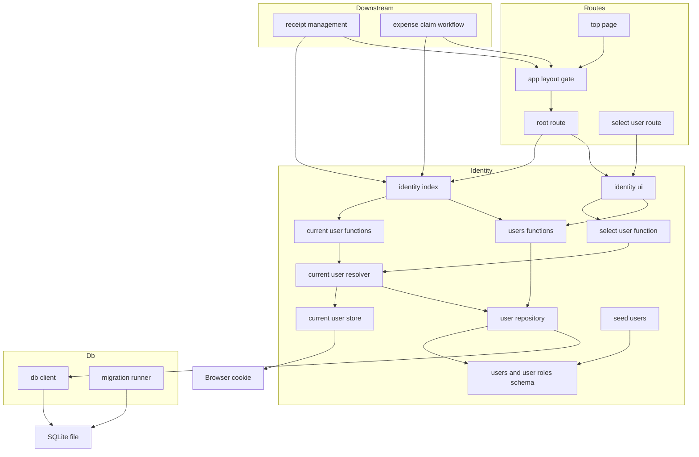
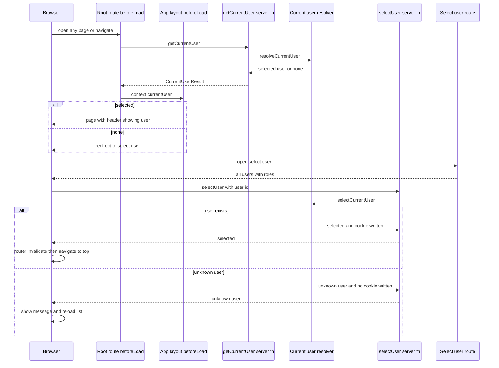
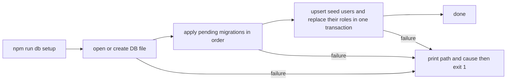
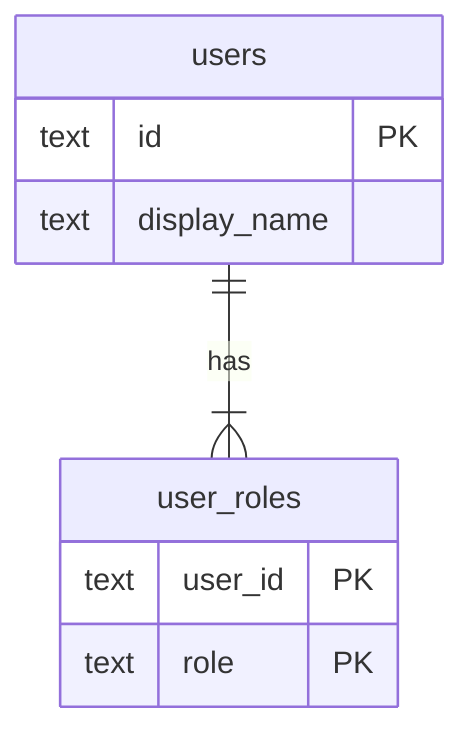

# Design Document: app-foundation

## Overview
**Purpose**: 経費精算アプリの土台を提供する。

- TanStack Start アプリの起動
- SQLite への永続化とマイグレーション
- 作業者／承認者ロールを持つシードユーザー
- ログインなしの操作ユーザー選択・切替
- 後続機能向けの「現在ユーザー」「ロール別ユーザー一覧」の取得口

**Users**: 後続 spec（receipt-management, expense-claim-workflow）の開発者は、取得口から現在ユーザーとロールを得て自機能の権限を判定する。アプリ利用者は、画面上で操作ユーザーを選び、作業者と承認者の立場を行き来する。

**Impact**: 空のリポジトリに次のものを新設する。

- TanStack Start（React、Vite 8）＋ TypeScript のプロジェクト
- Drizzle ORM によるスキーマとマイグレーション
- `identity` モジュール（ユーザー／ロール／現在ユーザー）
- 共通レイアウト

### Goals
- `npm install` → `npm run db:setup` → `npm run dev` の 3 手順で、共通レイアウト付きの画面が表示される
- 現在ユーザーの保持方法（Cookie）を `src/identity/` の内部に閉じ込め、後続 spec が保持方法を一切知らずに済む
- 現在ユーザーの取得口を、ルートのローダー・コンポーネント・Server Function のどこからでも同じ関数で呼べるようにする
- データ構造の変更を、コミット済みの順序付き SQL マイグレーションとして再現できる

### Non-Goals
- パスワード・OAuth 等の本格認証、サーバー側セッション管理
- ユーザー／ロールの作成・編集・削除 UI
- ロールに基づく操作の可否判定（各機能 spec が担う）
- グローバルナビゲーション（機能画面へのリンク群）。後続 spec が必要に応じて追加する
- 本番デプロイ構成（Nitro 等による本番サーバー）
- JavaScript を無効にした状態でのユーザー選択

## Boundary Commitments

### This Spec Owns
- **アプリ基盤**:
  - TanStack Start プロジェクトの構成とルーター（`src/router.tsx`）
  - ツールチェーン：TypeScript、ESLint、Prettier、Tailwind CSS、Vitest、Playwright
  - 実行環境の前提（Node.js バージョン）
- **永続化基盤**:
  - SQLite 接続（`src/db/client.server.ts`）
  - マイグレーションの生成・適用方式（drizzle-kit、`drizzle/` ディレクトリ）
  - データ初期化手順（`npm run db:setup`）
- **ユーザーとロールのデータ**: `users` / `user_roles` テーブル、シードユーザーの定義と投入。ユーザーとロールの真実の情報源
- **現在ユーザー**: 保持（Cookie）、選択・切替、未選択時のユーザー選択画面へのゲート
- **公開契約**: `@/identity` が公開するもの。
  - Server Function：`getCurrentUser` / `requireCurrentUser` / `listUsersByRole`
  - 型：`User` / `Role` / `UserId` / `CurrentUserResult`
  - 定数：`ROLES` / `ROLE_LABELS`
  - `_app` ルートのコンテキスト `user`
- **共通レイアウト**: 次のルートを持つ。
  - ルートルート：アプリ名、現在ユーザー表示、切替操作、エラー表示
  - `_app` パスなしレイアウト（ゲート）
  - トップ画面、ユーザー選択画面

### Out of Boundary
- 本格認証、ユーザー管理 UI
- 領収書・申請のテーブル、画面、ドメインロジック
- 「この操作を許可するか」の判定。例：作業者だけが領収書を登録できる、自己承認の禁止。取得口はロールを返すだけで、可否を返さない
- 承認者候補の絞り込みルール（例：申請者本人を除く）。`listUsersByRole({ data: { role: 'approver' } })` の結果を workflow 側で絞り込む
- 後続 spec のシードデータ

### Allowed Dependencies
- **外部**:
  - フレームワーク：TanStack Start 1.169 / TanStack Router 1.170、React 19、Vite 8
  - データ：Drizzle ORM 0.45 / drizzle-kit 0.31、better-sqlite3 13
  - スタイル：Tailwind CSS 4
  - スクリプト：tsx
  - テスト：Vitest 5、Playwright 1.64
  - Lint とフォーマット：ESLint 10、Prettier 3
- **依存方向（`src/` 内）**: 各層は左側の層だけを import する。

  `identity/types` → `db/client.server` → `identity/schema` → `identity/user-repository.server` → `identity/current-user-store.server` → `identity/current-user.server` → `identity/*.functions` → `identity/index` → `identity/ui` → `routes/*`
- **後続 spec に許可する import**:
  - `@/identity`：取得口と型（すべての用途）
  - `@/identity/schema`：外部キー参照（`users.id`）のためだけ
  - `@/db/client.server`：自機能のテーブルへのクエリのため（サーバー専用ファイルからのみ）
- **テストファイル（`**/*.test.{ts,tsx}`）にだけ追加で許可する import**:
  - `@/db/test-utils.server`：`createTestDatabase()` で in-memory DB を用意するため
  - `@/identity/seed.server`：`SEED_USERS` と `seedUsers(db)` で外部キー先のユーザーを用意するため
  - 許可はファイルの命名で判定し、ディレクトリでは判定しない。テストを置く場所が増えても ESLint の設定を変えずに済む
- **後続 spec に禁止する import**:
  - 上記以外の `@/identity/*` と `@/db/*`（`current-user-store.server`、`user-repository.server`、`select-user.functions` 等）
  - ESLint の `no-restricted-imports` で機械的に検出する
  - `@/identity/ui` はアプリシェル（`src/routes/__root.tsx`、`src/routes/select-user.tsx`）専用
- **相対 import は `./`（同じディレクトリとその配下）だけに限る**:
  - `../` で始まる import は `src/` 全体で禁止する。ディレクトリをまたぐ import は必ず `@/` エイリアスで書く
  - これにより、モジュールの内部へ届く経路がエイリアスの形だけになり、上記の制限を相対パスで迂回できない
- `identity` と `db` は後続 spec のモジュールを import しない

### Revalidation Triggers
- 次の形の変更：
  - `@/identity` の公開関数の入力・出力
  - 型 `User` / `Role` / `UserId` / `CurrentUserResult`
  - `_app` ルートのコンテキスト（`user`）
- `users.id` の型・採番方式の変更、シードユーザー ID の変更。後続 spec の外部キーとテストに影響する
- テスト用 API（`createTestDatabase()`、`SEED_USERS`、`seedUsers(db)`）の入力・出力、およびテストファイルに許可する import の範囲
- ルーターのキャッシュ設定（`defaultPreload` / `defaultGcTime`）の変更。後続 spec の画面が前のユーザーのデータを表示しないことの前提になる
- ユーザー選択画面のパス（`/select-user`）や、`src/routes/_app/` 配下に機能画面を置く規約の変更
- スキーマの配置規約（`src/*/schema.ts`）やマイグレーション適用方式の変更
- Node.js の前提バージョン、Drizzle ORM のメジャー更新（1.0 移行）、TanStack Start のメジャー更新
- Cookie から本格認証への差し替えは、公開契約が変わらない限り再検証不要

## Architecture

### Architecture Pattern & Boundary Map
深いモジュール（機能単位のディレクトリ）＋ TanStack Router のファイルベースルーティング。現在ユーザーに関する知識は `src/identity/` に集約し、外へは小さな公開面だけを出す。サーバー専用のファイルは `*.server.ts` と命名し、TanStack Start のインポート保護でクライアントバンドルへの混入をビルドエラーにする。



**Architecture Integration**:
- **Selected pattern**: 機能モジュール（深いモジュール）。
  - 保持方法・DB 照合・未選択時の扱いを `identity` 内部に引き下げ、公開面は 3 つの Server Function に絞る
  - ポート／アダプタは作らない。実装が 1 つしかなく、公開関数の境界がそのまま差し替え点になるため
- **実行環境の境界**: TanStack Start のルートの `beforeLoad` / `loader` は、初回はサーバーで、クライアント遷移時はブラウザで動く。
  - 取得口を Server Function（`createServerFn`）にすることで、サーバー上では直接実行され、ブラウザ上では RPC になる
  - どちらの場合も呼び出し側のコードは同じ
- **Domain boundaries**: `db` はインフラ（接続とマイグレーション）だけを持ち、テーブル定義を持たない。テーブル定義は各機能ディレクトリの `schema.ts` が持つ
- **Existing patterns preserved**: 既存コードなし。本 spec の構成が後続 spec の規約になる
- **Steering compliance**:
  - `roadmap.md` の制約に従う：フルスタック TypeScript、SQLite、ORM 選定をここで行う、健全で見通しのよい設計を優先
  - フレームワークは設計レビューで Next.js から TanStack Start に変更した（`research.md` 参照）。`roadmap.md` の記述も合わせて更新する
  - `tech.md` / `structure.md` は未作成のため、本 design の決定を後で steering に反映する

### Technology Stack

| Layer | Choice / Version | Role in Feature | Notes |
|-------|------------------|-----------------|-------|
| Runtime | Node.js 24 LTS（`engines: >=22.12`）、npm | 実行環境 | better-sqlite3 13 と TanStack Start が Node.js 22 以上を要求する。`.node-version` に `24` を記載（mise が読み取る） |
| Framework | TanStack Start 1.169（`@tanstack/react-start`）、TanStack Router 1.170、React 19 | ルーティング、SSR、Server Functions | Cookie は `@tanstack/react-start/server` の `getCookie` / `setCookie` で扱う |
| Build | Vite 8、`@vitejs/plugin-react` 6 | 開発サーバー、ビルド、インポート保護 | `resolve.tsconfigPaths: true` でパスエイリアスを解決 |
| Language | TypeScript 6.0（`strict: true`） | 型安全 | typescript-eslint が 6.0 系までの対応のため 7 系にしない。パスエイリアス `@/*` → `src/*` |
| Styling | Tailwind CSS 4（`@tailwindcss/vite`） | 共通レイアウトと画面のスタイル | PostCSS 設定は不要 |
| Data / Storage | SQLite（better-sqlite3 13） | ローカル永続化 | Vite の SSR は `node_modules` の依存を既定で外部化するため、ネイティブモジュールの追加設定は不要 |
| ORM / Migration | Drizzle ORM 0.45、drizzle-kit 0.31 | スキーマ定義、SQL マイグレーション生成・適用 | 1.0 は RC のため安定版に固定。比較は `research.md` |
| Scripts | tsx 4 | `scripts/db-setup.ts` の実行 | パスエイリアスを解決できるため |
| Test | Vitest 5、Playwright 1.64 | 単体・統合テスト、E2E | |
| Lint | ESLint 10（flat config）、typescript-eslint 8、eslint-plugin-react-hooks 7、@tanstack/eslint-plugin-router | 静的検査、import 境界の強制 | `no-restricted-imports` で `@/identity` の内部を保護 |
| Format | Prettier 3、prettier-plugin-tailwindcss、eslint-config-prettier | コード整形 | ESLint の整形系ルールは `eslint-config-prettier` で無効化 |

## File Structure Plan

### Directory Structure
```
.node-version                       # Node.js 24（mise の idiomatic version file として読まれる）
package.json                        # 依存、engines、"type": "module"、scripts（下記）
tsconfig.json                       # strict、jsx: react-jsx、moduleResolution: Bundler、@/* エイリアス
vite.config.ts                      # tanstackStart() → viteReact() → tailwindcss()、resolve.tsconfigPaths、server.port 3000
eslint.config.js                    # typescript-eslint + react-hooks + TanStack Router + import 境界の制限 + eslint-config-prettier
.prettierrc.json                    # Prettier 設定（prettier-plugin-tailwindcss）
.prettierignore                     # src/routeTree.gen.ts、drizzle/、data/ など生成物
drizzle.config.ts                   # dialect: sqlite、schema: ./src/*/schema.ts、out: ./drizzle
vitest.config.ts                    # environment: node、resolve.tsconfigPaths、include: src/**/*.test.{ts,tsx}
playwright.config.ts                # webServer: E2E 用 DB で db:setup → dev
.gitignore                          # data/*.db*、node_modules、dist、.tanstack、test-results 等
drizzle/                            # drizzle-kit generate が出力する SQL マイグレーションと meta（コミット対象）
data/.gitkeep                       # SQLite ファイルの置き場（DB ファイル自体は無視）
scripts/
└── db-setup.ts                     # データ初期化手順：DB ファイル作成 → マイグレーション適用 → シード投入
src/
├── router.tsx                      # getRouter()：createRouter({ routeTree, scrollRestoration: true, defaultPreload: false, defaultGcTime: 0, defaultErrorComponent, defaultNotFoundComponent })
├── routeTree.gen.ts                # ルート定義から自動生成（コミット対象、Lint と Prettier の対象外）
├── styles.css                      # Tailwind の読み込み
├── db/
│   ├── client.server.ts            # SQLite 接続のシングルトン、DB パス解決、DatabaseUnavailableError
│   ├── migrate.server.ts           # applyMigrations(db)：drizzle/ のマイグレーションを適用
│   └── test-utils.server.ts        # createTestDatabase()：in-memory SQLite にマイグレーションを適用（テスト専用）
├── identity/
│   ├── index.ts                    # 公開面：getCurrentUser / requireCurrentUser / listUsersByRole、型、ROLES / ROLE_LABELS の再エクスポート
│   ├── types.ts                    # Role、ROLES、ROLE_LABELS、UserId、User、CurrentUserResult、SelectUserResult
│   ├── validation.ts               # parseRoleInput / parseSelectUserInput（Server Function の入力検証）
│   ├── schema.ts                   # users / user_roles テーブル定義
│   ├── user-repository.server.ts   # findUsers / findUserById（内部）
│   ├── current-user-store.server.ts  # Cookie の読み書き（内部、保持方法の唯一の所在）
│   ├── current-user.server.ts      # resolveCurrentUser / selectCurrentUser（判断のロジック、内部）
│   ├── current-user.functions.ts   # Server Function：getCurrentUser / requireCurrentUser
│   ├── users.functions.ts          # Server Function：listUsersByRole / listAllUsers
│   ├── select-user.functions.ts    # Server Function：selectUser（POST、内部）
│   ├── seed.server.ts              # SEED_USERS と seedUsers(db)
│   └── ui/
│       ├── index.ts                # アプリシェル向け公開面：CurrentUserIndicator、UserSelectList、listAllUsers
│       ├── current-user-indicator.tsx  # 現在ユーザーの表示名・ロールと切替リンク
│       ├── user-select-list.tsx        # 全ユーザー一覧と選択ボタン
│       └── role-labels.ts              # formatRoleLabels：ロールの表示ラベルを「・」でつなぐ（ui 内部）
└── routes/
    ├── -components/
    │   └── route-error.tsx         # RouteError / RouteNotFound：日本語のエラー・未検出表示（ルート生成の対象外）
    ├── __root.tsx                  # shellComponent でドキュメント、component でヘッダー（アプリ名 + CurrentUserIndicator）と <main>、エラー表示。beforeLoad で現在ユーザーを取得
    ├── select-user.tsx             # ユーザー選択画面（ゲートの外）
    ├── _app.tsx                    # パスなしレイアウト：未選択なら /select-user へリダイレクト、コンテキストに user を入れる
    └── _app/
        └── index.tsx               # トップ画面（/）：現在ユーザーの表示名とロール
e2e/
├── user-switching.spec.ts          # 選択・切替・維持・独立性・不正 Cookie のシナリオ
└── layout-accessibility.spec.ts    # キーボード操作と支援技術向けの名前
```

**package.json scripts**:

| Script | Command |
|--------|---------|
| `dev` | `vite dev` |
| `build` | `vite build` |
| `typecheck` | `tsc --noEmit` |
| `lint` | `eslint .` |
| `format` | `prettier --write .` |
| `format:check` | `prettier --check .` |
| `test` | `vitest run` |
| `test:e2e` | `playwright test` |
| `db:generate` | `drizzle-kit generate` |
| `db:setup` | `tsx scripts/db-setup.ts` |

`vite build` はインポート保護の違反をエラーにするため、境界の検証として使う。本番サーバー（`start`）は持たない。

**規約（後続 spec 向け）**:
- 機能画面は `src/routes/_app/` 配下に置く。ルートルートの共通レイアウトと `_app` のゲートが自動で適用される（5.2）
- 画面から現在ユーザーを使うときは、`_app` のコンテキストの `user`（`Route.useRouteContext()`、ローダーの `context.user`）を使う。これは同じナビゲーションで `getCurrentUser` が返した値である
- 自機能の Server Function でデータを返す・変更するときは、ハンドラの先頭で `await requireCurrentUser()` を呼んで認可の材料にする。`beforeLoad` のゲートは表示の保護であり、データの保護ではない
- サーバー側のロジック（問い合わせ、検証、権限の判断）は、`db: AppDatabase` と `user: User` を引数で受け取る普通の関数として `*.server.ts` に置く。`getDb()` と `requireCurrentUser()` を呼ぶのは `*.functions.ts` のハンドラだけにする。identity の `current-user.server.ts` と `current-user.functions.ts` の分け方と同じで、ロジックを Vitest から in-memory DB と任意のユーザーで検証できる
- テストでは `createTestDatabase()` で DB を用意し、`seedUsers(db)` でユーザーを投入してから `SEED_USERS` の ID を外部キーに使う。この 2 つの import は `*.test.{ts,tsx}` からだけ許可される
- コンポーネントのテストは `*.test.tsx` とする。DOM が必要なテストはファイル先頭の `// @vitest-environment` コメントで環境を指定し、必要な依存（jsdom 等）は後続 spec が追加する
- 機能画面のローダーやコンポーネントで起きたエラーは、ルーターの `defaultErrorComponent`（`RouteError`）が共通レイアウトの `<main>` の中に表示する。ヘッダーと切替操作は残る。画面固有の表示が必要なときだけ、そのルートに `errorComponent` を置く。データが見つからないときは `throw notFound()` を使う
- ディレクトリをまたぐ import は `@/` エイリアスで書く。`../` は Lint で禁止される
- 機能ごとのテーブル定義は `src/<feature>/schema.ts` に置く。`drizzle.config.ts` のグロブが拾うため、本 spec のファイルを変更せずに追加できる
- ユーザーを参照する外部キー列は `text(...).references(() => users.id).$type<UserId>()` とする
- サーバー専用のファイル（DB アクセスなど）は `*.server.ts`、Server Function の定義は `*.functions.ts` と命名する

テストファイルは対象と同じディレクトリに `*.test.ts`（コンポーネントは `*.test.tsx`）として置く。

- `src/db/client.test.ts`
- `src/identity/user-repository.test.ts`
- `src/identity/seed.test.ts`
- `src/identity/current-user.test.ts`
- `src/identity/validation.test.ts`

### Modified Files
- `README.md`：「セットアップ」節を追加する。内容は次のとおり。
  - Node.js 24 の用意（mise なら `.node-version` を自動で読む）
  - `npm install`、`npm run db:setup`、`npm run dev`
  - マイグレーションの追加手順（`npm run db:generate`）
- `.gitignore`：新規作成（既存なし）

## System Flows

### 画面アクセスとユーザー選択・切替



**Key Decisions**:
- 現在ユーザーはルートルートの `beforeLoad` で 1 回だけ取得し、ルーターコンテキストで子ルートへ渡す。ヘッダー（全画面、3.4）とゲート（3.1）が同じ結果を使う
- `beforeLoad` は初回表示ではサーバー、クライアント遷移ではブラウザで動く。ブラウザでは `getCurrentUser` が RPC になる。遷移のたびに再評価されるため、別のタブで切り替えた結果も次の遷移でヘッダーとゲートに反映される
- ローダーのデータについては、ルーターのキャッシュのキーに現在ユーザーが含まれない。キャッシュが残っていると、別のタブで切り替えた後の遷移で、ヘッダーは新しいユーザー、本文は前のユーザーのデータ、という状態になりうる。これを防ぐため、ルーターで次の 2 つを設定し、ローダーのデータを遷移をまたいで再利用しない
  - `defaultPreload: false`：ホバー時の先読みをしない
  - `defaultGcTime: 0`：表示中でないルートのデータをすぐ捨てる。再訪時はローダーを実行し直し、その完了を待って表示する
  - 代償として、遷移のたびにローダーの RPC が走る。ローカルで動かす小規模なアプリなので許容する
- ゲートは `_app` パスなしレイアウトに置く。
  - `/select-user` はゲートの外にあり、未選択でも表示できる
  - 切替時もヘッダーのリンクから同じ画面へ移り、同じ Server Function で上書きする（3.5）
- 保持された ID が DB に存在しない場合（3.9）は未選択として扱う。Cookie は残したまま、次の選択で上書きする
- 選択に成功したら、クライアントで `router.invalidate()` を呼んで全ルートの `beforeLoad` とローダーを新しい現在ユーザーで再実行させてから、トップへ遷移する（3.3, 3.5）
- ユーザーごとに内容が変わるため、ルートルートは `Cache-Control: private, no-store` を返す

### データ初期化



シードは固定 ID を主キーにした upsert と、そのユーザーのロールの置き換えを 1 トランザクションで行う。何度実行しても結果は同じになる（1.5）。

## Requirements Traceability

| Requirement | Summary | Components | Interfaces | Flows |
|-------------|---------|------------|------------|-------|
| 1.1 | 手順どおりの起動で共通レイアウト付き画面を表示 | RootRoute、README セットアップ節、package.json scripts | — | データ初期化 |
| 1.2 | 再起動後もデータを保持 | DbClient（ファイルベース SQLite） | `getDb()` | — |
| 1.3 | 順序付きの変更履歴と再現性 | drizzle.config.ts、`drizzle/`、MigrationRunner | `applyMigrations(db)` | データ初期化 |
| 1.4 | 初期化でスキーマ最新化＋シード投入 | DbSetupScript、MigrationRunner、SeedUsers | `npm run db:setup` | データ初期化 |
| 1.5 | 初期化を繰り返しても重複なし・同一識別 | SeedUsers（固定 ID の upsert） | `seedUsers(db)` | データ初期化 |
| 1.6 | 保存先に接続できないとき原因を出力し描画しない | DbClient、DbSetupScript、RootRoute（errorComponent）、RouteError | `DatabaseUnavailableError` | データ初期化 |
| 2.1 | 一意の識別子と表示名 | IdentitySchema、IdentityTypes | `User` | — |
| 2.2 | ロールは作業者・承認者の 2 種のみ | IdentityTypes、IdentitySchema（CHECK 制約） | `Role`、`ROLES` | — |
| 2.3 | 1 つ以上のロール、両方の保持を許容 | IdentitySchema（複合主キー）、IdentityTypes（非空タプル）、UserRepository | `User.roles` | — |
| 2.4 | 作業者 2 名以上・承認者 2 名以上・両方 1 名以上 | SeedUsers | `SEED_USERS` | — |
| 2.5 | ユーザー／ロールの編集画面を提供しない | File Structure Plan（該当ルートなし） | — | — |
| 3.1 | 未選択時はユーザー選択画面、機能内容は非表示 | AppLayout、RootRoute、CurrentUserFunctions | `getCurrentUser()` | 画面アクセス |
| 3.2 | 選択画面に全ユーザーを表示名・ロール付きで一覧 | SelectUserRoute、UserSelectList、UsersFunctions | `listAllUsers()` | 画面アクセス |
| 3.3 | 選んだユーザーを現在ユーザーにしトップへ | SelectUserFunction、CurrentUserResolver、UserSelectList | `selectUser({ data })` | 画面アクセス |
| 3.4 | 全画面で現在ユーザーの表示名・ロールを表示 | RootRoute、CurrentUserIndicator | ルートコンテキスト `currentUser` | 画面アクセス |
| 3.5 | 任意の画面から切替、以降は新ユーザー視点 | CurrentUserIndicator（切替リンク）、SelectUserFunction、UserSelectList（`router.invalidate()`） | `selectUser({ data })` | 画面アクセス |
| 3.6 | 認証情報を求めない | UserSelectList（入力欄なし） | — | — |
| 3.7 | 遷移・再読み込み後も維持 | CurrentUserStore（Cookie、maxAge 30 日） | `readCurrentUserId()` | — |
| 3.8 | ブラウザごとに独立 | CurrentUserStore（ブラウザ単位の Cookie） | — | — |
| 3.9 | 保持ユーザーが存在しなければ未選択扱い | CurrentUserResolver | `resolveCurrentUser(db)` | 画面アクセス |
| 4.1 | 現在ユーザーの単一の取得口 | IdentityPublicApi、CurrentUserFunctions、ESLint 境界 | `getCurrentUser()` | — |
| 4.2 | 未選択を明示的に返す | CurrentUserResolver | `CurrentUserResult` の `none` | — |
| 4.3 | ロール指定のユーザー一覧 | IdentityPublicApi、UsersFunctions、UserRepository | `listUsersByRole({ data: { role } })` | — |
| 4.4 | 両ロール保持者はどちらの一覧にも含む | UserRepository | `findUsers(db, { role })` | — |
| 4.5 | 一覧は毎回同じ順序 | UserRepository（`users.id` 昇順） | `findUsers(db, { role })` | — |
| 4.6 | 保持方法を利用側に露出しない | IdentityPublicApi、CurrentUserStore、ESLint 境界、インポート保護 | — | — |
| 4.7 | 操作可否の判定を返さない | IdentityPublicApi（ロールのみ返す） | `User` | — |
| 5.1 | 全画面にアプリ名・現在ユーザー表示・切替操作 | RootRoute、CurrentUserIndicator、Router（defaultErrorComponent） | — | — |
| 5.2 | 後続機能の画面にも同じ共通レイアウト | RootRoute、AppLayout、`src/routes/_app/` 配置規約 | — | — |
| 5.3 | トップ画面に表示名とロール | TopPage | `_app` コンテキスト `user` | — |
| 5.4 | キーボード操作可能、支援技術で読み取り可能 | RootRoute、CurrentUserIndicator、UserSelectList | — | — |

## Components and Interfaces

| Component | Domain/Layer | Intent | Req Coverage | Key Dependencies (P0/P1) | Contracts |
|-----------|--------------|--------|--------------|--------------------------|-----------|
| DbClient | db | SQLite 接続の提供と接続失敗の明示 | 1.2, 1.6 | better-sqlite3 (P0) | Service |
| MigrationRunner | db | コミット済みマイグレーションの適用 | 1.3, 1.4 | drizzle-orm migrator (P0) | Service |
| DbSetupScript | scripts | データ初期化手順 | 1.4, 1.5, 1.6 | MigrationRunner (P0), SeedUsers (P0) | Batch |
| IdentityTypes | identity | ユーザー・ロール・結果型の定義 | 2.1, 2.2, 2.3, 4.2 | — | — |
| InputValidation | identity（内部） | Server Function の入力検証 | 3.3, 4.3 | IdentityTypes (P0) | Service |
| IdentitySchema | identity | users / user_roles テーブル | 2.1, 2.2, 2.3 | Drizzle (P0) | State |
| UserRepository | identity（内部） | ユーザーとロールの問い合わせ | 3.2, 4.3, 4.4, 4.5 | DbClient (P0), IdentitySchema (P0) | Service |
| CurrentUserStore | identity（内部） | Cookie による現在ユーザー ID の保持 | 3.7, 3.8, 4.6 | `@tanstack/react-start/server` (P0) | State |
| CurrentUserResolver | identity（内部） | 現在ユーザーの解決と選択の判断 | 3.3, 3.9, 4.2 | CurrentUserStore (P0), UserRepository (P0) | Service |
| CurrentUserFunctions | identity | 現在ユーザーの取得口（Server Function） | 3.1, 4.1, 4.2 | CurrentUserResolver (P0) | API |
| UsersFunctions | identity | ユーザー一覧の取得口（Server Function） | 3.2, 4.3 | UserRepository (P0), InputValidation (P0) | API |
| SelectUserFunction | identity（内部） | 現在ユーザーの設定・切替（Server Function） | 3.3, 3.5 | CurrentUserResolver (P0), InputValidation (P0) | API |
| IdentityPublicApi | identity | 後続 spec への単一の取得口 | 4.1, 4.3, 4.6, 4.7 | CurrentUserFunctions (P0), UsersFunctions (P0) | Service |
| SeedUsers | identity | シードユーザーの定義と冪等な投入 | 1.4, 1.5, 2.4 | IdentitySchema (P0) | Batch |
| CurrentUserIndicator | identity/ui | 現在ユーザー表示と切替リンク | 3.4, 3.5, 5.1, 5.4 | IdentityTypes (P0) | — |
| UserSelectList | identity/ui | 全ユーザーの選択 UI | 3.2, 3.3, 3.5, 3.6, 5.4 | SelectUserFunction (P0), TanStack Router (P0) | — |
| RootRoute | routes | 全画面共通の枠組みと現在ユーザーの取得 | 1.1, 1.6, 3.4, 5.1, 5.2, 5.4 | IdentityPublicApi (P0), CurrentUserIndicator (P0) | State |
| AppLayout | routes | 機能画面のゲート | 3.1, 5.2 | RootRoute (P0) | State |
| TopPage | routes | トップ画面 | 5.3 | AppLayout (P0) | — |
| SelectUserRoute | routes | ユーザー選択画面 | 3.2 | UserSelectList (P0), UsersFunctions (P0) | — |

### db

#### DbClient

| Field | Detail |
|-------|--------|
| Intent | SQLite ファイルへの接続を 1 つだけ作って共有し、接続できない理由を明示する |
| Requirements | 1.2, 1.6 |

**Responsibilities & Constraints**
- DB パスは環境変数 `DATABASE_PATH`、未設定なら `data/app.db`（プロジェクトルート相対）
- アプリ実行時は DB ファイルが存在することを要求する（`fileMustExist`）。
  - 存在しなければ `npm run db:setup` を促す `DatabaseUnavailableError` を投げる
  - DB ファイルの作成を許可するのは初期化スクリプトだけ
- 接続時に `PRAGMA foreign_keys = ON` と `PRAGMA journal_mode = WAL` を設定する
- 接続時にマイグレーションの適用状態を確認し、最新でなければ `DatabaseUnavailableError` を投げる。
  - マイグレーション管理テーブル `__drizzle_migrations` がなければ `migrations-not-applied`
  - `drizzle/meta/_journal.json` の最後のエントリの `when` より、`__drizzle_migrations` の `created_at` の最大値が小さければ `migrations-pending`。後続 spec のマイグレーションを取り込んだ後に `npm run db:setup` を再実行し忘れた状態を、`no such table` のような SQLite のエラーではなく、対処のわかるエラーとして示すため
  - drizzle の migrator も同じ比較で未適用を判定するため、`applyMigrations` が適用する対象と一致する
  - 確認するのは `create: false` で開くとき（`getDb()` を含む）だけ。`create: true` は初期化スクリプトとテスト用で、開いた後にマイグレーションを適用するため確認しない
- 開発サーバーのモジュール再読み込みで接続が増えないよう、接続を `globalThis` にキャッシュする
- テーブル定義を import しない（`db` は機能モジュールに依存しない）
- ファイル名を `*.server.ts` にし、クライアントからの import をビルドエラーにする

**Contracts**: Service [x]

##### Service Interface
```typescript
import type Database from 'better-sqlite3';
import type { BetterSQLite3Database } from 'drizzle-orm/better-sqlite3';

/** drizzle() が返す型。テストや初期化スクリプトが接続を閉じられるよう `$client` を含める。 */
export type AppDatabase = BetterSQLite3Database & { $client: Database.Database };

export type DatabaseUnavailableReason =
  | 'file-not-found'
  | 'migrations-not-applied'
  | 'migrations-pending'
  | 'open-failed';

export class DatabaseUnavailableError extends Error {
  readonly reason: DatabaseUnavailableReason;
  readonly databasePath: string;
  constructor(params: {
    reason: DatabaseUnavailableReason;
    databasePath: string;
    cause: unknown;
  });
}

/** アプリ実行時の共有接続。初回呼び出しで接続し、以後は同じ接続を返す。 */
export function getDb(): AppDatabase;

/**
 * 指定パス（':memory:' 可）に接続する。getDb() もこれを create=false で使う。
 * create=true：ファイルを作成し、マイグレーションの適用状態を確認しない（初期化スクリプトとテスト用）。
 * create=false：ファイルの存在とマイグレーションの適用状態を確認する。
 */
export function openDatabase(params: { path: string; create: boolean }): AppDatabase;

export function resolveDatabasePath(): string;
```
- Preconditions: `getDb()` の前に `npm run db:setup` が実行済みであること
- Postconditions: 返る接続は外部キー制約が有効
- Invariants: プロセス内で `getDb()` の接続は 1 つ

**Implementation Notes**
- `DatabaseUnavailableError` のメッセージには DB パス、理由、対処（`npm run db:setup`）を含める。投げる前に `console.error` でサーバーログへ出力する
- `migrations-pending` の判定は `drizzle/meta/_journal.json` を実行時に読む。ローカル開発（プロジェクトルートで `vite dev`）だけを前提とするため、本番ビルドへの同梱は考えない
- `_journal.json` と `__drizzle_migrations` の対応は drizzle-orm 0.45 の migrator の実装に依存する。Drizzle ORM のメジャー更新（1.0 移行）時に確認する（再検証トリガーに含まれる）

##### テスト用ユーティリティ（`src/db/test-utils.server.ts`）
```typescript
/** in-memory SQLite を開き、drizzle/ の全マイグレーションを適用して返す。テストごとに独立した DB になる。 */
export function createTestDatabase(): AppDatabase;
```
- 使い終わったら呼び出し側が `db.$client.close()` で閉じる
- identity と後続 spec のテストで共用する。`*.test.{ts,tsx}` からだけ import を許可する
- 全機能のマイグレーションを適用するため、後続 spec のテーブルもそのまま使える

#### MigrationRunner

| Field | Detail |
|-------|--------|
| Intent | `drizzle/` のマイグレーションを番号順に適用する |
| Requirements | 1.3, 1.4 |

**Contracts**: Service [x]

```typescript
/** drizzle/ の未適用マイグレーションを順に適用する。適用済みはスキップする。 */
export function applyMigrations(db: AppDatabase): void;
```
- Postconditions: スキーマが最新のマイグレーションと一致する
- Implementation Notes:
  - `drizzle-orm/better-sqlite3/migrator` の `migrate(db, { migrationsFolder })` を使う
  - マイグレーションは `npm run db:generate`（`drizzle-kit generate`）で生成する。手で編集した場合も含めてコミットする
  - `drizzle-kit push` は履歴が残らないため使わない

#### DbSetupScript

| Field | Detail |
|-------|--------|
| Intent | 「データ初期化手順」を 1 コマンドにまとめる |
| Requirements | 1.4, 1.5, 1.6 |

**Contracts**: Batch [x]

##### Batch / Job Contract
- **Trigger**: `npm run db:setup`（`tsx scripts/db-setup.ts`）
- **Input / validation**: `DATABASE_PATH`（任意）。親ディレクトリがなければ作成する
- **Output / destination**: DB ファイル。`openDatabase({ create: true })` → `applyMigrations` → `seedUsers` の順に行う
- **Idempotency & recovery**:
  - マイグレーションは適用済みをスキップし、シードは upsert なので何度でも実行できる
  - 失敗時は DB パスと原因を標準エラーに出し、終了コード 1 で終える

### identity

#### IdentityTypes

```typescript
export const ROLES = ['worker', 'approver'] as const;
export type Role = (typeof ROLES)[number];

export const ROLE_LABELS: Readonly<Record<Role, string>> = {
  worker: '作業者',
  approver: '承認者',
};

export type UserId = string & { readonly __brand: 'UserId' };

export interface User {
  readonly id: UserId;
  readonly displayName: string;
  /** 1 つ以上。順序は ROLES の順（worker → approver）。 */
  readonly roles: readonly [Role, ...Role[]];
}

export type CurrentUserResult =
  | { readonly status: 'selected'; readonly user: User }
  | { readonly status: 'none' };

/** selectUser の結果（identity 内部とアプリシェルで使う）。 */
export type SelectUserResult =
  | { readonly status: 'selected'; readonly user: User }
  | { readonly status: 'unknown-user' };
```
- `User` はロールを返すのみで、`canApprove` のような可否の判定は持たない（4.7）
- すべての型はプレーンなオブジェクトと文字列で構成され、Server Function の戻り値としてシリアライズできる。`UserId` は `string` に代入できるため、シリアライズ可能性の型検査を通る

#### InputValidation（内部）

| Field | Detail |
|-------|--------|
| Intent | ブラウザから届く Server Function の入力を、型付きの値に変換する |
| Requirements | 3.3, 4.3 |

**Contracts**: Service [x]
```typescript
/** { role } が ROLES のいずれかであれば返し、そうでなければ Error を投げる。 */
export function parseRoleInput(input: unknown): { readonly role: Role };

/** { userId } が空でない文字列であれば返し、そうでなければ Error を投げる。存在確認はしない。 */
export function parseSelectUserInput(input: unknown): { readonly userId: string };
```
- `createServerFn(...).validator(parseRoleInput)` のように渡す
- zod 等のライブラリは使わない（検証対象が 2 つの単純な形のため）

#### IdentitySchema

| Field | Detail |
|-------|--------|
| Intent | ユーザーとロールの永続化構造 |
| Requirements | 2.1, 2.2, 2.3 |

**Contracts**: State [x]
- **State model**: 「Data Models」節を参照
- **Persistence & consistency**: ロールの値は CHECK 制約で 2 値に限定し、`(user_id, role)` の複合主キーで重複を防ぐ
- 後続 spec が import してよいのは `users`（外部キー参照のため）のみ
- drizzle-kit がこのファイルを直接読み込むため、`*.server.ts` にはしない。テーブル定義のみで、接続や秘密情報を持たない

#### UserRepository（内部）

| Field | Detail |
|-------|--------|
| Intent | ユーザーとロールを `User` 型として読み出す唯一の場所 |
| Requirements | 3.2, 4.3, 4.4, 4.5 |

**Responsibilities & Constraints**
- 読み取り専用（書き込みは SeedUsers のみ）
- 返却順は `users.id` 昇順で固定（4.5）。各ユーザーの `roles` は `ROLES` の順
- ロール指定時は、そのロールを持つユーザーを、そのユーザーの全ロールとともに返す（4.4）
- ロールを 1 つも持たないユーザーは不変条件違反としてエラーにする。シード以外に書き込み経路がないため、発生時はデータ破損である

**Contracts**: Service [x]
```typescript
export function findUsers(db: AppDatabase, filter?: { readonly role?: Role }): readonly User[];
export function findUserById(db: AppDatabase, id: string): User | undefined;
```
- `findUserById` は Cookie やフォーム由来の未検証の文字列を受け取るため、引数は `string`。見つかった場合だけ `UserId` を持つ `User` を返す

#### CurrentUserStore（内部）

| Field | Detail |
|-------|--------|
| Intent | 現在ユーザー ID の保持方法（Cookie）を知る唯一の場所 |
| Requirements | 3.7, 3.8, 4.6 |

**Contracts**: State [x]
```typescript
/** リクエストのコンテキスト内（Server Function のハンドラ、SSR 中の処理）で呼ぶ。未保持なら undefined。 */
export function readCurrentUserId(): string | undefined;
/** リクエストのコンテキスト内で呼ぶ。レスポンスに Set-Cookie を付ける。 */
export function writeCurrentUserId(id: UserId): void;
```
- 実装は `@tanstack/react-start/server` の `getCookie` / `setCookie`
- **State model**: Cookie `current_user_id` にユーザー ID のみを保存する。属性は次のとおり。
  - `httpOnly: true`、`sameSite: 'lax'`、`path: '/'`
  - `maxAge: 60 * 60 * 24 * 30`（30 日）
  - `secure: process.env.NODE_ENV === 'production'`
- **Persistence & consistency**: Cookie はブラウザ（プロファイル）単位で独立する（3.8）。表示名やロールは保存せず、毎回 DB と照合する
- **Concurrency strategy**: 同一ブラウザの複数タブは同じ Cookie を共有し、最後の選択が有効になる。他のタブには、次の遷移で `beforeLoad` が再実行されたときに反映される
- 本格認証へ差し替えるときは、このファイルと `select-user.functions.ts` を置き換える。公開面は変わらない

#### CurrentUserResolver（内部、`current-user.server.ts`）

| Field | Detail |
|-------|--------|
| Intent | 保持された ID を DB と照合して現在ユーザーを決め、選択時の検証を一箇所で行う |
| Requirements | 3.3, 3.9, 4.2 |

**Contracts**: Service [x]
```typescript
/** 保持 ID を読み、DB と照合する。未保持または DB に存在しない ID なら { status: 'none' }。 */
export function resolveCurrentUser(db: AppDatabase): CurrentUserResult;

/** userId が DB に存在すれば保持して { status: 'selected' }。存在しなければ保持せずに { status: 'unknown-user' }。 */
export function selectCurrentUser(db: AppDatabase, userId: string): SelectUserResult;
```
- Server Function から切り離した通常の関数にして、`current-user-store.server` をモックすれば Vitest で検証できるようにする
- Postconditions:
  - `resolveCurrentUser` は仮のユーザーを返さない（4.2）
  - DB 接続に失敗した場合は `DatabaseUnavailableError` を投げ、未選択とは区別する（1.6）
  - `selectCurrentUser` は検証前の値を Cookie に書かない

#### CurrentUserFunctions（`current-user.functions.ts`）

| Field | Detail |
|-------|--------|
| Intent | 現在ユーザーの取得口。ルートの `beforeLoad` / ローダー、コンポーネント、他の Server Function のどこからでも呼べる |
| Requirements | 3.1, 4.1, 4.2 |

**Contracts**: API [x]

##### API Contract
| Method | Endpoint | Request | Response | Errors |
|--------|----------|---------|----------|--------|
| Server Function（GET） | `getCurrentUser` | なし | `CurrentUserResult` | DB 接続失敗 → `DatabaseUnavailableError` |
| Server Function（GET） | `requireCurrentUser` | なし | `User` | 未選択 → `redirect({ to: '/select-user' })` を送出、DB 接続失敗 → `DatabaseUnavailableError` |

```typescript
import { createServerFn } from '@tanstack/react-start';

/** 現在ユーザーを返す。未保持または DB に存在しない ID なら { status: 'none' }。 */
export const getCurrentUser = createServerFn({ method: 'GET' }).handler(
  (): CurrentUserResult => resolveCurrentUser(getDb()),
);

/** 現在ユーザーを返す。未選択ならユーザー選択画面（/select-user）へのリダイレクトを投げ、戻らない。 */
export const requireCurrentUser = createServerFn({ method: 'GET' }).handler((): User => {
  /* resolveCurrentUser → none なら throw redirect({ to: '/select-user' }) */
});
```
- 呼び出し方は `await getCurrentUser()`。サーバー上（他の Server Function のハンドラ、SSR 中の `beforeLoad`）では直接実行され、ブラウザ上では RPC になる
- `requireCurrentUser` は主に後続 spec の Server Function のハンドラの先頭で使う。送出されたリダイレクトは呼び出し元のルーターが処理する

#### UsersFunctions（`users.functions.ts`）

| Field | Detail |
|-------|--------|
| Intent | ユーザー一覧の取得口 |
| Requirements | 3.2, 4.3 |

**Contracts**: API [x]

##### API Contract
| Method | Endpoint | Request | Response | Errors |
|--------|----------|---------|----------|--------|
| Server Function（GET） | `listUsersByRole` | `{ role: Role }` | `readonly User[]`（`users.id` 昇順） | 不正なロール → 検証エラー、DB 接続失敗 → `DatabaseUnavailableError` |
| Server Function（GET） | `listAllUsers` | なし | `readonly User[]`（`users.id` 昇順） | DB 接続失敗 → `DatabaseUnavailableError` |

```typescript
/** 指定ロールを持つユーザーの一覧。両ロール保持者はどちらの一覧にも含まれる。 */
export const listUsersByRole = createServerFn({ method: 'GET' })
  .validator(parseRoleInput)
  .handler(({ data }): readonly User[] => findUsers(getDb(), { role: data.role }));

/** 全ユーザーの一覧。ユーザー選択画面専用（@/identity/ui からのみ公開）。 */
export const listAllUsers = createServerFn({ method: 'GET' }).handler(
  (): readonly User[] => findUsers(getDb()),
);
```
- 一覧の取得は現在ユーザーを要求しない。未選択の状態でユーザー選択画面が使うため

#### SelectUserFunction（内部、`select-user.functions.ts`）

| Field | Detail |
|-------|--------|
| Intent | 選ばれたユーザーを現在ユーザーにする（選択と切替で共通） |
| Requirements | 3.3, 3.5 |

**Contracts**: API [x]

##### API Contract
| Method | Endpoint | Request | Response | Errors |
|--------|----------|---------|----------|--------|
| Server Function（POST） | `selectUser` | `{ userId: string }` | `SelectUserResult` | 空の `userId` → 検証エラー、DB 接続失敗 → `DatabaseUnavailableError` |

```typescript
export const selectUser = createServerFn({ method: 'POST' })
  .validator(parseSelectUserInput)
  .handler(({ data }): SelectUserResult => selectCurrentUser(getDb(), data.userId));
```
- 遷移はハンドラで行わず、呼び出し側（UserSelectList）が結果を見て行う。理由は `research.md` の「ユーザー選択」の決定を参照
- TanStack Start の既定の CSRF ミドルウェア（同一オリジンの検査）に依存する。`src/start.ts` は作らない

#### IdentityPublicApi（`src/identity/index.ts`）

| Field | Detail |
|-------|--------|
| Intent | 後続 spec が使ってよい唯一の入口 |
| Requirements | 4.1, 4.3, 4.6, 4.7 |

**Contracts**: Service [x]
```typescript
export { getCurrentUser, requireCurrentUser } from './current-user.functions';
export { listUsersByRole } from './users.functions';
export { ROLES, ROLE_LABELS } from './types';
export type { Role, UserId, User, CurrentUserResult } from './types';
```
- 公開しないもの（4.6）：
  - 保持方法（Cookie 名、Cookie API）
  - DB 接続、リポジトリ
  - `selectUser`
- 全ユーザーの一覧は公開しない。要件はロール別一覧のみで、選択画面は `@/identity/ui` 経由で使う
- このファイルは Server Function の定義（`*.functions.ts`）と型だけを再エクスポートする。クライアントから import しても、サーバー専用コードはバンドルに入らない

**Implementation Notes**
- `eslint.config.js` の `no-restricted-imports` で次を制限する
  - `src/` の全ファイルで `../` で始まる import を禁止する（`group: ['../*']`）。ディレクトリをまたぐ import はエイリアスに統一され、以下の制限を相対パスで迂回できなくなる
  - `src/identity/` と `src/db/` の外のファイルに対して：
    - `@/identity/*` を禁止する。ただし `@/identity/schema` は許可する
    - `@/identity/ui` は `src/routes/__root.tsx` と `src/routes/select-user.tsx` だけに許可する
    - `@/db/*` を禁止する。ただし `@/db/client.server` は許可する
  - `src/identity/` と `src/db/` の中では、上の階層のファイルも `@/identity/...`（例：`ui/` から `@/identity/select-user.functions`）のようにエイリアスで参照する。モジュール内部向けの制限はかからない
  - `**/*.test.{ts,tsx}` 向けの設定ブロックを別に置き、上記に加えて `@/db/test-utils.server` と `@/identity/seed.server` を許可する。`files` のグロブで判定するため、テストの置き場所には依存しない
- flat config では、同じルールを後のブロックで設定するとオプションが丸ごと置き換わる（マージされない）。
  - 制限パターンの一覧を `eslint.config.js` 内の定数にして、各ブロックで必要な分を展開する
  - テスト用のブロックでも `../` の禁止と `@/identity/*` の制限が残ることを Setup Verification で確かめる
- サーバー専用ファイル（`*.server.ts`）はインポート保護の対象になり、クライアントバンドルから到達すると `vite build` が失敗する

#### SeedUsers（`seed.server.ts`）

| Field | Detail |
|-------|--------|
| Intent | シードユーザーの定義と冪等な投入 |
| Requirements | 1.4, 1.5, 2.4 |

**Contracts**: Batch [x]
```typescript
export interface SeedUser {
  readonly id: UserId;
  readonly displayName: string;
  readonly roles: readonly [Role, ...Role[]];
}
export const SEED_USERS: readonly SeedUser[];
export function seedUsers(db: AppDatabase): void;
```

| id | displayName | roles |
|----|-------------|-------|
| `user-01` | 佐藤 花子 | worker |
| `user-02` | 鈴木 一郎 | worker |
| `user-03` | 田中 美咲 | approver |
| `user-04` | 高橋 健 | approver |
| `user-05` | 伊藤 直樹 | worker, approver |

- **Idempotency**: 1 トランザクションで次を行う。
  - 各ユーザーを `id` で upsert する（表示名を更新）
  - そのユーザーの `user_roles` を削除し、定義どおりに入れ直す
- シードにないユーザーは削除しない。作成経路がないため存在しない想定であり、後続 spec の外部キーを壊さないため
- シード ID は後続 spec のテストからも参照されるため、変更は再検証トリガー
- 後続 spec のテストは `*.test.{ts,tsx}` から `SEED_USERS` と `seedUsers(db)` を import してよい（Allowed Dependencies 参照）。アプリのコードからは import しない

### identity/ui（アプリシェル専用）

`src/identity/ui/index.ts` から `CurrentUserIndicator`、`UserSelectList`、`listAllUsers` を公開する。どちらのコンポーネントもデータを props で受け取り、新しい境界は持たないため概要のみ記す。

- **CurrentUserIndicator**（3.4, 3.5, 5.1, 5.4）
  - props は `{ currentUser: CurrentUserResult }`
  - 選択済みなら、表示名とロールラベルをテキストで表示する（例：「現在のユーザー：伊藤 直樹（作業者・承認者）」）
  - 表示は `aria-label="現在のユーザー"` の `<section>` で囲む
  - 続けて `/select-user` への `<Link>`「ユーザーを切り替える」を置く
  - 未選択なら「ユーザー未選択」と表示し、同じリンクを置く
- **UserSelectList**（3.2, 3.3, 3.5, 3.6, 5.4）
  - props は `{ users: readonly User[]; currentUserId: UserId | undefined }`
  - `<ul>` で一覧表示する。各項目は表示名とロールラベルを表示し、`<button type="button">` で選択する
  - ボタンのアクセシブルネームは「佐藤 花子 を選択」。現在ユーザーの項目には「選択中」と表示する
  - パスワード等の入力欄は置かない
  - 押下時の処理：`useServerFn(selectUser)` で `{ data: { userId } }` を送る
    - `selected` なら `await router.invalidate()` の後 `router.navigate({ to: '/' })`
    - `unknown-user` なら `role="alert"` の要素に「選択したユーザーが見つかりません」と表示し、`router.invalidate()` で一覧を読み直す
  - `useHydrated()` が false の間（ハイドレーション前）はボタンを `disabled` にする
  - 送信中は全ボタンを `disabled` にし、二重送信を防ぐ

### routes

いずれも新しい境界を持たないルートファイル。ルート間で受け渡すのはルーターコンテキストのみ。

- **RootRoute**（`__root.tsx`。1.1, 1.6, 3.4, 5.1, 5.2, 5.4）
  - `beforeLoad`: `return { currentUser: await getCurrentUser() }`。子ルートのコンテキストに `currentUser: CurrentUserResult` が入る
  - `headers`: `{ 'Cache-Control': 'private, no-store' }`
  - `head`: 文字コード、viewport、タイトル「経費精算」、`styles.css` へのリンク
  - `shellComponent`（ドキュメント）：`<html lang="ja">`。`<head>` に `<HeadContent />`、`<body>` の中に `children`、末尾に `<Scripts />`
    - ルートルートの `beforeLoad` が失敗しても描画されるため、エラー表示にもスタイルとスクリプトが届く
    - 現在ユーザーに依存するものを置かない
  - `component`（レイアウト）：`<header>` にアプリ名（`<Link to="/">` 経費精算）と `CurrentUserIndicator`、続けて `<main>` の中に `<Outlet />`。すべてのルートに適用される。フォーカスリングを消さない
  - `errorComponent`: `RouteError`。ルートルート自身（`beforeLoad` など）のエラーのときに、シェルの中で `component` の代わりに描画される。ヘッダーを含め、部分的なデータで画面を描画しない
    - TanStack Router のエラー境界はルートごとにあり、子ルートのエラーはここに届かない。子ルートのエラーはルーターの `defaultErrorComponent` が受け持つ（Router 参照）
    - 現在ユーザーの取得は全ナビゲーションでここの `beforeLoad` を通るため、DB 接続の失敗（1.6）はここで表示される
  - `shellComponent` の API 名と振る舞いは、実装時に TanStack Start 1.169 で確認する
  - `notFoundComponent`: `RouteNotFound`
- **AppLayout**（`_app.tsx`。3.1, 5.2）
  - `beforeLoad`: `context.currentUser.status === 'none'` なら `throw redirect({ to: '/select-user' })`。そうでなければ `return { user: context.currentUser.user }`
  - 子ルートのコンテキストに `user: User` が入る
  - コンポーネントは `<Outlet />` のみ
- **TopPage**（`_app/index.tsx`、パス `/`。5.3）
  - `Route.useRouteContext()` の `user` から、表示名とロールラベルを見出しと本文で表示する
- **SelectUserRoute**（`select-user.tsx`。3.2）
  - `loader`: `listAllUsers()`
  - 見出し「ユーザーを選択」と `UserSelectList` を表示する。`currentUserId` はコンテキストの `currentUser` から渡す
- **Router**（`src/router.tsx`）
  - `getRouter()` で `createRouter({ routeTree, scrollRestoration: true, defaultPreload: false, defaultGcTime: 0, defaultErrorComponent: RouteError, defaultNotFoundComponent: RouteNotFound })` を返す
  - キャッシュ設定の理由は System Flows の Key Decisions を参照（前のユーザーのデータを表示しないため）
  - `defaultErrorComponent` / `defaultNotFoundComponent` は、`errorComponent` / `notFoundComponent` を持たない子ルートで使われる。設定しないと組み込みの英語表示（「Something went wrong!」）になる。子ルートのエラーは共通レイアウトの `<main>` の中に表示され、ヘッダーと切替操作は残る（5.1）
- **RouteError / RouteNotFound**（`routes/-components/route-error.tsx`）
  - `-` で始まるディレクトリは TanStack Router のルート生成の対象外
  - `RouteError`：「データを読み込めませんでした」と表示する。開発時（`import.meta.env.DEV`）は `error.message` も表示する。`DatabaseUnavailableError` のメッセージには DB パスと対処が含まれる
  - `RouteNotFound`：「ページが見つかりません」とトップへのリンク

## Data Models

### Domain Model
- **User**（集約ルート）: `id`、`displayName`、`roles`。ロールは User に従属する値の集合で、単独では存在しない
- **Role**（値）: `worker` | `approver` の 2 値
- **不変条件**: 各 User は 1 つ以上の Role を持つ。同じ Role を重複して持たない
- **CurrentUser**: 永続データではなく、ブラウザごとの「どの User として操作しているか」の参照。DB 上の User を指さなくなったら未選択とみなす

### Logical Data Model



- `users` 1 : N `user_roles`（N ≥ 1 はアプリ側の不変条件）
- 後続 spec のテーブルは `users.id` を外部キーとして参照する

### Physical Data Model

| Table | Column | Type | Constraints |
|-------|--------|------|-------------|
| `users` | `id` | TEXT | PRIMARY KEY |
| `users` | `display_name` | TEXT | NOT NULL |
| `user_roles` | `user_id` | TEXT | NOT NULL、REFERENCES `users(id)` ON DELETE CASCADE |
| `user_roles` | `role` | TEXT | NOT NULL、CHECK (`role` IN ('worker', 'approver')) |
| `user_roles` | — | — | PRIMARY KEY (`user_id`, `role`) |

- インデックス: `user_roles(role)`（ロール別一覧用）
- Drizzle では `users.id` を `text('id').primaryKey().$type<UserId>()` と定義する

## Error Handling

### Error Strategy
- **DB 接続・スキーマ未適用（1.6）**:
  - `DbClient` が `DatabaseUnavailableError` を投げる
  - リポジトリと Server Function は握りつぶさずに伝播させる。Server Function から投げられたエラーは呼び出し元へシリアライズされる
  - ルートルートの `beforeLoad` で失敗した場合は、`shellComponent` の中に `errorComponent` が表示され、画面本体とヘッダーは描画されない
  - 未選択（`status: 'none'`）とは決して混同しない
- **初期化スクリプトの失敗**: DB パスと原因を標準エラーに出し、終了コード 1
- **不正・不明なユーザー ID**:
  - Cookie 由来なら未選択として扱う（3.9）
  - 選択操作由来なら Cookie を書かずに `unknown-user` を返し、選択画面にメッセージを出す
- **Server Function の入力の形が不正**: 検証関数が Error を投げる。正規の UI からは発生しない
- **不変条件違反（ロールのないユーザー）**: データ破損としてエラーにする

### Error Categories and Responses
| 状況 | 分類 | 応答 |
|------|------|------|
| DB ファイルがない | System | `DatabaseUnavailableError('file-not-found')`。メッセージで `npm run db:setup` を案内 |
| マイグレーション未適用 | System | `DatabaseUnavailableError('migrations-not-applied')` |
| 未適用の新しいマイグレーションがある | System | `DatabaseUnavailableError('migrations-pending')`。メッセージで `npm run db:setup` の再実行を案内 |
| 接続・クエリ失敗 | System | `DatabaseUnavailableError('open-failed')`、または SQLite のエラーをそのまま伝播 |
| Cookie のユーザーが存在しない | User state | 未選択として `/select-user` へ |
| 選択操作で未知の ID | User input | Cookie を書かず、選択画面に `role="alert"` のメッセージ |
| Server Function の入力の形が不正 | User input | 検証エラー（呼び出し元に Error） |

### Monitoring
ローカル開発のみのため、サーバーログ（`console.error`）への出力に限る。

## Testing Strategy

### Unit / Integration Tests（Vitest、in-memory SQLite にマイグレーションを適用）
- `src/identity/user-repository.test.ts`
  - `findUsers(db, { role: 'approver' })` が承認者ロールを持つユーザーだけを返す。両ロール保持者（`user-05`）が作業者・承認者どちらの一覧にも含まれ、その `roles` が `['worker', 'approver']` であること（4.3, 4.4）
  - 挿入順を入れ替えても返却順が `id` 昇順で変わらないこと（4.5）
  - `findUsers(db)` が全ユーザーを表示名・ロール付きで返すこと（3.2）
  - スキーマが `worker` / `approver` 以外のロールの挿入を拒否すること（2.2）
  - ロールを 1 つも持たないユーザーが存在するとエラーになること（2.3 の不変条件）
- `src/identity/seed.test.ts`
  - `SEED_USERS` が作業者 2 名以上、承認者 2 名以上、両方 1 名以上を含み、全員が 1 つ以上のロールを持つこと（2.3, 2.4）
  - `seedUsers` を 2 回実行してもユーザー数・ロール数が増えず、ID が同じであること（1.5）
- `src/identity/current-user.test.ts`（`current-user-store.server` を `vi.mock` で置き換える）
  - 保持 ID なし → `resolveCurrentUser` が `{ status: 'none' }`（4.2）
  - DB に存在しない保持 ID → `{ status: 'none' }`（3.9）
  - 有効な保持 ID → `{ status: 'selected', user }`（4.1）
  - `selectCurrentUser` が既知の ID では Cookie を書いて `selected` を返すこと。未知の ID では Cookie を書かずに `unknown-user` を返すこと（3.3）
- `src/identity/validation.test.ts`
  - `parseRoleInput` が `worker` / `approver` 以外を拒否すること（2.2, 4.3）
  - `parseSelectUserInput` が文字列でない値と空文字を拒否すること（3.3）
- `src/db/client.test.ts`
  - 存在しないパスを `create: false` で開くと `reason: 'file-not-found'` の `DatabaseUnavailableError` になり、メッセージにパスを含むこと（1.6）
  - マイグレーション未適用の DB で `reason: 'migrations-not-applied'` になること（1.6）
  - `__drizzle_migrations` の最新行を削除して「最後のマイグレーションが未適用」の状態にすると `reason: 'migrations-pending'` になり、`applyMigrations` の後は開けること（1.3, 1.6）
  - 一時ファイルに書き込み、接続を閉じて開き直しても読めること（1.2）

Server Function のラッパー（`*.functions.ts`）とルートは薄い接続部分のため、Vitest では扱わず E2E で検証する。

### E2E Tests（Playwright）
起動は `DATABASE_PATH=data/e2e.db` で `db:setup` を実行した後の `npm run dev`。

- `e2e/user-switching.spec.ts`
  - Cookie なしで `/` にアクセスすると `/select-user` に遷移し、トップ画面の内容が表示されないこと（3.1）
  - 選択画面に 5 名が表示名とロール付きで並び、パスワード入力欄がないこと（3.2, 3.6）
  - `佐藤 花子 を選択` → `/` に遷移し、ヘッダーとトップ画面に「佐藤 花子」「作業者」が表示されること（3.3, 3.4, 5.3）
  - 再読み込み後も同じユーザーが表示されること（3.7）
  - ヘッダーの「ユーザーを切り替える」から `伊藤 直樹` を選ぶと、ヘッダーとトップ画面の表示が「作業者・承認者」に変わること。クライアント遷移で古い表示が残らないことも確かめる（3.5）
  - 2 つのブラウザコンテキストで別々のユーザーを選び、互いに影響しないこと（3.8）
  - 同じブラウザコンテキストの 2 つのタブで、タブ B でユーザーを切り替えた後、タブ A でトップ画面へ遷移すると、ヘッダーとトップ画面の両方が新しいユーザーの表示になること（3.5）
  - `current_user_id=unknown` の Cookie を設定して `/` にアクセスすると `/select-user` に遷移すること（3.9）
- `e2e/layout-accessibility.spec.ts`
  - `/select-user` と `/` の両方でヘッダーにアプリ名と切替リンクがあること（5.1）
  - キーボード（Tab / Enter）だけでユーザーを選択し、ヘッダーの切替リンクに到達できること（5.4）
  - `getByRole('region', { name: '現在のユーザー' })` で現在ユーザーの表示名とロールが読み取れること（5.4）

### Setup Verification
タスク完了時に手動で確認する（CI では行わない）。

- 空の `DATABASE_PATH` に対して `npm run db:setup` を 2 回実行し、両方とも成功すること（1.4, 1.5）
- 存在しない `DATABASE_PATH` で `npm run dev` を起動して `/` を開くと、スタイルが当たったエラー画面に DB パスと `npm run db:setup` の案内が表示され、ヘッダーが表示されないこと（1.6）
- `npm run build` が成功すること。インポート保護の違反がないことの確認を兼ねる（4.6）
- `npm run lint` が `@/identity` 内部への import を検出すること（4.6）。一時ファイルで ESLint ルールを試して確かめる
  - 相対パス（例：`src/receipts/x.ts` から `../identity/current-user-store.server`）での迂回も `../` の禁止で検出されること
  - あわせて、`*.test.ts` と `*.test.tsx` からの `@/db/test-utils.server` と `@/identity/seed.server` の import は検出されず、それ以外のファイルからは検出されることを確かめる
  - テストファイルでも `../` の import と `@/identity/current-user-store.server` の import は検出されること（flat config の上書きで制限が消えていないこと）
- `npm run typecheck` と `npm run format:check` が成功すること
- 2.5 と 5.2 はルート構成のレビューで確認する
  - ユーザー編集用のルートがないこと
  - 機能画面の配置先が `src/routes/_app/` であること

## Security Considerations
- 本格認証ではない。Cookie を書き換えれば誰にでもなれることは前提として受け入れる（ローカル開発用アプリ）
- それでも、ブラウザから受け取った ID は DB で検証してから Cookie に書く
- Cookie は `httpOnly` / `sameSite: 'lax'` にし、クライアントスクリプトから読ませない
- Server Function は TanStack Start の既定の CSRF ミドルウェア（同一オリジンの検査）に依存する
- `beforeLoad` のゲートは表示の保護であり、データの保護ではない。データを返す・変更する Server Function は `requireCurrentUser()` を呼ぶ規約にする
- サーバー専用コード（DB 接続、Cookie）は `*.server.ts` にしてクライアントバンドルに入らないようにする
