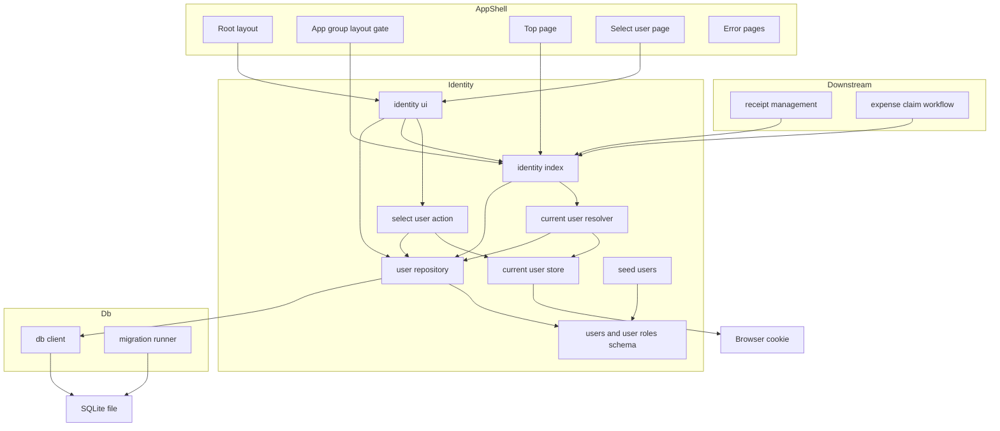
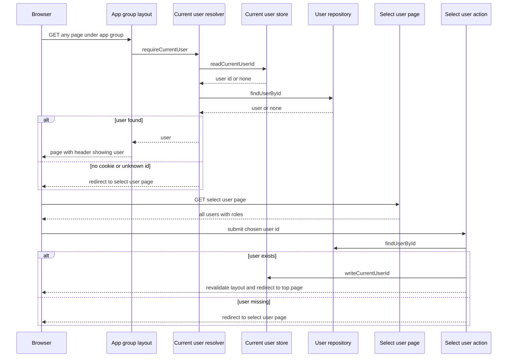
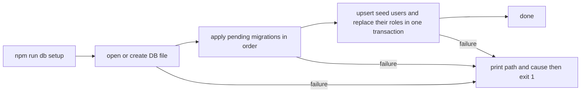
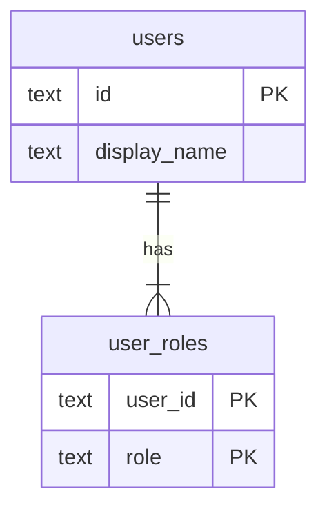

# Design Document: app-foundation

## Overview
**Purpose**: 経費精算アプリの土台として、Next.js（App Router）アプリの起動、SQLite への永続化とマイグレーション、作業者／承認者ロールを持つシードユーザー、ログインなしの操作ユーザー選択・切替、および後続機能向けの「現在ユーザー」「ロール別ユーザー一覧」の取得口を提供する。

**Users**: 後続 spec（receipt-management, expense-claim-workflow）の開発者は、取得口から現在ユーザーとロールを得て自機能の権限を判定する。アプリ利用者は、画面上で操作ユーザーを選び、作業者と承認者の立場を行き来する。

**Impact**: 空のリポジトリに、Next.js 16 + TypeScript のプロジェクト、Drizzle ORM によるスキーマとマイグレーション、`identity` モジュール（ユーザー／ロール／現在ユーザー）、共通レイアウトを新設する。

### Goals
- `npm install` → `npm run db:setup` → `npm run dev` の 3 手順で、共通レイアウト付きの画面が表示される
- 現在ユーザーの保持方法（Cookie）を `src/identity/` の内部に閉じ込め、後続 spec が保持方法を一切知らずに済む
- データ構造の変更を、コミット済みの順序付き SQL マイグレーションとして再現できる

### Non-Goals
- パスワード・OAuth 等の本格認証、サーバー側セッション管理
- ユーザー／ロールの作成・編集・削除 UI
- ロールに基づく操作の可否判定（各機能 spec が担う）
- グローバルナビゲーション（機能画面へのリンク群）。後続 spec が必要に応じて追加する
- 本番デプロイ構成

## Boundary Commitments

### This Spec Owns
- **アプリ基盤**: Next.js プロジェクト構成、ツールチェーン（TypeScript、ESLint、Tailwind CSS、Vitest、Playwright）、実行環境の前提（Node.js バージョン）
- **永続化基盤**: SQLite 接続（`src/db/client.ts`）、マイグレーションの生成・適用方式（drizzle-kit、`drizzle/` ディレクトリ）、データ初期化手順（`npm run db:setup`）
- **ユーザーとロールのデータ**: `users` / `user_roles` テーブル、シードユーザーの定義と投入。ユーザーとロールの真実の情報源
- **現在ユーザー**: 保持（Cookie）、選択・切替、未選択時のユーザー選択画面へのゲート
- **公開契約**: `@/identity` の `getCurrentUser` / `requireCurrentUser` / `listUsersByRole` と型 `User` / `Role` / `UserId` / `CurrentUserResult`、`ROLE_LABELS`
- **共通レイアウト**: ルートレイアウト（アプリ名、現在ユーザー表示、切替操作）、`(app)` ルートグループのゲート、トップ画面、エラー画面

### Out of Boundary
- 本格認証、ユーザー管理 UI
- 領収書・申請のテーブル、画面、ドメインロジック
- 「この操作を許可するか」の判定（例：作業者だけが領収書を登録できる、自己承認の禁止）。取得口はロールを返すだけで、可否を返さない
- 承認者候補の絞り込みルール（例：申請者本人を除く）。`listUsersByRole('approver')` の結果を workflow 側で絞り込む
- 後続 spec のシードデータ

### Allowed Dependencies
- **外部**: Next.js 16、React 19、Drizzle ORM 0.45 / drizzle-kit 0.31、better-sqlite3 13、Tailwind CSS 4、`server-only`、tsx、Vitest 5、Playwright 1.64
- **依存方向（`src/` 内）**: `identity/types` → `db/client` → `identity/schema` → `identity/user-repository` → `identity/current-user-store` → `identity/current-user` → `identity/actions` → `identity/ui` → `app/*`。各層は左側の層だけを import する
- **後続 spec に許可する import**:
  - `@/identity` — 取得口と型（すべての用途）
  - `@/identity/schema` — 外部キー参照（`users.id`）のためだけ
  - `@/db/client` — 自機能のテーブルへのクエリのため
- **後続 spec に禁止する import**: 上記以外の `@/identity/*`（`current-user-store`、`user-repository`、`actions` 等）。ESLint の `no-restricted-imports` で機械的に検出する。`@/identity/ui` はアプリシェル（`src/app/layout.tsx`、`src/app/select-user/`）専用
- `identity` と `db` は後続 spec のモジュールを import しない

### Revalidation Triggers
- `@/identity` の公開関数のシグネチャ、`User` / `Role` / `UserId` / `CurrentUserResult` の形の変更
- `users.id` の型・採番方式の変更、シードユーザー ID の変更（後続 spec の外部キーとテストに影響）
- ユーザー選択画面のパス（`/select-user`）や `(app)` ルートグループ規約の変更
- スキーマの配置規約（`src/*/schema.ts`）やマイグレーション適用方式の変更
- Node.js の前提バージョン、Drizzle ORM のメジャー更新（1.0 移行）
- Cookie から本格認証への差し替えは、公開契約が変わらない限り再検証不要

## Architecture

### Architecture Pattern & Boundary Map
深いモジュール（機能単位のディレクトリ）＋ App Router。現在ユーザーに関する知識は `src/identity/` に集約し、外へは小さな公開面だけを出す。



**Architecture Integration**:
- **Selected pattern**: 機能モジュール（深いモジュール）。保持方法・DB 照合・未選択時の扱いを `identity` 内部に引き下げ、公開面は 3 関数に絞る。ポート／アダプタは作らない（実装が 1 つしかなく、公開関数の境界がそのまま差し替え点になるため）
- **Domain boundaries**: `db` はインフラ（接続とマイグレーション）だけを持ち、テーブル定義を持たない。テーブル定義は各機能ディレクトリの `schema.ts` が持つ
- **Existing patterns preserved**: 既存コードなし。本 spec の構成が後続 spec の規約になる
- **Steering compliance**: `roadmap.md` の制約（Next.js App Router + TypeScript、SQLite、ORM 選定をここで行う、健全で見通しのよい設計を優先）に従う。`tech.md` / `structure.md` は未作成のため、本 design の決定を後で steering に反映する

### Technology Stack

| Layer | Choice / Version | Role in Feature | Notes |
|-------|------------------|-----------------|-------|
| Runtime | Node.js 24 LTS（`engines: >=22`）、npm | 実行環境 | better-sqlite3 13 が Node.js 22 以上を要求。`.nvmrc` に `24` を記載 |
| Frontend / Backend | Next.js 16.4（App Router）、React 19 | 画面、Server Components、Server Actions | `cookies()` は非同期。Cookie の書き込みは Server Action に限定 |
| Language | TypeScript（`strict: true`） | 型安全 | パスエイリアス `@/*` → `src/*` |
| Styling | Tailwind CSS 4 | 共通レイアウトと画面のスタイル | create-next-app の既定構成 |
| Data / Storage | SQLite（better-sqlite3 13） | ローカル永続化 | Next.js の既定の `serverExternalPackages` に含まれるため追加設定不要 |
| ORM / Migration | Drizzle ORM 0.45、drizzle-kit 0.31 | スキーマ定義、SQL マイグレーション生成・適用 | 1.0 は RC のため安定版に固定。比較は `research.md` |
| Scripts | tsx 4 | `scripts/db-setup.ts` の実行 | パスエイリアスを解決できるため |
| Guard | `server-only` | サーバー専用モジュールの誤用防止 | `identity` と `db` の全ファイルで import |
| Test | Vitest 5、Playwright 1.64 | 単体・統合テスト、E2E | |
| Lint | ESLint 9（flat config）、eslint-config-next 16 | 静的検査、import 境界の強制 | `no-restricted-imports` で `@/identity` の内部を保護 |

## File Structure Plan

### Directory Structure
```
.nvmrc                              # Node.js 24
package.json                        # 依存、engines、scripts（dev/build/start/lint/typecheck/test/test:e2e/db:generate/db:setup）
tsconfig.json                       # strict、@/* エイリアス
next.config.ts                      # Next.js 設定（既定値のみ）
eslint.config.mjs                   # eslint-config-next + @/identity 内部 import の禁止
postcss.config.mjs                  # Tailwind CSS 4
drizzle.config.ts                   # dialect: sqlite、schema: ./src/*/schema.ts、out: ./drizzle
vitest.config.ts                    # @ エイリアス、server-only を空モジュールに置換
playwright.config.ts                # webServer: E2E 用 DB で db:setup → dev
.gitignore                          # data/*.db、.next、node_modules、test-results 等
drizzle/                            # drizzle-kit generate が出力する SQL マイグレーションと meta（コミット対象）
data/.gitkeep                       # SQLite ファイルの置き場（DB ファイル自体は無視）
scripts/
└── db-setup.ts                     # データ初期化手順：DB ファイル作成 → マイグレーション適用 → シード投入
src/
├── db/
│   ├── client.ts                   # SQLite 接続のシングルトン、DB パス解決、DatabaseUnavailableError
│   ├── migrate.ts                  # applyMigrations(db)：drizzle/ のマイグレーションを適用
│   └── test-utils.ts               # createTestDatabase()：in-memory SQLite にマイグレーションを適用（テスト専用）
├── identity/
│   ├── index.ts                    # 公開面：getCurrentUser / requireCurrentUser / 型 / ROLE_LABELS の再エクスポートと listUsersByRole の実装
│   ├── types.ts                    # Role、ROLES、ROLE_LABELS、UserId、User、CurrentUserResult
│   ├── schema.ts                   # users / user_roles テーブル定義
│   ├── user-repository.ts          # findUsers / findUserById（内部）
│   ├── current-user-store.ts       # Cookie の読み書き（内部、保持方法の唯一の所在）
│   ├── current-user.ts             # getCurrentUser / requireCurrentUser の実装
│   ├── actions.ts                  # 'use server'：selectUserAction
│   ├── seed.ts                     # SEED_USERS と seedUsers(db)
│   └── ui/
│       ├── index.ts                # アプリシェル向け公開面：CurrentUserIndicator、UserSelectList
│       ├── current-user-indicator.tsx  # 現在ユーザーの表示名・ロールと切替リンク
│       └── user-select-list.tsx        # 全ユーザー一覧と選択ボタン
└── app/
    ├── layout.tsx                  # ルートレイアウト：<html>、ヘッダー（アプリ名 + CurrentUserIndicator）、<main>
    ├── globals.css                 # Tailwind の読み込み
    ├── error.tsx                   # ページ描画エラーの表示（開発時は原因メッセージを表示）
    ├── global-error.tsx            # ルートレイアウトのエラー表示
    ├── select-user/
    │   └── page.tsx                # ユーザー選択画面（UserSelectList を配置）
    └── (app)/
        ├── layout.tsx              # ゲート：requireCurrentUser() を呼び、未選択なら /select-user へ
        └── page.tsx                # トップ画面：現在ユーザーの表示名とロール
e2e/
├── user-switching.spec.ts          # 選択・切替・維持・独立性・不正 Cookie のシナリオ
└── layout-accessibility.spec.ts    # キーボード操作と支援技術向けの名前
```

**規約（後続 spec 向け）**:
- 機能画面は `src/app/(app)/` 配下に置く。ルートレイアウトとゲートが自動で適用される（5.2）
- 機能ごとのテーブル定義は `src/<feature>/schema.ts` に置く。`drizzle.config.ts` のグロブが拾うため、本 spec のファイルを変更せずに追加できる
- ユーザーを参照する外部キー列は `text(...).references(() => users.id).$type<UserId>()` とする

テストファイルは対象と同じディレクトリに `*.test.ts` として置く（`src/db/client.test.ts`、`src/identity/user-repository.test.ts`、`src/identity/seed.test.ts`、`src/identity/current-user.test.ts`、`src/identity/actions.test.ts`）。

### Modified Files
- `README.md` — 「セットアップ」節を追加（Node.js 24 の用意、`npm install`、`npm run db:setup`、`npm run dev`、マイグレーション追加手順 `npm run db:generate`）
- `.gitignore` — 新規作成（既存なし）

## System Flows

### 画面アクセスとユーザー選択・切替



**Key Decisions**:
- ゲートは `(app)` レイアウトに置く。`/select-user` はゲートの外にあり、未選択でも表示できる。切替時もヘッダーのリンクから同じ画面へ移り、同じアクションで上書きする（3.5）
- 保持された ID が DB に存在しない場合（3.9）は未選択として扱う。描画中は Cookie を消せないため、Cookie は残したまま次の選択で上書きする
- 選択後は `revalidatePath('/', 'layout')` でレイアウトを再描画させ、ヘッダーと各画面を新しい現在ユーザーの視点にそろえる（3.5）
- レイアウトのゲートはクライアント遷移で再評価されないことがあるため、ページと Server Action は `requireCurrentUser()` か `getCurrentUser()` を自分でも呼ぶ。ゲートは表示を守る一次防御で、データ操作の防御ではない

### データ初期化



シードは固定 ID を主キーにした upsert と、そのユーザーのロールの置き換えを 1 トランザクションで行う。何度実行しても結果は同じになる（1.5）。

## Requirements Traceability

| Requirement | Summary | Components | Interfaces | Flows |
|-------------|---------|------------|------------|-------|
| 1.1 | 手順どおりの起動で共通レイアウト付き画面を表示 | RootLayout、README セットアップ節、package.json scripts | — | データ初期化 |
| 1.2 | 再起動後もデータを保持 | DbClient（ファイルベース SQLite） | `getDb()` | — |
| 1.3 | 順序付きの変更履歴と再現性 | drizzle.config.ts、`drizzle/`、MigrationRunner | `applyMigrations(db)` | データ初期化 |
| 1.4 | 初期化でスキーマ最新化＋シード投入 | DbSetupScript、MigrationRunner、SeedUsers | `npm run db:setup` | データ初期化 |
| 1.5 | 初期化を繰り返しても重複なし・同一識別 | SeedUsers（固定 ID の upsert） | `seedUsers(db)` | データ初期化 |
| 1.6 | 保存先に接続できないとき原因を出力し描画しない | DbClient、DbSetupScript、ErrorPages | `DatabaseUnavailableError` | データ初期化 |
| 2.1 | 一意の識別子と表示名 | IdentitySchema、IdentityTypes | `User` | — |
| 2.2 | ロールは作業者・承認者の 2 種のみ | IdentityTypes、IdentitySchema（CHECK 制約） | `Role`、`ROLES` | — |
| 2.3 | 1 つ以上のロール、両方の保持を許容 | IdentitySchema（複合主キー）、IdentityTypes（非空タプル）、UserRepository | `User.roles` | — |
| 2.4 | 作業者 2 名以上・承認者 2 名以上・両方 1 名以上 | SeedUsers | `SEED_USERS` | — |
| 2.5 | ユーザー／ロールの編集画面を提供しない | File Structure Plan（該当ルートなし） | — | — |
| 3.1 | 未選択時はユーザー選択画面、機能内容は非表示 | AppGroupLayout、CurrentUserResolver | `requireCurrentUser()` | 画面アクセス |
| 3.2 | 選択画面に全ユーザーを表示名・ロール付きで一覧 | SelectUserPage、UserSelectList、UserRepository | `findUsers()` | 画面アクセス |
| 3.3 | 選んだユーザーを現在ユーザーにしトップへ | SelectUserAction、CurrentUserStore | `selectUserAction(formData)` | 画面アクセス |
| 3.4 | 全画面で現在ユーザーの表示名・ロールを表示 | RootLayout、CurrentUserIndicator | `getCurrentUser()` | — |
| 3.5 | 任意の画面から切替、以降は新ユーザー視点 | CurrentUserIndicator（切替リンク）、SelectUserAction | `selectUserAction(formData)` | 画面アクセス |
| 3.6 | 認証情報を求めない | UserSelectList（入力欄なし） | — | — |
| 3.7 | 遷移・再読み込み後も維持 | CurrentUserStore（Cookie、maxAge 30 日） | `readCurrentUserId()` | — |
| 3.8 | ブラウザごとに独立 | CurrentUserStore（ブラウザ単位の Cookie） | — | — |
| 3.9 | 保持ユーザーが存在しなければ未選択扱い | CurrentUserResolver | `getCurrentUser()` | 画面アクセス |
| 4.1 | 現在ユーザーの単一の取得口 | IdentityPublicApi、ESLint 境界 | `getCurrentUser()` | — |
| 4.2 | 未選択を明示的に返す | CurrentUserResolver | `CurrentUserResult` の `none` | — |
| 4.3 | ロール指定のユーザー一覧 | IdentityPublicApi、UserRepository | `listUsersByRole(role)` | — |
| 4.4 | 両ロール保持者はどちらの一覧にも含む | UserRepository | `listUsersByRole(role)` | — |
| 4.5 | 一覧は毎回同じ順序 | UserRepository（`users.id` 昇順） | `listUsersByRole(role)` | — |
| 4.6 | 保持方法を利用側に露出しない | IdentityPublicApi、CurrentUserStore、ESLint 境界 | — | — |
| 4.7 | 操作可否の判定を返さない | IdentityPublicApi（ロールのみ返す） | `User` | — |
| 5.1 | 全画面にアプリ名・現在ユーザー表示・切替操作 | RootLayout、CurrentUserIndicator | — | — |
| 5.2 | 後続機能の画面にも同じ共通レイアウト | RootLayout、AppGroupLayout、`(app)` 配置規約 | — | — |
| 5.3 | トップ画面に表示名とロール | TopPage | `requireCurrentUser()` | — |
| 5.4 | キーボード操作可能、支援技術で読み取り可能 | RootLayout、CurrentUserIndicator、UserSelectList | — | — |

## Components and Interfaces

| Component | Domain/Layer | Intent | Req Coverage | Key Dependencies (P0/P1) | Contracts |
|-----------|--------------|--------|--------------|--------------------------|-----------|
| DbClient | db | SQLite 接続の提供と接続失敗の明示 | 1.2, 1.6 | better-sqlite3 (P0) | Service |
| MigrationRunner | db | コミット済みマイグレーションの適用 | 1.3, 1.4 | drizzle-orm migrator (P0) | Service |
| DbSetupScript | scripts | データ初期化手順 | 1.4, 1.5, 1.6 | MigrationRunner (P0), SeedUsers (P0) | Batch |
| IdentityTypes | identity | ユーザー・ロール・結果型の定義 | 2.1, 2.2, 2.3, 4.2 | — | — |
| IdentitySchema | identity | users / user_roles テーブル | 2.1, 2.2, 2.3 | Drizzle (P0) | State |
| UserRepository | identity（内部） | ユーザーとロールの問い合わせ | 3.2, 4.3, 4.4, 4.5 | DbClient (P0), IdentitySchema (P0) | Service |
| CurrentUserStore | identity（内部） | Cookie による現在ユーザー ID の保持 | 3.7, 3.8, 4.6 | next/headers (P0) | State |
| CurrentUserResolver | identity | 現在ユーザーの解決とゲート | 3.1, 3.9, 4.1, 4.2 | CurrentUserStore (P0), UserRepository (P0) | Service |
| IdentityPublicApi | identity | 後続 spec への単一の取得口 | 4.1, 4.3, 4.6, 4.7 | CurrentUserResolver (P0), UserRepository (P0) | Service |
| SelectUserAction | identity | 現在ユーザーの設定・切替 | 3.3, 3.5 | CurrentUserStore (P0), UserRepository (P0) | API |
| SeedUsers | identity | シードユーザーの定義と冪等な投入 | 1.4, 1.5, 2.4 | IdentitySchema (P0) | Batch |
| CurrentUserIndicator | identity/ui | 現在ユーザー表示と切替リンク | 3.4, 3.5, 5.1, 5.4 | IdentityPublicApi (P0) | — |
| UserSelectList | identity/ui | 全ユーザーの選択 UI | 3.2, 3.3, 3.6, 5.4 | UserRepository (P0), SelectUserAction (P0) | — |
| RootLayout | app | 全画面共通の枠組み | 1.1, 3.4, 5.1, 5.2, 5.4 | CurrentUserIndicator (P0) | — |
| AppGroupLayout | app | 機能画面のゲート | 3.1, 5.2 | IdentityPublicApi (P0) | — |
| TopPage | app | トップ画面 | 5.3 | IdentityPublicApi (P0) | — |
| SelectUserPage | app | ユーザー選択画面 | 3.2 | UserSelectList (P0) | — |
| ErrorPages | app | 描画エラーの表示 | 1.6 | — | — |

### db

#### DbClient

| Field | Detail |
|-------|--------|
| Intent | SQLite ファイルへの接続を 1 つだけ作って共有し、接続できない理由を明示する |
| Requirements | 1.2, 1.6 |

**Responsibilities & Constraints**
- DB パスは環境変数 `DATABASE_PATH`、未設定なら `data/app.db`（プロジェクトルート相対）
- アプリ実行時は DB ファイルが存在することを要求する（`fileMustExist`）。存在しなければ `npm run db:setup` を促す `DatabaseUnavailableError` を投げる。初期化スクリプトだけが作成を許可する
- 接続時に `PRAGMA foreign_keys = ON` と `PRAGMA journal_mode = WAL` を設定する
- 接続時にマイグレーション管理テーブル `__drizzle_migrations` の存在を確認し、なければ「マイグレーション未適用」として `DatabaseUnavailableError` を投げる
- 開発サーバーの HMR で接続が増えないよう、接続を `globalThis` にキャッシュする
- テーブル定義を import しない（`db` は機能モジュールに依存しない）

**Contracts**: Service [x]

##### Service Interface
```typescript
import type { BetterSQLite3Database } from 'drizzle-orm/better-sqlite3';

export type AppDatabase = BetterSQLite3Database;

export type DatabaseUnavailableReason =
  | 'file-not-found'
  | 'migrations-not-applied'
  | 'open-failed';

export class DatabaseUnavailableError extends Error {
  readonly reason: DatabaseUnavailableReason;
  readonly databasePath: string;
  constructor(params: {
    reason: DatabaseUnavailableReason;
    databasePath: string;
    cause: unknown;
  });
}

/** アプリ実行時の共有接続。初回呼び出しで接続し、以後は同じ接続を返す。 */
export function getDb(): AppDatabase;

/** 初期化スクリプトとテスト用：指定パス（':memory:' 可）に接続する。create=true ならファイルを作成する。 */
export function openDatabase(params: { path: string; create: boolean }): AppDatabase;

export function resolveDatabasePath(): string;
```
- Preconditions: `getDb()` の前に `npm run db:setup` が実行済みであること
- Postconditions: 返る接続は外部キー制約が有効
- Invariants: プロセス内で `getDb()` の接続は 1 つ

**Implementation Notes**
- `DatabaseUnavailableError` のメッセージには DB パス、理由、対処（`npm run db:setup`）を含める。投げる前に `console.error` でサーバーログへ出力する（本番ビルドではクライアントへのメッセージが伏せられるため）
- Risk: `__drizzle_migrations` の存在確認では「未適用の新しいマイグレーション」までは検出しない。新しいマイグレーションを取り込んだら `npm run db:setup` を再実行する手順を README に書く

#### MigrationRunner

| Field | Detail |
|-------|--------|
| Intent | `drizzle/` のマイグレーションを番号順に適用する |
| Requirements | 1.3, 1.4 |

**Contracts**: Service [x]

```typescript
/** drizzle/ の未適用マイグレーションを順に適用する。適用済みはスキップする。 */
export function applyMigrations(db: AppDatabase): void;
```
- Postconditions: スキーマが最新のマイグレーションと一致する
- Implementation Notes: `drizzle-orm/better-sqlite3/migrator` の `migrate(db, { migrationsFolder })` を使う。マイグレーションは `npm run db:generate`（`drizzle-kit generate`）で生成し、手で編集した場合も含めてコミットする。`drizzle-kit push` は履歴が残らないため使わない

#### DbSetupScript

| Field | Detail |
|-------|--------|
| Intent | 「データ初期化手順」を 1 コマンドにまとめる |
| Requirements | 1.4, 1.5, 1.6 |

**Contracts**: Batch [x]

##### Batch / Job Contract
- **Trigger**: `npm run db:setup`（`tsx scripts/db-setup.ts`）
- **Input / validation**: `DATABASE_PATH`（任意）。親ディレクトリがなければ作成する
- **Output / destination**: DB ファイル（`openDatabase({ create: true })` → `applyMigrations` → `seedUsers`）
- **Idempotency & recovery**: マイグレーションは適用済みをスキップし、シードは upsert なので何度でも実行できる。失敗時は DB パスと原因を標準エラーに出し、終了コード 1 で終える

### identity

#### IdentityTypes

```typescript
export const ROLES = ['worker', 'approver'] as const;
export type Role = (typeof ROLES)[number];

export const ROLE_LABELS: Readonly<Record<Role, string>> = {
  worker: '作業者',
  approver: '承認者',
};

export type UserId = string & { readonly __brand: 'UserId' };

export interface User {
  readonly id: UserId;
  readonly displayName: string;
  /** 1 つ以上。順序は ROLES の順（worker → approver）。 */
  readonly roles: readonly [Role, ...Role[]];
}

export type CurrentUserResult =
  | { readonly status: 'selected'; readonly user: User }
  | { readonly status: 'none' };
```
- `User` はロールを返すのみで、`canApprove` のような可否の判定は持たない（4.7）

#### IdentitySchema

| Field | Detail |
|-------|--------|
| Intent | ユーザーとロールの永続化構造 |
| Requirements | 2.1, 2.2, 2.3 |

**Contracts**: State [x]
- **State model**: 「Data Models」節を参照
- **Persistence & consistency**: ロールの値は CHECK 制約で 2 値に限定し、`(user_id, role)` の複合主キーで重複を防ぐ
- 後続 spec が import してよいのは `users`（外部キー参照のため）のみ

#### UserRepository（内部）

| Field | Detail |
|-------|--------|
| Intent | ユーザーとロールを `User` 型として読み出す唯一の場所 |
| Requirements | 3.2, 4.3, 4.4, 4.5 |

**Responsibilities & Constraints**
- 読み取り専用（書き込みは SeedUsers のみ）
- 返却順は `users.id` 昇順で固定（4.5）。各ユーザーの `roles` は `ROLES` の順
- ロール指定時は、そのロールを持つユーザーを、そのユーザーの全ロールとともに返す（4.4）
- ロールを 1 つも持たないユーザーは不変条件違反としてエラーにする（シード以外に書き込み経路がないため、発生時はデータ破損）

**Contracts**: Service [x]
```typescript
export function findUsers(db: AppDatabase, filter?: { readonly role?: Role }): readonly User[];
export function findUserById(db: AppDatabase, id: string): User | undefined;
```
- `findUserById` は Cookie 由来の未検証の文字列を受け取るため、引数は `string`。見つかった場合だけ `UserId` を持つ `User` を返す

#### CurrentUserStore（内部）

| Field | Detail |
|-------|--------|
| Intent | 現在ユーザー ID の保持方法（Cookie）を知る唯一の場所 |
| Requirements | 3.7, 3.8, 4.6 |

**Contracts**: State [x]
```typescript
/** Server Component / Server Action から呼べる。未保持なら undefined。 */
export function readCurrentUserId(): Promise<string | undefined>;
/** Server Action からのみ呼ぶ（Next.js の制約）。 */
export function writeCurrentUserId(id: UserId): Promise<void>;
```
- **State model**: Cookie `current_user_id` にユーザー ID のみを保存。`httpOnly: true`、`sameSite: 'lax'`、`path: '/'`、`maxAge: 60 * 60 * 24 * 30`、`secure: process.env.NODE_ENV === 'production'`
- **Persistence & consistency**: Cookie はブラウザ（プロファイル）単位で独立する（3.8）。表示名やロールは保存せず、毎回 DB と照合する
- **Concurrency strategy**: 同一ブラウザの複数タブは同じ Cookie を共有し、最後の選択が有効になる
- 本格認証へ差し替えるときは、このファイルと `actions.ts` を置き換える。公開面は変わらない

#### CurrentUserResolver

| Field | Detail |
|-------|--------|
| Intent | 保持された ID を DB と照合して現在ユーザーを決め、未選択時の扱いを一箇所で行う |
| Requirements | 3.1, 3.9, 4.1, 4.2 |

**Contracts**: Service [x]
```typescript
/** 現在ユーザーを返す。未保持または DB に存在しない ID なら { status: 'none' }。 */
export const getCurrentUser: () => Promise<CurrentUserResult>;

/** 現在ユーザーを返す。未選択ならユーザー選択画面（/select-user）へリダイレクトし、戻らない。 */
export function requireCurrentUser(): Promise<User>;
```
- Preconditions: リクエストのコンテキスト内（Server Component、Server Action、Route Handler）で呼ぶ
- Postconditions: `getCurrentUser` は仮のユーザーを返さない（4.2）。DB 接続に失敗した場合は `DatabaseUnavailableError` を投げ、未選択とは区別する（1.6）
- Invariants: 同一リクエスト内では同じ結果を返す（`getCurrentUser` を React `cache()` で包む）

#### IdentityPublicApi（`src/identity/index.ts`）

| Field | Detail |
|-------|--------|
| Intent | 後続 spec が使ってよい唯一の入口 |
| Requirements | 4.1, 4.3, 4.6, 4.7 |

**Contracts**: Service [x]
```typescript
export { getCurrentUser, requireCurrentUser } from './current-user';
export { ROLES, ROLE_LABELS } from './types';
export type { Role, UserId, User, CurrentUserResult } from './types';

/** 指定ロールを持つユーザーの一覧。users.id 昇順。両ロール保持者はどちらの一覧にも含まれる。 */
export function listUsersByRole(role: Role): Promise<readonly User[]>;
```
- 保持方法（Cookie 名、Cookie API）、DB 接続、リポジトリは公開しない（4.6）
- 全ユーザーの一覧は公開しない（要件はロール別一覧のみ。選択画面は `identity/ui` 内部で使う）

**Implementation Notes**
- `eslint.config.mjs` の `no-restricted-imports` で `@/identity/*` を禁止し、例外として `@/identity/schema` と `@/identity/ui`（アプリシェル用）を許可する。`src/identity/` 内部の相対 import は対象外
- `src/identity/` の全ファイルで `import 'server-only'` を行い、クライアントコンポーネントからの誤用をビルド時に検出する（`ui/` のサーバーコンポーネントも同様）

#### SelectUserAction

| Field | Detail |
|-------|--------|
| Intent | 選ばれたユーザーを現在ユーザーにする（選択と切替で共通） |
| Requirements | 3.3, 3.5 |

**Contracts**: API [x]

##### API Contract
| Method | Endpoint | Request | Response | Errors |
|--------|----------|---------|----------|--------|
| Server Action | `selectUserAction` | `FormData { userId: string }` | `redirect('/')` | 未知の `userId` → `redirect('/select-user')`、DB 接続失敗 → `DatabaseUnavailableError` |

```typescript
'use server';
export async function selectUserAction(formData: FormData): Promise<never>;
```
- `userId` を `findUserById` で検証してから `writeCurrentUserId` を呼ぶ。検証前の値を Cookie に書かない
- 成功時は `revalidatePath('/', 'layout')` の後 `redirect('/')`

#### SeedUsers

| Field | Detail |
|-------|--------|
| Intent | シードユーザーの定義と冪等な投入 |
| Requirements | 1.4, 1.5, 2.4 |

**Contracts**: Batch [x]
```typescript
export interface SeedUser {
  readonly id: UserId;
  readonly displayName: string;
  readonly roles: readonly [Role, ...Role[]];
}
export const SEED_USERS: readonly SeedUser[];
export function seedUsers(db: AppDatabase): void;
```

| id | displayName | roles |
|----|-------------|-------|
| `user-01` | 佐藤 花子 | worker |
| `user-02` | 鈴木 一郎 | worker |
| `user-03` | 田中 美咲 | approver |
| `user-04` | 高橋 健 | approver |
| `user-05` | 伊藤 直樹 | worker, approver |

- **Idempotency**: 1 トランザクションで、各ユーザーを `id` で upsert（表示名を更新）し、そのユーザーの `user_roles` を削除して定義どおりに入れ直す
- シードにないユーザーは削除しない（作成経路がないため存在しない想定。後続 spec の外部キーを壊さないため）
- シード ID は後続 spec のテストからも参照されるため、変更は再検証トリガー

### identity/ui（アプリシェル専用）

両コンポーネントとも Server Component。新しい境界は持たないため概要のみ記す。

- **CurrentUserIndicator**（3.4, 3.5, 5.1, 5.4）: `getCurrentUser()` を呼ぶ。選択済みなら「現在のユーザー：伊藤 直樹（作業者・承認者）」の形で表示名とロールラベルをテキストで表示し、`aria-label="現在のユーザー"` の `<section>` で囲む。続けて `/select-user` への `<Link>`「ユーザーを切り替える」を置く。未選択なら「ユーザー未選択」と表示し、同じリンクを置く
- **UserSelectList**（3.2, 3.3, 3.6, 5.4）: 内部の `findUsers(getDb())` で全ユーザーを取得し、`<ul>` で一覧表示する。各項目は表示名とロールラベルを表示し、`<form action={selectUserAction}>` 内の `<button type="submit" name="userId" value={id}>` で選択する。ボタンのアクセシブルネームは「佐藤 花子 を選択」。パスワード等の入力欄は置かない。現在ユーザーの項目には「選択中」と表示する

### app

いずれも新しい境界を持たない Route ファイル。

- **RootLayout**（1.1, 3.4, 5.1, 5.2, 5.4）: `<html lang="ja">`。`<header>` にアプリ名（`<Link href="/">` 経費精算）と `CurrentUserIndicator`、続けて `<main>`。すべてのルートに適用される。フォーカスリングを消さない
- **AppGroupLayout**（3.1, 5.2）: `await requireCurrentUser()` を呼んでから `children` を描画する。未選択なら子を描画せずリダイレクトする
- **TopPage**（5.3）: `requireCurrentUser()` の結果から表示名とロールラベルを見出しと本文で表示する
- **SelectUserPage**（3.2）: 見出し「ユーザーを選択」と `UserSelectList`
- **ErrorPages**（1.6）: `error.tsx` と `global-error.tsx`（Client Component）。開発時は `error.message`（`DatabaseUnavailableError` のパスと対処を含む）を、本番時は汎用メッセージと `digest` を表示する。部分的なデータで画面を描画しない

## Data Models

### Domain Model
- **User**（集約ルート）: `id`、`displayName`、`roles`。ロールは User に従属する値の集合で、単独では存在しない
- **Role**（値）: `worker` | `approver` の 2 値
- **不変条件**: 各 User は 1 つ以上の Role を持つ。同じ Role を重複して持たない
- **CurrentUser**: 永続データではなく、ブラウザごとの「どの User として操作しているか」の参照。DB 上の User を指さなくなったら未選択とみなす

### Logical Data Model



- `users` 1 : N `user_roles`（N ≥ 1 はアプリ側の不変条件）
- 後続 spec のテーブルは `users.id` を外部キーとして参照する

### Physical Data Model

| Table | Column | Type | Constraints |
|-------|--------|------|-------------|
| `users` | `id` | TEXT | PRIMARY KEY |
| `users` | `display_name` | TEXT | NOT NULL |
| `user_roles` | `user_id` | TEXT | NOT NULL、REFERENCES `users(id)` ON DELETE CASCADE |
| `user_roles` | `role` | TEXT | NOT NULL、CHECK (`role` IN ('worker', 'approver')) |
| `user_roles` | — | — | PRIMARY KEY (`user_id`, `role`) |

- インデックス: `user_roles(role)`（ロール別一覧用）
- Drizzle では `users.id` を `text('id').primaryKey().$type<UserId>()` と定義する

## Error Handling

### Error Strategy
- **DB 接続・スキーマ未適用（1.6）**: `DbClient` が `DatabaseUnavailableError` を投げる。リポジトリと取得口は握りつぶさずに伝播させ、Next.js のエラー境界（`error.tsx` / `global-error.tsx`）が表示する。未選択（`status: 'none'`）とは決して混同しない
- **初期化スクリプトの失敗**: DB パスと原因を標準エラーに出し、終了コード 1
- **不正・不明なユーザー ID**: Cookie 由来なら未選択として扱う（3.9）。フォーム由来なら Cookie を書かずにユーザー選択画面へ戻す
- **不変条件違反（ロールのないユーザー）**: データ破損としてエラーにする

### Error Categories and Responses
| 状況 | 分類 | 応答 |
|------|------|------|
| DB ファイルがない | System | `DatabaseUnavailableError('file-not-found')`。メッセージで `npm run db:setup` を案内 |
| マイグレーション未適用 | System | `DatabaseUnavailableError('migrations-not-applied')` |
| 接続・クエリ失敗 | System | `DatabaseUnavailableError('open-failed')`、または SQLite のエラーをそのまま伝播 |
| Cookie のユーザーが存在しない | User state | 未選択として `/select-user` へ |
| 選択フォームに未知の ID | User input | `/select-user` へ戻す |

### Monitoring
ローカル開発のみのため、サーバーログ（`console.error`）への出力に限る。

## Testing Strategy

### Unit / Integration Tests（Vitest、in-memory SQLite にマイグレーションを適用）
- `src/identity/user-repository.test.ts`
  - `findUsers({ role: 'approver' })` が承認者ロールを持つユーザーだけを返し、両ロール保持者（`user-05`）が作業者・承認者どちらの一覧にも含まれ、その `roles` が `['worker', 'approver']` であること（4.3, 4.4）
  - 挿入順を入れ替えても返却順が `id` 昇順で変わらないこと（4.5）
  - `findUsers()` が全ユーザーを表示名・ロール付きで返すこと（3.2）
  - スキーマが `worker` / `approver` 以外のロールの挿入を拒否すること（2.2）
  - ロールを 1 つも持たないユーザーが存在するとエラーになること（2.3 の不変条件）
- `src/identity/seed.test.ts`
  - `SEED_USERS` が作業者 2 名以上、承認者 2 名以上、両方 1 名以上を含み、全員が 1 つ以上のロールを持つこと（2.3, 2.4）
  - `seedUsers` を 2 回実行してもユーザー数・ロール数が増えず、ID が同じであること（1.5）
- `src/identity/current-user.test.ts`（`current-user-store` と `next/navigation` をモック）
  - 保持 ID なし → `{ status: 'none' }`（4.2）
  - DB に存在しない保持 ID → `{ status: 'none' }`（3.9）
  - 有効な保持 ID → `{ status: 'selected', user }`（4.1）
  - `requireCurrentUser` が未選択時に `/select-user` へリダイレクトすること（3.1）
- `src/identity/actions.test.ts`（`current-user-store` と `next/navigation` をモック）
  - 既知の ID で Cookie を書き、`/` へリダイレクトすること。未知の ID では Cookie を書かずに `/select-user` へ戻すこと（3.3）
- `src/db/client.test.ts`
  - 存在しないパスを `create: false` で開くと `reason: 'file-not-found'` の `DatabaseUnavailableError` になり、メッセージにパスを含むこと（1.6）
  - マイグレーション未適用の DB で `reason: 'migrations-not-applied'` になること（1.6）
  - 一時ファイルに書き込み、接続を閉じて開き直しても読めること（1.2）

### E2E Tests（Playwright、`DATABASE_PATH=data/e2e.db` で `db:setup` 後に起動）
- `e2e/user-switching.spec.ts`
  - Cookie なしで `/` にアクセスすると `/select-user` に遷移し、トップ画面の内容が表示されないこと（3.1）
  - 選択画面に 5 名が表示名とロール付きで並び、パスワード入力欄がないこと（3.2, 3.6）
  - `佐藤 花子 を選択` → `/` に遷移し、ヘッダーとトップ画面に「佐藤 花子」「作業者」が表示されること（3.3, 3.4, 5.3）
  - 再読み込み後も同じユーザーが表示されること（3.7）
  - ヘッダーの「ユーザーを切り替える」から `伊藤 直樹` を選ぶと、表示が「作業者・承認者」に変わること（3.5）
  - 2 つのブラウザコンテキストで別々のユーザーを選び、互いに影響しないこと（3.8）
  - `current_user_id=unknown` の Cookie を設定して `/` にアクセスすると `/select-user` に遷移すること（3.9）
- `e2e/layout-accessibility.spec.ts`
  - `/select-user` と `/` の両方でヘッダーにアプリ名と切替リンクがあること（5.1）
  - キーボード（Tab / Enter）だけでユーザーを選択し、ヘッダーの切替リンクに到達できること（5.4）
  - `getByRole('region', { name: '現在のユーザー' })` で現在ユーザーの表示名とロールが読み取れること（5.4）

### Setup Verification
- 空の `DATABASE_PATH` に対して `npm run db:setup` を 2 回実行し、両方とも成功すること（1.4, 1.5）。CI ではなくタスク完了時の手動確認として扱う
- `npm run build` が成功し、`npm run lint` が `@/identity` 内部への import を検出すること（4.6、ESLint ルールのテストとして一時ファイルで確認）
- 2.5 と 5.2 はルート構成のレビューで確認する（ユーザー編集用ルートがないこと、機能画面の配置先が `(app)` であること）

## Security Considerations
- 本格認証ではない。Cookie を書き換えれば誰にでもなれることは前提として受け入れる（ローカル開発用アプリ）
- それでも、フォームから受け取った ID は DB で検証してから Cookie に書く。Cookie は `httpOnly` / `sameSite: 'lax'` にし、クライアントスクリプトから読ませない
- Server Action は Next.js の Origin チェックによる CSRF 対策に依存する
