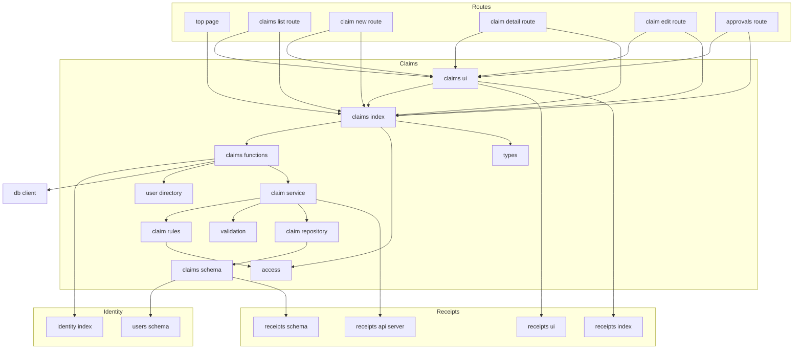
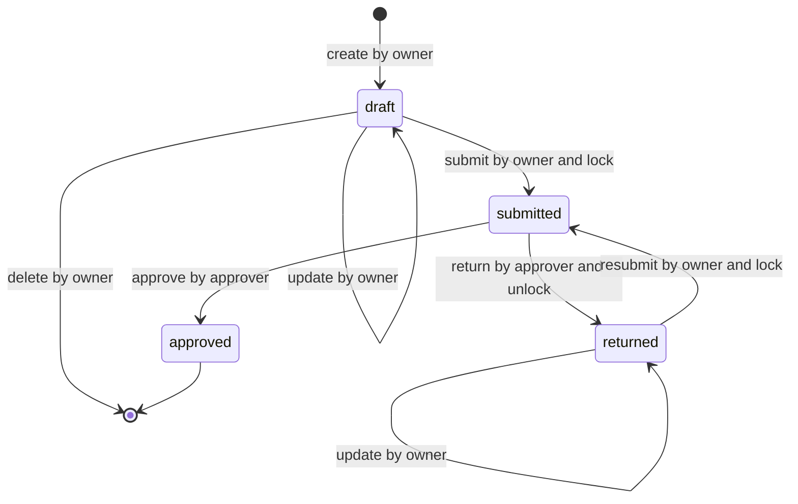
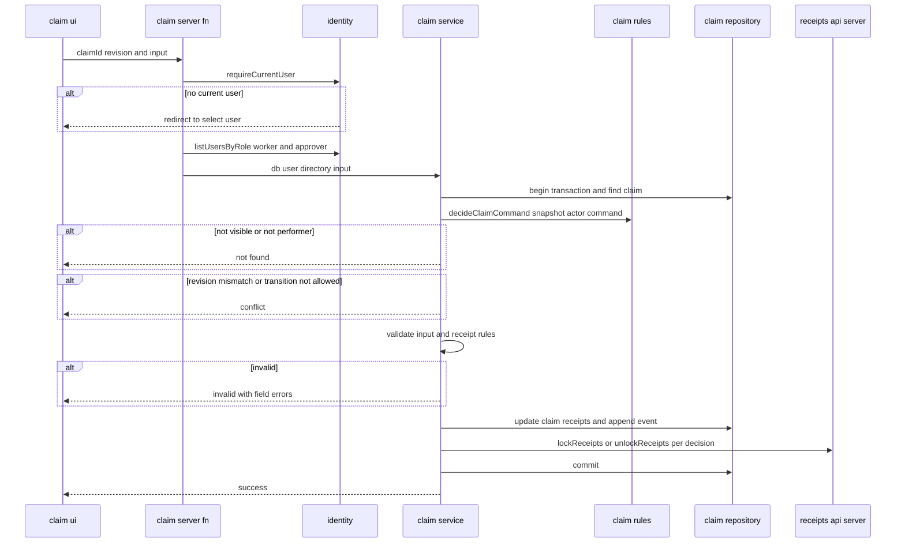
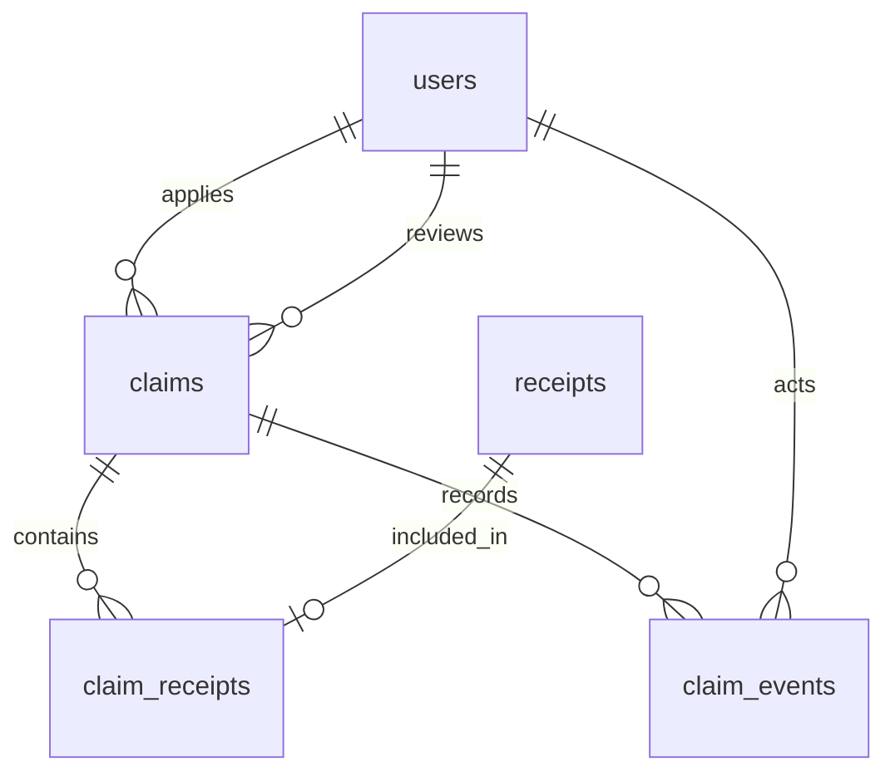

# Design Document: expense-claim-workflow

## Overview
**Purpose**: 作業者が自分の領収書を束ねて経費精算を申請し、指定した承認者が承認または差し戻すまでの流れを提供する。申請の状態遷移（下書き → 申請中 → 差し戻し → 申請中 … → 精算完了）と、それに伴う領収書のロックの指示を、この spec のドメインモデル一か所に閉じ込める。

**Users**: 作業者ロールのユーザーは `/claims` 配下で自分の申請を作成・修正・提出する。承認者ロールのユーザーは `/approvals` で自分宛ての申請を確認し、申請の詳細画面で承認・差し戻しを行う。

**Impact**: 次のものを新設・変更する。

- 機能モジュール `src/claims/`（型、入力検証、ロールの判定、遷移規則、ユーザーの名簿、テーブル、リポジトリ、サービス、Server Function、画面部品）
- 画面 `/claims`、`/claims/new`、`/claims/$claimId`、`/claims/$claimId/edit`、`/approvals`
- マイグレーション（`claims`、`claim_receipts`、`claim_events`）
- `eslint.config.js` の `MODULE_BOUNDARIES` への追加、トップ画面への導線（既存の領収書の導線とまとめて 1 つのナビゲーションに組み直す）、`structure.md` への公開面の追記

### Goals
- 申請の状態・遷移・操作者・ロックの効果を 1 つの遷移表で定め、サーバーの判断と画面の「許される操作」を同じ表から導く
- 状態の変更、承認者の記録、領収書のロックの付け外し、操作履歴を 1 つのトランザクションで反映する
- 申請者と指定された承認者以外には、申請の存在すら分からないようにする
- 表示した内容に対する操作であることを `revision` で保証し、古い画面からの承認・差し戻し・修正を拒否する

### Non-Goals
- 多段階承認、承認者の代理・自動割当・変更依頼
- 提出後の取り下げ、差し戻し後の申請の削除
- 支払・振込処理、会計連携、通知
- 領収書そのものの登録・編集・削除と入力検証（receipt-management）
- 申請の検索・絞り込み・ページ分割
- 申請のメモ、承認時のコメント

## Boundary Commitments

### This Spec Owns
- **申請のデータ**: `claims`（件名・申請者・状態・承認者・revision・日時）、`claim_receipts`（申請と領収書の紐付け）、`claim_events`（操作履歴）。申請の状態の真実の情報源
- **状態遷移の規則**: 4 つの状態、4 つの遷移、状態を変えない 2 つの操作（修正・下書きの削除）、それぞれの操作者（申請者／指定された承認者）、ロックの効果、履歴の種類。`src/claims/claim-rules.ts` だけが持つ
- **ロックの判断**: いつ `lockReceipts` / `unlockReceipts` を呼ぶか（提出・再提出でロック、差し戻しで解除、精算完了は維持、下書きはロックしない）
- **申請のアクセス制御**: 作業者・承認者ロールの判定（`canCreateClaims` / `canReviewClaims`）、申請の可視性、操作者の判定。`@/receipts/api.server` が所有者で絞らないため、領収書の所有者の確認も本 spec が行う
- **承認者候補の絞り込み**: 承認者ロールを持ち、申請者本人でないユーザー
- **画面**: 作業者の申請一覧・作成・詳細・修正、承認者の申請一覧、詳細画面での提出・削除・承認・差し戻し、トップ画面からの導線
- **公開契約**: `@/claims`（Server Function、型、状態のラベル、`canCreateClaims` / `canReviewClaims`）、`@/claims/ui`（ルートファイル向けの画面部品）

### Out of Boundary
- 領収書の項目・入力検証・所有者・ロックの記録（receipt-management）。本 spec は `receipts` / `receipt_locks` に直接書き込まない
- ユーザー・ロール・現在ユーザーの管理と切替（app-foundation）
- CSRF ミドルウェアと `src/start.ts`（app-foundation の所有。本 spec は変更しない）
- グローバルナビゲーション。トップ画面に導線を置くだけにする
- トップ画面（`src/routes/_app/index.tsx`）の既存の表示と、receipt-management が足した「領収書を管理する」リンクの文言・リンク先。ただし導線を 1 つの `<nav>` にまとめるため、そのリンクの置き場所だけは本 spec が組み直す（他の共有ファイルへの変更は追記に限る。この 1 か所だけが例外）
- 通知、多段階承認、支払連携（将来の下流）

### Allowed Dependencies
- **外部**: app-foundation が導入済みのものだけ（TanStack Start / Router、React 19、Drizzle ORM 0.45、better-sqlite3、Tailwind CSS 4、Vitest、Playwright）。新しい依存は追加しない
- **上流の公開面**:
  - `@/identity`：`requireCurrentUser`、`listUsersByRole`、`User`、`UserId`、`Role`
  - `@/identity/schema`：`users`（外部キー参照のためだけ）
  - `@/receipts`：型 `Receipt` / `ReceiptId`、`RECEIPT_CATEGORY_LABELS`
  - `@/receipts/schema`：`receipts`（外部キー参照のためだけ）
  - `@/receipts/api.server`：`findReceiptsByIds` / `listReceiptsByOwner` / `lockReceipts` / `unlockReceipts`（サービスからのみ）
  - `@/receipts/ui`：`formatYen` / `formatReceiptDate`（画面部品からのみ）
  - `@/db/client.server`：`getDb`、`AppDatabase`（サーバー専用ファイルからのみ）
  - テストファイルだけ：`@/db/test-utils.server`、`@/identity/seed.server`、`@/receipts/test-fixtures.server`（`createTestReceipt` / `updateTestReceipt` / `deleteTestReceipt`。receipt-management が testOnly として公開し、Lint がテストファイル以外からの import を禁じる）
- **前提**: receipt-management の実装が完了していること（`drizzle/0001_receipts.sql`、`@/receipts/api.server`、`@/receipts/test-fixtures.server`）。あわせて app-foundation が `src/start.ts` に登録している CSRF ミドルウェアに依存する（本 spec は `src/start.ts` を変更しない）
- **依存方向（`src/claims/` 内）**: 各層は左側の層だけを import する。

  `types` → `validation` → `access` → `claim-rules` → `user-directory` → `schema` → `claim-repository.server` → `claim-service.server` → `claims.functions` → `index` → `ui/*` → `routes/_app/claims/*`・`routes/_app/approvals/*`・`routes/_app/index.tsx`

  - `ui/*` はサーバー専用ファイル（`*.server.ts`、`@/receipts/api.server`）を import しない。Server Function は `@/claims` 経由で使う
  - `claim-rules` は DB を知らない純粋なモジュール。状態に関する判断は、サービス・画面のどちらもここを通す
- **禁止**:
  - `receipts` / `receipt_locks` への直接の読み書き（テストを含め例外なし。テストの領収書は `@/receipts/test-fixtures.server` で用意する）、`@/receipts` の内部モジュールの import
  - `@/identity/schema` の `users` を結合して表示名を読むこと（表示名は `listUsersByRole` から得る）
  - `claim-rules.ts` とサービス以外（`src/claims/ui/` とルートを含む）で申請の状態の比較（`status === 'submitted'` など）を書くこと。画面は `AvailableClaimActions` と `SubmitOptions.mode` に従う
  - receipts・identity・db から `claims` を import すること

### Revalidation Triggers
次の変更は、本 spec の下流（将来の多段階承認・通知・支払連携）の再検証を要する。

- 状態（`CLAIM_STATUSES`）・遷移・操作者の規則の変更
- `@/claims` の Server Function の入力・結果の形、`AvailableClaimActions` の意味
- `claims` / `claim_events` の列の削除・改名、履歴の種類（`CLAIM_EVENT_TYPES`）の変更

次の上流の変更は、本 spec の再検証を要する。

- receipt-management：`@/receipts/api.server` の入出力・冪等性・トランザクションの入れ子の扱い（`findReceiptsByIds` が未検証の文字列 ID を受け取り、存在しない ID を返さないことを含む）、`@/receipts/test-fixtures.server` の `createTestReceipt` / `updateTestReceipt` / `deleteTestReceipt` の入出力、`Receipt` / `ReceiptId` の形、ロック中の領収書の削除の拒否（`ON DELETE RESTRICT`）、`ON DELETE CASCADE` の規則、`formatYen` / `formatReceiptDate`
- app-foundation：`listUsersByRole` / `requireCurrentUser` の契約、`User.roles` の意味、`SEED_USERS` の ID

## Architecture

### Existing Architecture Analysis
- app-foundation の機能モジュール方式に従う。`*.functions.ts` のハンドラが `getDb()` と `requireCurrentUser()` を呼び、`*.server.ts` の普通の関数に `db` と `user` を渡す
- receipt-management は、ロックの記録を持ち、付け外しを下流に委ねる（Downstream Contract）。本 spec はその契約の唯一の利用者
- `@/identity` には `db` を受け取るユーザー検索の公開面がない。承認者候補と表示名は、ハンドラで `listUsersByRole` を呼んで得る（app-foundation の design が想定する使い方）
- Drizzle 0.45 の better-sqlite3 ドライバでは、`db.transaction` の中で再び `db.transaction` を呼ぶと SAVEPOINT として入れ子になる。`lockReceipts` を状態遷移のトランザクションの中で呼べる（`research.md`）

### Architecture Pattern & Boundary Map



**Architecture Integration**:
- **Selected pattern**: 機能モジュール + 純粋なドメイン規則（遷移表）+ トランザクションスクリプトのサービス。遷移表が「何をしてよいか・何が起こるか」を決め、サービスはそれを DB と receipts に反映するだけ
- **Domain/feature boundaries**: 申請の状態を解釈するのは `claim-rules` だけ。receipts には「ロックせよ／外せ」だけを伝え、状態は渡さない。identity からは一覧の結果だけを受け取り、絞り込みは `user-directory` で行う
- **Existing patterns preserved**: Server Function は薄く、判断は `*.server.ts`。結果は判別共用体。入力の形の検証は `validation.ts` の `parseXxxInput`。外部キーは `@/identity/schema`・`@/receipts/schema` を参照
- **New components rationale**: `claim-rules`（規則の唯一の所在）、`user-directory`（上流の一覧から承認者候補と表示名を引く純粋な値）、`use-claim-mutation`（6 つの変更操作で共通の送信・失敗・競合の扱い）
- **Steering compliance**: feature-first、公開面だけを見せる、`../` を使わない、マイグレーションはコミットする、データの保護は Server Function ごと

### Technology Stack

| Layer | Choice / Version | Role in Feature | Notes |
|-------|------------------|-----------------|-------|
| Frontend | React 19、TanStack Router 1.170 | 一覧・フォーム・詳細・操作領域、ローダー | `useServerFn`、`useHydrated`、`router.invalidate()` |
| Backend | TanStack Start 1.169（`createServerFn`） | Server Function | CSRF 保護は app-foundation の `src/start.ts` が登録済みの前提 |
| Data / Storage | SQLite（better-sqlite3）+ Drizzle ORM 0.45 / drizzle-kit 0.31 | `claims` / `claim_receipts` / `claim_events`、マイグレーション | `npm run db:generate -- --name claims` |
| Runtime | Node.js 24 | `crypto.randomUUID()`、`Intl.DateTimeFormat` | 標準 API |

## File Structure Plan

### Directory Structure
```
src/claims/
├── index.ts                      # クライアントからも使える公開面：Server Function、型、状態・履歴のラベル、canCreateClaims / canReviewClaims
├── types.ts                      # ClaimId、ClaimStatus、ClaimEventType とラベル、UserRef、一覧・詳細・フォームの表示用の型、各操作の結果型、AvailableClaimActions
├── validation.ts                 # parseXxxInput（Server Function の入力の形）、validateClaimTitle / validateReturnComment、CLAIM_LIMITS
├── access.ts                     # canCreateClaims（作業者ロール）/ canReviewClaims（承認者ロール）
├── claim-rules.ts                # 遷移表、canViewClaim / decideClaimCommand / listAvailableActions（純粋、DB を知らない）
├── user-directory.ts             # createUserDirectory：ID → 表示名、承認者候補（承認者ロールかつ申請者本人以外）
├── schema.ts                     # claims / claim_receipts / claim_events テーブル定義（drizzle-kit が読む。公開しない）
├── claim-repository.server.ts    # SQL の唯一の所在：申請・紐付け・履歴の読み書き（内部）
├── claim-service.server.ts       # 現在ユーザーの操作：可視性・操作者・revision・遷移表・入力・領収書の規則の判断、トランザクション、ロックの付け外し（内部）
├── claims.functions.ts           # Server Function：listMyClaims / listClaimsToReview / getClaim / getClaimForm / createClaim / updateClaim / deleteClaim / submitClaim / approveClaim / returnClaim
└── ui/
    ├── index.ts                  # ルート向けの公開面
    ├── format.ts                 # formatDateTime（Asia/Tokyo 固定）
    ├── use-claim-mutation.ts     # 変更操作の共通フック：送信中、例外時の失敗表示、conflict 時の再読み込み
    ├── notices.tsx               # RoleRequired / ClaimNotFound / ClaimNotEditable
    ├── claim-status-badge.tsx    # 状態の表示
    ├── my-claim-list.tsx         # 作業者の申請一覧の表と空の状態
    ├── review-claim-list.tsx     # 承認者の申請一覧の表と空の状態
    ├── claim-form.tsx            # 作成・修正で共通のフォーム（件名、領収書の選択）
    ├── claim-detail.tsx          # 詳細：見出し情報、領収書の表、合計、最新の差し戻しコメント
    ├── claim-history.tsx         # 操作履歴
    ├── submit-claim-section.tsx  # 承認者の選択と提出・再提出
    ├── delete-claim-section.tsx  # 下書きの削除の確認領域
    └── review-section.tsx        # 承認（確認あり）と差し戻し（コメント）

src/routes/_app/claims/
├── index.tsx                     # /claims：作業者の申請一覧（ローダーで listMyClaims）
├── new.tsx                       # /claims/new：作成（ローダーで getClaimForm）
└── $claimId/
    ├── index.tsx                 # /claims/$claimId：詳細と操作（ローダーで getClaim）
    └── edit.tsx                  # /claims/$claimId/edit：修正（ローダーで getClaimForm）

src/routes/_app/approvals/
└── index.tsx                     # /approvals：承認者の申請一覧（ローダーで listClaimsToReview）

drizzle/
└── 0002_claims.sql               # drizzle-kit generate の出力（drizzle/meta/ の更新を含む）

e2e/
└── claims.spec.ts                # 作成→提出→差し戻し→修正→再提出→承認、ロック、可視性、削除、キーボード操作
```

テストファイルは対象と同じディレクトリに置く。

- `src/claims/validation.test.ts`
- `src/claims/access.test.ts`
- `src/claims/claim-rules.test.ts`
- `src/claims/user-directory.test.ts`
- `src/claims/claim-repository.test.ts`
- `src/claims/claim-service.test.ts`
- `src/claims/index.test.ts`（公開面）
- `src/claims/ui/index.test.tsx`

### Modified Files
- `eslint.config.js` — `RESTRICT_CLAIMS_INTERNAL`（`@/claims/**` から `ui` を除く）を定義し、`MODULE_BOUNDARIES` に `{ dir: 'src/claims', internal: [RESTRICT_CLAIMS_INTERNAL], testOnly: [], appShellOnly: [] }` を足す
- `src/routes/_app/index.tsx` — receipt-management が足した「領収書を管理する」リンクと、`canCreateClaims(user)` なら「自分の申請」（`/claims`）、`canReviewClaims(user)` なら「自分宛ての申請」（`/approvals`）のリンクを、1 つの `<nav aria-label="機能">` の中の `<ul>` にまとめる。領収書のリンクの文言・リンク先・表示条件は変えず、置き場所だけをこの `<nav>` の先頭の項目に移す（共有ファイルへの変更のうち、追記でないのはこの 1 か所だけ）
- `src/routeTree.gen.ts` — ルートの追加に伴う自動生成
- `.kiro/steering/structure.md` — import 境界の節に `@/claims` の公開面（`index`、`ui`）を 1 行追記する

`src/start.ts` は変更しない。変更系の Server Function は、app-foundation が `src/start.ts` で明示的に登録している CSRF ミドルウェアに保護を任せる。

## System Flows

### 申請の状態遷移



**Key Decisions**:
- 表示名は draft = 下書き、submitted = 申請中、returned = 差し戻し、approved = 精算完了
- 精算完了から出る遷移はない。精算完了の申請は修正・削除もできない（5.8）
- 差し戻しの申請は削除できない（3.7）。修正と再提出だけができる

### 変更操作の判断（Server Function → サービス → 遷移表）



**Key Decisions**:
- 判断の順序は「現在ユーザー → 申請の存在と可視性 → 操作者 → revision → 遷移の可否 → 入力の検証 → 領収書の規則 → 反映」。権限のない人には `not-found` だけを返し、状態や入力の誤りを漏らさない（5.6, 11.4）
- 読み込みから反映までを 1 回の `db.transaction` の中で行う。better-sqlite3 は単一接続の同期 API のため、ほぼ同時の要求も直列になり、後の要求は `revision` の不一致で `conflict` になる（6.4, 6.5）
- ロックの付け外しは遷移表の効果（`lock` / `unlock` / `none`）に従い、同じトランザクションの中で `@/receipts/api.server` を呼ぶ。途中で例外が起きれば、状態・履歴・ロックがすべて巻き戻る（6.6）
- `listUsersByRole` は非同期のため、トランザクションの前にハンドラで呼ぶ
- 作成（`createClaim`）は申請がまだないため、「現在ユーザー → 作業者ロール → 件名の検証 → 領収書の規則 → 挿入（下書き、履歴 `created`）」の順
- 画面は結果を受けて次のように振る舞う（`use-claim-mutation` が共通で扱う）
  - 成功：`router.invalidate()` の後、申請の詳細へ遷移する（削除は `/claims` へ）（10.5）
  - `invalid`：入力を保持したまま、項目ごとにエラーを表示する
  - `conflict`：「申請の状態が変わったため、この操作はできません。最新の内容を表示しました」を `role="alert"` で表示し、`router.invalidate()` で最新の内容を読み直す（6.3, 6.4）
  - `not-found`：「申請が見つかりません」を `role="alert"` で表示する
  - `forbidden`：必要なロールを表示する
  - 例外（DB の障害など）：「処理を完了できませんでした。時間をおいてもう一度お試しください」を `role="alert"` で表示し、遷移しない（12.5）

## Requirements Traceability

| Requirement | Summary | Components | Interfaces | Flows |
|-------------|---------|------------|------------|-------|
| 1.1 | 作成画面に件名と選べる領収書 | NewClaimRoute、ClaimForm、ClaimService | `getClaimForm` | — |
| 1.2 | 下書きとして保存し詳細を表示 | ClaimService、ClaimRepository、ClaimForm | `createClaim` | 変更操作の判断 |
| 1.3 | 件名の誤りは保存せず入力を保持 | ClaimValidation、ClaimService、ClaimForm | `CreateClaimResult` の `invalid` | 変更操作の判断 |
| 1.4 | 件名の前後空白を除く | ClaimValidation | `validateClaimTitle` | — |
| 1.5 | 再起動後も保持 | ClaimsSchema（SQLite ファイル） | — | — |
| 2.1 | 自分の領収書だけ | ClaimService（所有者の確認） | `findReceiptsByIds` | 変更操作の判断 |
| 2.2 | 1 領収書 = 1 申請 | ClaimsSchema（`claim_receipts.receipt_id` 主キー）、ClaimService | `findClaimIdsByReceiptIds` | 変更操作の判断 |
| 2.3 | 選択肢は未使用の自分の領収書と既存分 | ClaimService、ClaimForm | `getClaimForm` | — |
| 2.4 | 含められない領収書の要求を拒否 | ClaimService、ClaimForm | `invalid`（`receiptIds`） | 変更操作の判断 |
| 2.5 | 削除された領収書は外れる | ClaimsSchema（`ON DELETE CASCADE`） | — | — |
| 2.6 | 領収書の変更後の内容を表示 | ClaimService（表示のたびに `findReceiptsByIds`） | `getClaim` | — |
| 2.7 | 合計金額 | ClaimService、ClaimDetail、MyClaimList、ReviewClaimList | `totalAmount` | — |
| 3.1 | 下書き・差し戻しの修正 | ClaimRules、ClaimService、ClaimForm、EditClaimRoute | `updateClaim` | 状態遷移、変更操作の判断 |
| 3.2 | 修正の誤りは変更せず理由を表示 | ClaimService、ClaimForm | `invalid` | 変更操作の判断 |
| 3.3 | 下書きの削除（確認あり） | ClaimRules、ClaimService、DeleteClaimSection | `deleteClaim` | 状態遷移 |
| 3.4 | 確認の取り消しで保持 | DeleteClaimSection | — | — |
| 3.5 | 外した領収書は再び使える | ClaimRepository（紐付けの行の削除） | `replaceClaimReceipts`、`deleteClaim` | — |
| 3.6 | 申請中・精算完了は修正・削除不可 | ClaimRules、ClaimService、ClaimRoute | `AvailableClaimActions`、`conflict` | 状態遷移 |
| 3.7 | 差し戻しは削除不可 | ClaimRules | `decideClaimCommand` | 状態遷移 |
| 4.1 | 承認者候補は承認者ロールかつ本人以外 | UserDirectory、ClaimService、SubmitClaimSection | `SubmitOptions` | — |
| 4.2 | 提出で申請中、承認者を記録 | ClaimRules、ClaimService、ClaimRepository | `submitClaim` | 状態遷移、変更操作の判断 |
| 4.3 | 再提出で申請中、承認者を記録 | ClaimRules、ClaimService | `submitClaim` | 状態遷移 |
| 4.4 | 再提出の初期選択は直前の承認者 | ClaimService、SubmitClaimSection | `SubmitOptions.defaultApproverId` | — |
| 4.5 | 不正な承認者の指定を拒否 | UserDirectory、ClaimService | `invalid`（`approverId`） | 変更操作の判断 |
| 4.6 | 領収書 0 件は提出不可 | ClaimService | `invalid`（`receiptIds`） | 変更操作の判断 |
| 4.7 | 承認者候補がいなければ提出不可 | ClaimService、SubmitClaimSection | `SubmitOptions.approverCandidates` | — |
| 5.1 | 承認で精算完了 | ClaimRules、ClaimService、ReviewSection | `approveClaim` | 状態遷移 |
| 5.2 | 差し戻しとコメントの記録 | ClaimRules、ClaimService、ReviewSection | `returnClaim` | 状態遷移 |
| 5.3 | コメントは任意 | ClaimValidation | `validateReturnComment` | — |
| 5.4 | コメント 500 文字超は拒否 | ClaimValidation、ReviewSection | `invalid`（`comment`） | 変更操作の判断 |
| 5.5 | コメントの前後空白を除く | ClaimValidation | `validateReturnComment` | — |
| 5.6 | 指定外の承認者は存在しない扱い | ClaimRules、ClaimService | `not-found` | 変更操作の判断 |
| 5.7 | 差し戻しの最新コメントを表示 | ClaimService、ClaimDetail | `ClaimDetail.latestReturnComment` | — |
| 5.8 | 精算完了は変更不可 | ClaimRules、ClaimRoute | `AvailableClaimActions` | 状態遷移 |
| 6.1 | 4 状態のいずれかを表示 | ClaimTypes、ClaimsSchema（CHECK）、ClaimStatusBadge | `CLAIM_STATUS_LABELS` | — |
| 6.2 | 遷移を 4 つに限る | ClaimRules | 遷移表 | 状態遷移 |
| 6.3 | 許されない操作は状態変化として表示 | ClaimRules、ClaimService、useClaimMutation | `conflict` | 変更操作の判断 |
| 6.4 | 送信時点の状態で判断 | ClaimService（トランザクション内の判断）、ClaimRules（revision） | `conflict` | 変更操作の判断 |
| 6.5 | 同時の操作は先着 1 つだけ | ClaimService（単一接続のトランザクションと revision） | `conflict` | 変更操作の判断 |
| 6.6 | 状態・承認者・ロック・履歴は全か無か | ClaimService（1 トランザクション）、ReceiptsDownstreamApi（入れ子） | `lockReceipts` / `unlockReceipts` | 変更操作の判断 |
| 7.1 | 申請中でロック | ClaimRules（効果 `lock`）、ClaimService | `lockReceipts` | 状態遷移 |
| 7.2 | 差し戻しでロック解除 | ClaimRules（効果 `unlock`）、ClaimService | `unlockReceipts` | 状態遷移 |
| 7.3 | 精算完了はロック維持 | ClaimRules（承認の効果 `none`、精算完了からの遷移なし） | — | 状態遷移 |
| 7.4 | 下書きはロックしない | ClaimRules（作成・修正の効果 `none`） | — | 状態遷移 |
| 7.5 | 外した領収書はロックなしのまま | ClaimRules（修正・削除は下書き・差し戻しのみ、効果 `none`） | — | 状態遷移 |
| 8.1 | 自分の申請を 6 項目で一覧 | MyClaimsRoute、MyClaimList、ClaimService | `listMyClaims` | — |
| 8.2 | 最終更新の新しい順 | ClaimRepository | `findClaimsByOwner` | — |
| 8.3 | 0 件なら空の表示と作成への導線 | MyClaimList | — | — |
| 8.4 | 詳細・作成へ遷移 | MyClaimList、MyClaimsRoute | — | — |
| 8.5 | 切替後は新しいユーザーの申請だけ | ClaimsFunctions（毎回 `requireCurrentUser`）、MyClaimsRoute（ローダー） | `listMyClaims` | — |
| 9.1 | 自分宛ての申請を一覧 | ApprovalsRoute、ReviewClaimList、ClaimService | `listClaimsToReview` | — |
| 9.2 | 申請中を先に、提出の古い順 | ClaimRepository | `findClaimsByApprover` | — |
| 9.3 | 0 件なら空の表示 | ReviewClaimList | — | — |
| 9.4 | 下書きを出さない | ClaimRepository（`status <> 'draft'`） | `findClaimsByApprover` | — |
| 9.5 | 詳細へ遷移 | ReviewClaimList | — | — |
| 10.1 | 詳細に申請と領収書の内容 | ClaimRoute、ClaimDetail、ClaimService | `getClaim` | — |
| 10.2 | 操作履歴を古い順に | ClaimRepository、ClaimService、ClaimHistory | `ClaimDetail.events` | — |
| 10.3 | 履歴は追記のみ | ClaimRepository（更新・削除の関数を持たない）、ClaimsSchema（`ON DELETE CASCADE` は申請の削除時のみ） | `insertClaimEvent` | — |
| 10.4 | 許される操作だけを表示 | ClaimRules、ClaimRoute | `listAvailableActions` | — |
| 10.5 | 成功後に最新の状態を表示 | useClaimMutation、ClaimRoute | — | 変更操作の判断 |
| 11.1 | 作成・修正・提出・削除は作業者の申請者のみ | Access、ClaimRules、ClaimService | `canCreateClaims` | 変更操作の判断 |
| 11.2 | 承認・差し戻しは承認者ロールの指定承認者のみ | Access、ClaimRules | `canReviewClaims` | 変更操作の判断 |
| 11.3 | 詳細は申請者と下書き以外の指定承認者のみ | ClaimRules | `canViewClaim` | — |
| 11.4 | 許可外は存在しない扱い | ClaimService、ClaimRoute（`notFound()`） | `not-found` | 変更操作の判断 |
| 11.5 | ロール不足は内容を出さず必要なロールを表示 | RoleRequired、MyClaimsRoute、NewClaimRoute、EditClaimRoute、ApprovalsRoute | `forbidden` | — |
| 11.6 | 未選択ならユーザー選択画面へ | ClaimsFunctions | `requireCurrentUser` | 変更操作の判断 |
| 11.7 | 要求ごとに確かめる | ClaimsFunctions、ClaimService | すべての Server Function | 変更操作の判断 |
| 11.8 | 指定承認者には他人の領収書も表示 | ClaimService（`findReceiptsByIds` は所有者で絞らない）、ClaimDetail | `getClaim` | — |
| 12.1 | トップ画面にロール別の導線 | TopPage | `canCreateClaims` / `canReviewClaims` | — |
| 12.2 | キーボードだけで操作 | ClaimForm、SubmitClaimSection、DeleteClaimSection、ReviewSection | — | — |
| 12.3 | ラベルとエラーの関連付け | ClaimForm、SubmitClaimSection、ReviewSection | — | — |
| 12.4 | 処理中の二重送信防止 | useClaimMutation と各操作の部品 | — | — |
| 12.5 | 保存先の障害時は失敗を表示 | useClaimMutation | — | 変更操作の判断 |
| 12.6 | 承認と差し戻しを分け、承認は確認 | ReviewSection | — | — |

## Components and Interfaces

| Component | Domain/Layer | Intent | Req Coverage | Key Dependencies (P0/P1) | Contracts |
|-----------|--------------|--------|--------------|--------------------------|-----------|
| ClaimTypes | claims | 申請・状態・履歴・結果の型と定数 | 6.1, 10.2 | `@/identity`、`@/receipts` の型 (P0) | — |
| ClaimValidation | claims | 入力の形と件名・コメントの検証 | 1.3, 1.4, 3.2, 5.3–5.5 | ClaimTypes (P0) | Service |
| Access | claims | 作業者・承認者ロールの判定 | 11.1, 11.2, 12.1 | `@/identity` の `User` (P0) | Service |
| ClaimRules | claims | 遷移表と可視性・操作者・revision の判断 | 3.1, 3.3, 3.6, 3.7, 4.2, 4.3, 5.1, 5.2, 5.6, 5.8, 6.2–6.4, 7.1–7.5, 10.4, 11.1–11.3 | Access (P0) | Service |
| UserDirectory | claims | 表示名と承認者候補 | 4.1, 4.5, 4.7, 8.1, 9.1, 10.1, 10.2 | `@/identity` の `User` (P0) | Service |
| ClaimsSchema | claims | 申請・紐付け・履歴の永続化構造 | 1.5, 2.2, 2.5, 6.1, 10.3 | `@/identity/schema` (P0)、`@/receipts/schema` (P0) | State |
| ClaimRepository | claims（内部） | SQL の唯一の所在 | 3.5, 8.2, 9.2, 9.4, 10.2, 10.3 | ClaimsSchema (P0) | Service |
| ClaimService | claims（内部） | 現在ユーザーの操作の判断と反映 | 1.1–1.3, 2.1–2.4, 2.6, 2.7, 3.1, 3.2, 4.1–4.7, 5.1, 5.2, 5.6, 5.7, 6.3–6.6, 7.1, 7.2, 8.1, 9.1, 10.1, 10.2, 11.4, 11.7, 11.8 | ClaimRules (P0)、ClaimRepository (P0)、ReceiptsDownstreamApi (P0)、UserDirectory (P0) | Service |
| ClaimsFunctions | claims | 画面向けの Server Function | 8.5, 11.6, 11.7 | `@/identity` (P0)、ClaimService (P0)、DbClient (P0) | API |
| ClaimsPublicApi | claims | クライアントからも使える公開面 | 12.1 | ClaimsFunctions (P0) | Service |
| ClaimsUi | claims/ui | 一覧・フォーム・詳細・履歴・操作領域・通知 | 1.1–1.3, 2.3, 2.4, 2.7, 3.2–3.4, 4.1, 4.4, 4.7, 5.4, 5.7, 6.1, 6.3, 8.1, 8.3, 8.4, 9.3, 9.5, 10.1, 10.2, 10.5, 11.5, 12.2–12.6 | ClaimsPublicApi (P0)、`@/receipts/ui` (P1) | — |
| MyClaimsRoute / NewClaimRoute / ClaimRoute / EditClaimRoute / ApprovalsRoute | routes | 画面の組み立てとデータ取得 | 1.1, 3.1, 3.6, 5.8, 8.1, 8.4, 8.5, 9.1, 10.1, 10.4, 11.4, 11.5 | ClaimsUi (P0)、ClaimsPublicApi (P0) | — |
| TopPage（変更） | routes | ロール別の導線 | 12.1 | ClaimsPublicApi (P0) | — |

### claims

#### ClaimTypes（`types.ts`）

```typescript
import type { UserId } from '@/identity';
import type { Receipt, ReceiptId } from '@/receipts';

export type ClaimId = string & { readonly __brand: 'ClaimId' };

export const CLAIM_STATUSES = ['draft', 'submitted', 'returned', 'approved'] as const;
export type ClaimStatus = (typeof CLAIM_STATUSES)[number];
export const CLAIM_STATUS_LABELS: Readonly<Record<ClaimStatus, string>> = {
  draft: '下書き',
  submitted: '申請中',
  returned: '差し戻し',
  approved: '精算完了',
};

export const CLAIM_EVENT_TYPES = ['created', 'submitted', 'resubmitted', 'returned', 'approved'] as const;
export type ClaimEventType = (typeof CLAIM_EVENT_TYPES)[number];
export const CLAIM_EVENT_LABELS: Readonly<Record<ClaimEventType, string>> = {
  created: '作成',
  submitted: '提出',
  resubmitted: '再提出',
  returned: '差し戻し',
  approved: '承認',
};

/** 表示用のユーザー。名簿にない ID は displayName が「不明なユーザー」になる */
export interface UserRef {
  readonly id: UserId;
  readonly displayName: string;
}

/** 現在ユーザーと申請の状態から許される操作（画面はこれだけを見て操作を出す） */
export interface AvailableClaimActions {
  readonly edit: boolean;
  readonly delete: boolean;
  readonly submit: boolean;
  readonly approve: boolean;
  readonly return: boolean;
}

export interface ClaimSummary {
  readonly id: ClaimId;
  readonly title: string;
  readonly status: ClaimStatus;
  readonly totalAmount: number;
  readonly receiptCount: number;
  readonly approver: UserRef | null;
  /** ミリ秒 */
  readonly updatedAt: number;
}

export interface ReviewClaimSummary {
  readonly id: ClaimId;
  readonly title: string;
  readonly status: Exclude<ClaimStatus, 'draft'>;
  readonly totalAmount: number;
  readonly applicant: UserRef;
  /** 最後に提出・再提出した日時（ミリ秒） */
  readonly submittedAt: number;
}

export interface ClaimEvent {
  readonly type: ClaimEventType;
  readonly actor: UserRef;
  /** submitted / resubmitted のときの指定承認者 */
  readonly approver: UserRef | null;
  /** returned のときのコメント（未入力は空文字） */
  readonly comment: string | null;
  readonly occurredAt: number;
}

export interface ClaimDetail {
  readonly id: ClaimId;
  readonly title: string;
  readonly status: ClaimStatus;
  /** 変更系の要求に送り返す値 */
  readonly revision: number;
  readonly applicant: UserRef;
  readonly approver: UserRef | null;
  /** 日付の降順。存在する領収書だけ */
  readonly receipts: readonly Receipt[];
  readonly totalAmount: number;
  /** 状態が returned のときだけ。最新の差し戻しのコメント */
  readonly latestReturnComment: string | null;
  /** 古い順 */
  readonly events: readonly ClaimEvent[];
}

export interface SubmitOptions {
  /** 遷移表の履歴の種類から決まる。提出（下書きから）か再提出（差し戻しから）か */
  readonly mode: 'submit' | 'resubmit';
  /** 承認者ロールを持ち、申請者本人でないユーザー（users.id 昇順） */
  readonly approverCandidates: readonly UserRef[];
  /** 再提出のときの直前の承認者（候補にいなければ null） */
  readonly defaultApproverId: UserId | null;
}

export interface ClaimFormData {
  /** 修正のときだけ。作成では null */
  readonly claim: {
    readonly id: ClaimId;
    readonly title: string;
    readonly receiptIds: readonly ReceiptId[];
    readonly revision: number;
  } | null;
  /** 他の申請に含まれていない自分の領収書と、この申請の領収書（一覧画面と同じ順） */
  readonly candidates: readonly Receipt[];
}

export type ClaimField = 'title' | 'receiptIds' | 'approverId' | 'comment';
export type ClaimFieldErrors = Readonly<Partial<Record<ClaimField, string>>>;

export type ListMyClaimsResult =
  | { readonly status: 'ok'; readonly claims: readonly ClaimSummary[] }
  | { readonly status: 'forbidden' };
export type ListClaimsToReviewResult =
  | { readonly status: 'ok'; readonly claims: readonly ReviewClaimSummary[] }
  | { readonly status: 'forbidden' };
export type GetClaimResult =
  | {
      readonly status: 'ok';
      readonly claim: ClaimDetail;
      readonly actions: AvailableClaimActions;
      /** actions.submit が真のときだけ */
      readonly submitOptions: SubmitOptions | null;
    }
  | { readonly status: 'not-found' };
export type GetClaimFormResult =
  | { readonly status: 'ok'; readonly form: ClaimFormData }
  | { readonly status: 'not-editable'; readonly claimId: ClaimId }
  | { readonly status: 'not-found' }
  | { readonly status: 'forbidden' };

type Rejection =
  | { readonly status: 'conflict' }
  | { readonly status: 'not-found' };
type Invalid = { readonly status: 'invalid'; readonly errors: ClaimFieldErrors };

export type CreateClaimResult =
  | { readonly status: 'created'; readonly claimId: ClaimId }
  | Invalid
  | { readonly status: 'forbidden' };
export type UpdateClaimResult = { readonly status: 'updated' } | Invalid | Rejection;
export type DeleteClaimResult = { readonly status: 'deleted' } | Rejection;
export type SubmitClaimResult = { readonly status: 'submitted' } | Invalid | Rejection;
export type ApproveClaimResult = { readonly status: 'approved' } | Rejection;
export type ReturnClaimResult = { readonly status: 'returned' } | Invalid | Rejection;
```
- すべてプレーンな値で、Server Function の戻り値としてシリアライズできる
- 申請に対する変更操作は、権限がなければ `not-found` に畳む（11.4）。`forbidden` は申請に紐づかない画面と作成だけが返す（11.5）

#### ClaimValidation（`validation.ts`）

| Field | Detail |
|-------|--------|
| Intent | ブラウザから届く入力の形を確かめ、件名とコメントを検証して正規化する |
| Requirements | 1.3, 1.4, 3.2, 5.3, 5.4, 5.5 |

**Contracts**: Service [x]

```typescript
export const CLAIM_LIMITS = { titleMaxLength: 100, commentMaxLength: 500 } as const;

// Server Function の validator。形が違えば Error を投げる。存在確認はしない
export function parseClaimIdInput(input: unknown): { readonly claimId: string };
export function parseClaimFormInput(input: unknown): { readonly claimId: string | null };
export function parseCreateClaimInput(input: unknown): { readonly title: string; readonly receiptIds: readonly string[] };
export function parseUpdateClaimInput(input: unknown): {
  readonly claimId: string; readonly revision: number; readonly title: string; readonly receiptIds: readonly string[];
};
export function parseSubmitClaimInput(input: unknown): {
  readonly claimId: string; readonly revision: number; readonly approverId: string;
};
export function parseClaimCommandInput(input: unknown): { readonly claimId: string; readonly revision: number };
export function parseReturnClaimInput(input: unknown): {
  readonly claimId: string; readonly revision: number; readonly comment: string;
};

export type FieldResult<T> = { readonly ok: true; readonly value: T } | { readonly ok: false; readonly error: string };
export function validateClaimTitle(title: string): FieldResult<string>;
export function validateReturnComment(comment: string): FieldResult<string>;
```

| 項目 | 前処理 | 規則 | メッセージ |
|------|--------|------|------------|
| title | 前後の空白を除く（1.4） | 空 → 誤り（1.3） | 件名を入力してください |
| | | 100 文字超（コードポイント単位）→ 誤り（1.3） | 件名は 100 文字以内で入力してください |
| comment | 前後の空白を除く（5.5） | 空は可（5.3）。500 文字超 → 誤り（5.4） | コメントは 500 文字以内で入力してください |
| receiptIds | 重複を除く | 文字列の配列でなければ形の誤り（validator が Error） | — |
| revision | — | 1 以上の整数でなければ形の誤り | — |

- 純粋関数。DB を使わない
- 承認者・領収書の妥当性は DB と名簿が必要なため、サービスで判定する

#### Access（`access.ts`）

```typescript
import type { User } from '@/identity';

/** 作業者ロールを持つユーザーだけが申請を作成・修正・提出・削除できる。 */
export function canCreateClaims(user: Pick<User, 'roles'>): boolean;
/** 承認者ロールを持つユーザーだけが承認・差し戻しでき、承認者の一覧を開ける。 */
export function canReviewClaims(user: Pick<User, 'roles'>): boolean;
```
- ロールの判定はここだけに置く。遷移表・サービス・画面・トップ画面の導線が共通で使う（11.1, 11.2, 11.5, 12.1）
- receipts の `canManageReceipts` とは独立に持つ（同じ規則でも、変更理由が別の spec にあるため）

#### ClaimRules（`claim-rules.ts`）

| Field | Detail |
|-------|--------|
| Intent | 申請の状態遷移の規則の唯一の所在。誰が、どの状態で、どの操作をしてよいか、その結果どうなるかを決める |
| Requirements | 3.1, 3.3, 3.6, 3.7, 4.2, 4.3, 5.1, 5.2, 5.6, 5.8, 6.2, 6.3, 6.4, 7.1, 7.2, 7.3, 7.4, 7.5, 10.4, 11.1, 11.2, 11.3 |

**Responsibilities & Constraints**
- 遷移表（下表）を定数として持ち、判断はすべてこの表から導く
- DB・receipts・identity の実行時の機能を知らない純粋なモジュール

**遷移表**

| 操作 | 遷移元 | 操作者 | 遷移先 | ロックの効果 | 履歴 |
|------|--------|--------|--------|--------------|------|
| update | draft | 申請者 | draft（変わらない） | none | なし |
| update | returned | 申請者 | returned（変わらない） | none | なし |
| delete | draft | 申請者 | 削除 | none | なし |
| submit | draft | 申請者 | submitted | lock | submitted |
| submit | returned | 申請者 | submitted | lock | resubmitted |
| approve | submitted | 承認者 | approved | none（維持） | approved |
| return | submitted | 承認者 | returned | unlock | returned |

- 作成は申請が存在しない操作のため表に含めず、「下書き・ロックなし・履歴 `created`」を `CREATE_EFFECT` として同じファイルに置く（7.4）
- 「申請者」は `actor.id === ownerId` かつ `canCreateClaims(actor)`。「承認者」は `actor.id === approverId` かつ `canReviewClaims(actor)`（11.1, 11.2）

**Contracts**: Service [x]

```typescript
import type { User, UserId } from '@/identity';

export type ClaimCommandType = 'update' | 'delete' | 'submit' | 'approve' | 'return';

export interface ClaimSnapshot {
  readonly status: ClaimStatus;
  readonly ownerId: UserId;
  readonly approverId: UserId | null;
  readonly revision: number;
}

export type ClaimActor = Pick<User, 'id' | 'roles'>;

export interface ClaimEffect {
  /** 'deleted' は申請の削除。update では遷移元と同じ */
  readonly next: ClaimStatus | 'deleted';
  readonly lock: 'lock' | 'unlock' | 'none';
  readonly event: ClaimEventType | null;
}

export type ClaimDecision =
  | { readonly ok: true; readonly effect: ClaimEffect }
  | { readonly ok: false; readonly reason: 'not-found' | 'conflict' };

export const CREATE_EFFECT: ClaimEffect; // { next: 'draft', lock: 'none', event: 'created' }

/** 申請者本人、または下書き以外の申請で承認者に指定されているユーザーだけが見られる（11.3）。 */
export function canViewClaim(snapshot: ClaimSnapshot, actor: ClaimActor): boolean;

/** 判断の順序：可視性 → 操作者 → revision → 遷移表。 */
export function decideClaimCommand(
  snapshot: ClaimSnapshot,
  actor: ClaimActor,
  command: { readonly type: ClaimCommandType; readonly revision: number },
): ClaimDecision;

/** 現在の revision で decideClaimCommand が ok になる操作の一覧（10.4）。 */
export function listAvailableActions(snapshot: ClaimSnapshot, actor: ClaimActor): AvailableClaimActions;
```
- Postconditions:
  - 見られない申請、またはその操作の操作者でない（例：申請者による承認、指定外の承認者による差し戻し）→ `not-found`（5.6, 11.4）
  - `revision` の不一致、または表にない（状態, 操作）の組 → `conflict`（6.3, 6.4）
  - 精算完了からの操作は表にないため、常に `conflict` または `not-found`（5.8）
- Invariants: `listAvailableActions` と `decideClaimCommand` は同じ表を使い、食い違わない

#### UserDirectory（`user-directory.ts`）

| Field | Detail |
|-------|--------|
| Intent | app-foundation のユーザー一覧から、表示名と承認者候補を引く純粋な値 |
| Requirements | 4.1, 4.5, 4.7, 8.1, 9.1, 10.1, 10.2 |

**Contracts**: Service [x]

```typescript
import type { User, UserId } from '@/identity';

export interface UserDirectory {
  /** 名簿にない ID は displayName を「不明なユーザー」にする */
  toRef(id: UserId): UserRef;
  /** 承認者ロールを持ち、applicantId 本人でないユーザー（users.id 昇順）（4.1） */
  approverCandidatesFor(applicantId: UserId): readonly User[];
  /** approverCandidatesFor(applicantId) に含まれるか（4.5） */
  isApproverCandidate(applicantId: UserId, approverId: string): boolean;
}

export function createUserDirectory(lists: {
  readonly workers: readonly User[];
  readonly approvers: readonly User[];
}): UserDirectory;
```
- すべてのユーザーは 1 つ以上のロールを持つため、2 つの一覧の和集合が全ユーザーになる
- ハンドラ（`claims.functions.ts`）が `listUsersByRole` を 2 回呼んで作る。テストは `SEED_USERS` から作る

#### ClaimsSchema（`schema.ts`）

| Field | Detail |
|-------|--------|
| Intent | 申請・紐付け・履歴の永続化構造 |
| Requirements | 1.5, 2.2, 2.5, 6.1, 10.3 |

**Contracts**: State [x]
- **State model**: 「Data Models」節を参照
- **Persistence & consistency**:
  - 状態は CHECK 制約で 4 値に限定し、「下書き以外は承認者を持つ」を CHECK 制約で保証する
  - `claim_receipts.receipt_id` を主キーにし、1 つの領収書が 2 つの申請に入らないことを DB でも保証する（2.2）
  - `claim_receipts.receipt_id` は `receipts.id` を `ON DELETE CASCADE` で参照する（Downstream Contract 3、2.5）
  - `claim_receipts.claim_id` と `claim_events.claim_id` は `claims.id` を `ON DELETE CASCADE` で参照する。下書きの削除で紐付けと履歴が消える（3.3, 3.5）
- drizzle-kit がこのファイルを直接読むため `*.server.ts` にしない。外部キーで申請を参照する下流が現時点でないため、`@/claims/schema` は公開しない

#### ClaimRepository（内部、`claim-repository.server.ts`）

| Field | Detail |
|-------|--------|
| Intent | `claims` / `claim_receipts` / `claim_events` への SQL を一か所に集める |
| Requirements | 3.5, 8.2, 9.2, 9.4, 10.2, 10.3 |

**Contracts**: Service [x]

```typescript
import type { AppDatabase } from '@/db/client.server';
import type { UserId } from '@/identity';
import type { ReceiptId } from '@/receipts';

export interface ClaimRecord {
  readonly id: ClaimId;
  readonly ownerId: UserId;
  readonly title: string;
  readonly status: ClaimStatus;
  readonly approverId: UserId | null;
  readonly revision: number;
  readonly createdAt: number;
  readonly updatedAt: number;
  readonly submittedAt: number | null;
}

export interface ClaimEventRecord {
  readonly type: ClaimEventType;
  readonly actorId: UserId;
  readonly approverId: UserId | null;
  readonly comment: string | null;
  readonly occurredAt: number;
}

/** 未検証の文字列 ID で 1 件。 */
export function findClaimById(db: AppDatabase, id: string): ClaimRecord | undefined;
/** 申請者の申請を updated_at の降順 → id の降順で（8.2）。 */
export function findClaimsByOwner(db: AppDatabase, ownerId: UserId): readonly ClaimRecord[];
/** 承認者に指定されている下書き以外の申請を、申請中（submitted_at の昇順）→ それ以外（updated_at の降順）の順で（9.2, 9.4）。 */
export function findClaimsByApprover(db: AppDatabase, approverId: UserId): readonly ClaimRecord[];
/** 申請ごとの領収書 ID（追加の古い順）。 */
export function findReceiptIdsByClaimIds(
  db: AppDatabase, claimIds: readonly ClaimId[],
): ReadonlyMap<ClaimId, readonly ReceiptId[]>;
/** 指定した領収書を含む申請の ID。どの申請にも含まれない領収書は結果に含めない。 */
export function findClaimIdsByReceiptIds(
  db: AppDatabase, receiptIds: readonly string[],
): ReadonlyMap<ReceiptId, ClaimId>;
/** 操作履歴を古い順（id の昇順）で（10.2）。 */
export function findClaimEvents(db: AppDatabase, claimId: ClaimId): readonly ClaimEventRecord[];
/** 最新の returned の履歴のコメント（5.7）。 */
export function findLatestReturnComment(db: AppDatabase, claimId: ClaimId): string | null;

export function insertClaim(db: AppDatabase, record: ClaimRecord): void;
/** 状態・件名・承認者・revision・日時を更新する。owner_id は更新しない。 */
export function updateClaimRecord(
  db: AppDatabase, id: ClaimId,
  patch: Partial<Pick<ClaimRecord, 'title' | 'status' | 'approverId' | 'submittedAt'>> & {
    readonly revision: number; readonly updatedAt: number;
  },
): void;
export function deleteClaimRecord(db: AppDatabase, id: ClaimId): void;
/** 申請の領収書を指定の集合に置き換える（外した分の行を消し、足した分を入れる）（3.5）。 */
export function replaceClaimReceipts(db: AppDatabase, claimId: ClaimId, receiptIds: readonly ReceiptId[], now: number): void;
/** 履歴を追記する。更新・削除の関数は持たない（10.3）。 */
export function insertClaimEvent(db: AppDatabase, claimId: ClaimId, event: ClaimEventRecord): void;
```
- 書き込みの関数は呼び出し側のトランザクションの中で呼ばれる前提で、自分ではトランザクションを開始しない
- 日時はミリ秒の整数（`Date.now()`）

#### ClaimService（内部、`claim-service.server.ts`）

| Field | Detail |
|-------|--------|
| Intent | 現在ユーザーによる申請の参照と操作を判断し、1 つのトランザクションで申請・履歴・ロックに反映する |
| Requirements | 1.1, 1.2, 1.3, 2.1, 2.2, 2.3, 2.4, 2.6, 2.7, 3.1, 3.2, 4.1–4.7, 5.1, 5.2, 5.6, 5.7, 6.3, 6.4, 6.5, 6.6, 7.1, 7.2, 8.1, 9.1, 10.1, 10.2, 11.4, 11.7, 11.8 |

**Dependencies**
- Inbound: ClaimsFunctions — 現在ユーザーと名簿を渡して呼ぶ (P0)
- Outbound: ClaimRules — 判断 (P0)、ClaimRepository — 永続化 (P0)、ClaimValidation — 件名・コメント (P0)
- External: `@/receipts/api.server` — `findReceiptsByIds` / `listReceiptsByOwner` / `lockReceipts` / `unlockReceipts` (P0)

**Contracts**: Service [x]

```typescript
import type { AppDatabase } from '@/db/client.server';
import type { User } from '@/identity';

export function listOwnClaims(db: AppDatabase, user: User, directory: UserDirectory): ListMyClaimsResult;
export function listClaimsForReview(db: AppDatabase, user: User, directory: UserDirectory): ListClaimsToReviewResult;
export function getClaimDetail(db: AppDatabase, user: User, directory: UserDirectory, claimId: string): GetClaimResult;
export function getClaimForm(db: AppDatabase, user: User, claimId: string | null): GetClaimFormResult;

export function createOwnClaim(
  db: AppDatabase, user: User, input: { readonly title: string; readonly receiptIds: readonly string[] },
): CreateClaimResult;
export function updateOwnClaim(
  db: AppDatabase, user: User,
  input: { readonly claimId: string; readonly revision: number; readonly title: string; readonly receiptIds: readonly string[] },
): UpdateClaimResult;
export function deleteOwnClaim(
  db: AppDatabase, user: User, input: { readonly claimId: string; readonly revision: number },
): DeleteClaimResult;
export function submitOwnClaim(
  db: AppDatabase, user: User, directory: UserDirectory,
  input: { readonly claimId: string; readonly revision: number; readonly approverId: string },
): SubmitClaimResult;
export function approveAssignedClaim(
  db: AppDatabase, user: User, input: { readonly claimId: string; readonly revision: number },
): ApproveClaimResult;
export function returnAssignedClaim(
  db: AppDatabase, user: User, input: { readonly claimId: string; readonly revision: number; readonly comment: string },
): ReturnClaimResult;
```

**参照の規則**
- `listOwnClaims`：`canCreateClaims` が偽なら `forbidden`。申請ごとの領収書 ID をまとめて `findReceiptsByIds` に渡し、件数と合計金額を算出する（2.7, 8.1）
- `listClaimsForReview`：`canReviewClaims` が偽なら `forbidden`。申請者の表示名は `directory.toRef`（9.1）
- `getClaimDetail`：`canViewClaim` が偽、または存在しなければ `not-found`（11.3, 11.4）。領収書は表示のたびに `findReceiptsByIds` で読み、日付の降順 → ID の昇順に並べる（2.6, 11.8）。`actions` は `listAvailableActions`、`submitOptions` は `actions.submit` のときだけ作る。`mode` は `decideClaimCommand` の submit の効果の履歴（`submitted` → `submit`、`resubmitted` → `resubmit`）、候補は `directory.approverCandidatesFor(ownerId)`、`defaultApproverId` は再提出で直前の承認者が候補にいればその ID（4.1, 4.4, 4.7）
- `getClaimForm`：`canCreateClaims` が偽なら `forbidden`。`claimId` がなければ作成用。あれば存在・可視性・申請者本人を確かめ（違えば `not-found`）、`update` が遷移表で許されなければ `not-editable`。`candidates` は `listReceiptsByOwner(user.id)` から、他の申請に含まれるものを除いたもの（2.3）

**変更の規則**（すべて 1 回の `db.transaction(() => { ... })` の中。コールバックの中でも引数の `db` を使う）
- 共通の骨組み：申請を読む → `decideClaimCommand` → `not-found` / `conflict` ならそのまま返す → 入力と領収書の規則 → `invalid` なら何も書かずに返す → 申請の更新（`revision + 1`、`updatedAt = now`）→ 効果の履歴を追記 → 効果のロックに従い `lockReceipts` / `unlockReceipts` を申請の全領収書 ID で呼ぶ
- **領収書の規則**（作成・修正）：入力の `receiptIds`（未検証の `readonly string[]`）の重複を除き、ブランド型へキャストせずにそのまま `findReceiptsByIds` と `findClaimIdsByReceiptIds` に渡す。`findReceiptsByIds` の結果に含まれない ID（結果の件数が入力の件数より少ない）、`ownerId !== user.id` の領収書、他の申請（自分自身以外）に含まれる領収書があれば `invalid`（`receiptIds`：「申請に含められない領収書が選ばれています。画面を読み込み直してください」）（2.1, 2.2, 2.4）。規則を満たしたら、以降の `replaceClaimReceipts` / `lockReceipts` / `unlockReceipts` には、返された `Receipt` の `id`（`ReceiptId`）だけを使う
- **ロック・解除の ID**：提出・再提出・差し戻しで `lockReceipts` / `unlockReceipts` に渡す ID は、`findReceiptIdsByClaimIds` が `claim_receipts` から読んだ `ReceiptId` を使う。利用者の入力をロックの関数に渡さない
- **作成**：`canCreateClaims` が偽なら `forbidden`。件名 → 領収書の規則 → 申請（draft、revision 1、承認者なし）・紐付け・履歴 `created` を挿入（1.2）
- **修正**：件名 → 領収書の規則 → 件名の更新と `replaceClaimReceipts`（3.1, 3.5）
- **削除**：申請の行を削除する（紐付け・履歴はカスケード）（3.3）
- **提出・再提出**：`directory.approverCandidatesFor(ownerId)` が空なら `invalid`（`approverId`：「提出できる承認者がいません」）（4.7）。`approverId` が空なら「承認者を選択してください」、候補にいなければ「指定された承認者には提出できません」（4.5）。紐付けが 0 件なら `invalid`（`receiptIds`：「領収書を 1 件以上含めてください」）（4.6）。状態を submitted、`approverId` と `submittedAt = now` を記録、履歴（`submitted` / `resubmitted`、承認者付き）、`lockReceipts`（4.2, 4.3, 7.1）
- **承認**：状態を approved、履歴 `approved`。ロックは変えない（5.1, 7.3）
- **差し戻し**：コメントを検証 → 状態を returned、履歴 `returned`（コメント付き）、`unlockReceipts`（5.2, 7.2）
- Postconditions:
  - `invalid` / `conflict` / `not-found` / `forbidden` の場合、DB を変更しない
  - 成功時、申請の状態・承認者・履歴・ロックがすべて反映されている。どこかで例外が起きれば、すべて巻き戻る（6.6）
- Invariants:
  - 申請中・精算完了の申請の領収書はすべてロック中、下書き・差し戻しの申請の領収書はロックされていない
  - 申請の状態を変えるのはこのファイルの関数だけで、遷移先は必ず `decideClaimCommand` の効果に従う

#### ClaimsFunctions（`claims.functions.ts`）

| Field | Detail |
|-------|--------|
| Intent | 画面から呼ぶ Server Function。現在ユーザーと名簿を用意してサービスに渡すだけ |
| Requirements | 8.5, 11.6, 11.7 |

**Contracts**: API [x]

##### API Contract
| Method | Endpoint | Request | Response | Errors |
|--------|----------|---------|----------|--------|
| Server Function（GET） | `listMyClaims` | なし | `ListMyClaimsResult` | 未選択 → `/select-user` へのリダイレクト、DB 障害 → 例外 |
| Server Function（GET） | `listClaimsToReview` | なし | `ListClaimsToReviewResult` | 同上 |
| Server Function（GET） | `getClaim` | `{ claimId: string }` | `GetClaimResult` | 同上、形が不正 → 検証エラー |
| Server Function（GET） | `getClaimForm` | `{ claimId: string \| null }` | `GetClaimFormResult` | 同上 |
| Server Function（POST） | `createClaim` | `{ title: string; receiptIds: string[] }` | `CreateClaimResult` | 同上 |
| Server Function（POST） | `updateClaim` | `{ claimId; revision; title; receiptIds }` | `UpdateClaimResult` | 同上 |
| Server Function（POST） | `deleteClaim` | `{ claimId; revision }` | `DeleteClaimResult` | 同上 |
| Server Function（POST） | `submitClaim` | `{ claimId; revision; approverId }` | `SubmitClaimResult` | 同上 |
| Server Function（POST） | `approveClaim` | `{ claimId; revision }` | `ApproveClaimResult` | 同上 |
| Server Function（POST） | `returnClaim` | `{ claimId; revision; comment }` | `ReturnClaimResult` | 同上 |

```typescript
async function loadUserDirectory(): Promise<UserDirectory> {
  const [workers, approvers] = await Promise.all([
    listUsersByRole({ data: { role: 'worker' } }),
    listUsersByRole({ data: { role: 'approver' } }),
  ]);
  return createUserDirectory({ workers, approvers });
}

export const submitClaim = createServerFn({ method: 'POST' })
  .validator(parseSubmitClaimInput)
  .handler(async ({ data }): Promise<SubmitClaimResult> => {
    const user = await requireCurrentUser();
    const directory = await loadUserDirectory();
    return submitOwnClaim(getDb(), user, directory, data);
  });
```
- すべてのハンドラは先頭で `await requireCurrentUser()` を呼ぶ（11.6, 11.7）。名簿は必要な操作（一覧 2 つ、詳細、提出）だけで読む
- `getDb()` / `requireCurrentUser()` / `listUsersByRole()` を呼ぶのはこのファイルだけ
- 変更系は POST。CSRF ミドルウェア（app-foundation が `src/start.ts` に登録）で同一オリジン以外からの呼び出しを拒否する

#### ClaimsPublicApi（`index.ts`）

```typescript
export {
  listMyClaims, listClaimsToReview, getClaim, getClaimForm,
  createClaim, updateClaim, deleteClaim, submitClaim, approveClaim, returnClaim,
} from './claims.functions';
export { canCreateClaims, canReviewClaims } from './access';
export { CLAIM_STATUSES, CLAIM_STATUS_LABELS, CLAIM_EVENT_LABELS } from './types';
export type { /* types.ts の公開型すべて */ } from './types';
```
- サーバー専用のコード（リポジトリ、サービス、`getDb`、`@/receipts/api.server`）と `claim-rules` を再エクスポートしない。画面は状態を判断せず、`AvailableClaimActions` に従う

**Implementation Notes**
- `eslint.config.js` に次を足す
  ```js
  const RESTRICT_CLAIMS_INTERNAL = {
    group: ['@/claims/**', '!@/claims/ui'],
    message: '`@/claims` の内部モジュールは import できません。`@/claims` か `@/claims/ui` を使ってください。',
  }
  ```
  `MODULE_BOUNDARIES` に `{ dir: 'src/claims', internal: [RESTRICT_CLAIMS_INTERNAL], testOnly: [], appShellOnly: [] }` を追加する
- `src/claims/` 自身のファイルは、上の階層のファイルを `@/claims/...` のエイリアスで参照する（`ui/` から `@/claims` など）

### claims/ui

`@/claims/ui` から公開する。データは props で受け取り、Server Function は `useServerFn` で `@/claims` から使う。新しい境界を持たないため、振る舞いの要点だけを記す。

```typescript
/** 変更操作の共通フック（use-claim-mutation.ts） */
export function useClaimMutation<TInput, TResult extends { readonly status: string }>(
  fn: (args: { data: TInput }) => Promise<TResult>,
  options: { readonly onSuccess: (result: TResult) => Promise<void> | void },
): {
  readonly run: (input: TInput) => Promise<TResult | undefined>;
  readonly pending: boolean;      // 送信中は true（12.4）
  readonly disabled: boolean;     // !useHydrated() || pending
  readonly alert: string | null;  // conflict / not-found / 例外のメッセージ（role="alert" で出す）
};
```
- `conflict` を受けたら `alert` に状態が変わった旨を入れ、`router.invalidate()` で最新の内容を読み直す（6.3, 6.4）。例外は catch して「処理を完了できませんでした。時間をおいてもう一度お試しください」（12.5）。`invalid` は呼び出し側に結果を返し、各部品が項目のエラーを出す

- **format.ts**：`formatDateTime(ms: number): string` — `Intl.DateTimeFormat('ja-JP', { timeZone: 'Asia/Tokyo' })` で `YYYY/MM/DD HH:mm`
- **ClaimStatusBadge**（6.1）：`CLAIM_STATUS_LABELS` の文言を表示する。色だけに頼らず文字で示す
- **MyClaimList**（2.7, 8.1, 8.3, 8.4）
  - 0 件なら「申請はありません」と「申請を作成する」リンク（`/claims/new`）
  - 1 件以上なら `<table>`（`<caption>` は「自分の申請」）。列は件名（詳細へのリンク）・状態・合計金額（`formatYen`）・領収書（「N 件」）・承認者（未指定は「—」）・最終更新（`formatDateTime`）
- **ReviewClaimList**（9.1, 9.3, 9.5）
  - 0 件なら「自分宛ての申請はありません」
  - 1 件以上なら `<table>`（`<caption>` は「自分宛ての申請」）。列は件名（詳細へのリンク）・申請者・状態・合計金額・提出日時
- **ClaimForm**（1.1, 1.3, 2.3, 2.4, 3.1, 3.2, 12.2, 12.3, 12.4）
  - props：`mode: 'create' | 'edit'`、`form: ClaimFormData`
  - 件名（`<input type="text">`、`aria-required="true"`）と、領収書の選択（`<fieldset>`、`<legend>` は「申請に含める領収書」）。各領収書はチェックボックスで、ラベルは「{日付} {支払先} {金額} {費目}」
  - 候補が 0 件なら「申請に含められる領収書がありません」と領収書の登録画面（`/receipts/new`）へのリンク。件名だけの下書きは作成できる
  - 選択中の合計金額をフォーム内に表示する
  - `invalid` のとき、誤りのある項目に `aria-invalid="true"` と `aria-describedby`、先頭に `role="alert"` で「入力内容を確認してください」、最初の誤りの項目にフォーカスを移す。入力は保持する
  - 送信ボタンは「下書きを保存する」（create）／「変更を保存する」（edit）。成功で詳細へ遷移する
  - 「キャンセル」リンクで一覧（create）または詳細（edit）へ戻る
- **ClaimDetail**（2.6, 2.7, 5.7, 10.1, 11.8）
  - 件名（見出し）、状態、申請者、承認者（未指定は「未指定」）、合計金額
  - `latestReturnComment` が null でなければ「差し戻しのコメント」として表示する（空文字なら「コメントはありません」）。null かどうかはサービスが状態から決める
  - 領収書の表（`<caption>` は「申請に含まれる領収書」）：日付・金額・支払先・費目（`RECEIPT_CATEGORY_LABELS`）・メモ。0 件なら「領収書が含まれていません」
- **ClaimHistory**（10.2）：`<ol>`（見出し「操作履歴」）で、各項目は「{日時} {ユーザー} が {操作}」。提出・再提出は承認者、差し戻しはコメントを添える
- **SubmitClaimSection**（4.1, 4.4, 4.5, 4.6, 4.7, 12.2–12.4）
  - props：`claimId`、`revision`、`submitOptions`
  - 承認者の `<select>`（`<label>` は「承認者」、先頭に値が空の「選択してください」、続けて候補）。`defaultApproverId` を初期選択にする
  - ボタンは「提出する」（`mode: 'submit'`）／「再提出する」（`mode: 'resubmit'`）
  - 候補が 0 件なら「提出できる承認者がいません」を表示し、選択とボタンを出さない
  - `invalid` の `approverId` / `receiptIds` のエラーを選択欄に関連付けて表示する
- **DeleteClaimSection**（3.3, 3.4, 12.2, 12.4）：receipt-management の削除の確認領域と同じ振る舞い。「この下書きを削除」→ 確認領域（`role="group"`、見出し「この下書きを削除しますか？」にフォーカス）→「削除する」「キャンセル」。キャンセルでボタンにフォーカスを戻す。成功で `/claims` へ
- **ReviewSection**（5.1, 5.2, 5.4, 12.2–12.4, 12.6）
  - 承認：「承認する」→ 確認領域（見出し「この申請を承認しますか？承認すると精算完了となり、以後変更できません」）→「承認を確定する」「キャンセル」
  - 差し戻し：コメント（`<textarea>`、`<label>` は「差し戻しのコメント（任意）」）と「差し戻す」ボタン。`invalid` の `comment` を関連付けて表示し、入力を保持する
  - どちらかの送信中は両方のボタンを `disabled`
- **Notices**（`notices.tsx`。11.4, 11.5, 3.6）
  - `RoleRequired({ role })`：「この画面を使うには{作業者|承認者}ロールが必要です」と `/select-user` へのリンク
  - `ClaimNotFound`：「申請が見つかりません」と `/claims`（作業者）へのリンク
  - `ClaimNotEditable({ claimId })`：「この申請は現在の状態では修正できません」と詳細へのリンク

### routes

- **MyClaimsRoute**（`src/routes/_app/claims/index.tsx`、`/claims`。8.1, 8.4, 8.5, 11.5）
  - `loader`: `listMyClaims()`。`forbidden` なら `RoleRequired role="worker"` だけを表示する
  - 見出し「自分の申請」と「申請を作成する」リンク（1 件以上のとき）、`MyClaimList`
- **NewClaimRoute**（`src/routes/_app/claims/new.tsx`、`/claims/new`。1.1, 11.5）
  - `loader`: `getClaimForm({ data: { claimId: null } })`。`forbidden` なら `RoleRequired`、`ok` なら見出し「申請を作成」と `ClaimForm mode="create"`
- **ClaimRoute**（`src/routes/_app/claims/$claimId/index.tsx`、`/claims/$claimId`。3.6, 5.8, 10.1, 10.4, 11.4）
  - `loader`: `getClaim({ data: { claimId } })`。`not-found` なら `throw notFound()`、`notFoundComponent` は `ClaimNotFound`
  - `ClaimDetail`、`ClaimHistory` を表示し、`actions` が真の操作だけを置く：`edit` → 「修正する」リンク（`/claims/$claimId/edit`）、`submit` → `SubmitClaimSection`、`delete` → `DeleteClaimSection`、`approve` / `return` → `ReviewSection`
  - 状態の比較を書かない。どの操作を出すかは `actions` だけで決める
- **EditClaimRoute**（`src/routes/_app/claims/$claimId/edit.tsx`、`/claims/$claimId/edit`。3.1, 3.6, 11.4, 11.5）
  - `loader`: `getClaimForm({ data: { claimId } })`。`not-found` → `notFound()`、`forbidden` → `RoleRequired`、`not-editable` → `ClaimNotEditable`、`ok` → 見出し「申請を修正」と `ClaimForm mode="edit"`
- **ApprovalsRoute**（`src/routes/_app/approvals/index.tsx`、`/approvals`。9.1, 11.5）
  - `loader`: `listClaimsToReview()`。`forbidden` なら `RoleRequired role="approver"`、`ok` なら見出し「自分宛ての申請」と `ReviewClaimList`
- **TopPage**（`src/routes/_app/index.tsx` の変更。12.1）
  - 導線を 1 つの `<nav aria-label="機能">` の中の `<ul>` にまとめ、各リンクを `<li>` に置く：receipt-management の「領収書を管理する」（既存の表示条件のまま）、`canCreateClaims(user)` なら `<Link to="/claims">`「自分の申請」、`canReviewClaims(user)` なら `<Link to="/approvals">`「自分宛ての申請」。既存の領収書のリンクは文言・リンク先・表示条件を変えず、この `<nav>` の中に移すだけ。導線以外の既存の表示は変えない

## Data Models

### Domain Model
- **Claim**（集約ルート）：`id`、`ownerId`、`title`、`status`、`approverId`、`revision`、日時
  - 申請者は作成時に決まり、変わらない
  - 不変条件：
    - `status` は 4 値のいずれか。下書きなら `approverId` は null でもよく、それ以外は必ず承認者を持つ
    - 申請中・精算完了の申請の領収書はすべてロック中、下書き・差し戻しの申請の領収書はロックされていない（ロックの記録は receipts が持つ）
    - `revision` は変更のたびに 1 増える
    - 状態の変更は遷移表に従う
- **ClaimReceipt**（Claim に従属する紐付け）：`receiptId`、`claimId`。1 つの領収書は 1 つの申請にしか属さない
- **ClaimEvent**（Claim に従属する追記のみの履歴）：種類・操作者・日時、提出時の承認者、差し戻しのコメント
- **UserRef**（値）：表示用のユーザー

### Logical Data Model



- `claims` 1 : N `claim_receipts`、`receipts` 1 : 0..1 `claim_receipts`、`claims` 1 : N `claim_events`
- 申請の削除は下書きだけで、紐付けと履歴をカスケードで消す。領収書の削除（ロックされていないものだけ可能）は紐付けをカスケードで消す

### Physical Data Model

| Table | Column | Type | Constraints |
|-------|--------|------|-------------|
| `claims` | `id` | TEXT | PRIMARY KEY（`crypto.randomUUID()`） |
| `claims` | `owner_id` | TEXT | NOT NULL、REFERENCES `users(id)` |
| `claims` | `title` | TEXT | NOT NULL |
| `claims` | `status` | TEXT | NOT NULL、CHECK (`status` IN (4 値)) |
| `claims` | `approver_id` | TEXT | NULL、REFERENCES `users(id)`、CHECK (`status` = 'draft' OR `approver_id` IS NOT NULL) |
| `claims` | `revision` | INTEGER | NOT NULL、CHECK (`revision` >= 1) |
| `claims` | `created_at` | INTEGER | NOT NULL（ミリ秒） |
| `claims` | `updated_at` | INTEGER | NOT NULL（ミリ秒） |
| `claims` | `submitted_at` | INTEGER | NULL（最後の提出・再提出、ミリ秒） |
| `claim_receipts` | `receipt_id` | TEXT | PRIMARY KEY、REFERENCES `receipts(id)` ON DELETE CASCADE |
| `claim_receipts` | `claim_id` | TEXT | NOT NULL、REFERENCES `claims(id)` ON DELETE CASCADE |
| `claim_receipts` | `added_at` | INTEGER | NOT NULL（ミリ秒） |
| `claim_events` | `id` | INTEGER | PRIMARY KEY AUTOINCREMENT（履歴の順序） |
| `claim_events` | `claim_id` | TEXT | NOT NULL、REFERENCES `claims(id)` ON DELETE CASCADE |
| `claim_events` | `type` | TEXT | NOT NULL、CHECK (`type` IN (5 値)) |
| `claim_events` | `actor_id` | TEXT | NOT NULL、REFERENCES `users(id)` |
| `claim_events` | `approver_id` | TEXT | NULL、REFERENCES `users(id)` |
| `claim_events` | `comment` | TEXT | NULL |
| `claim_events` | `occurred_at` | INTEGER | NOT NULL（ミリ秒） |

- インデックス：`claims(owner_id, updated_at)`、`claims(approver_id, status)`、`claim_receipts(claim_id)`、`claim_events(claim_id, id)`
- Drizzle では `id` を `text('id').primaryKey().$type<ClaimId>()`、外部キーの列を `.references(() => users.id).$type<UserId>()` / `.references(() => receipts.id, { onDelete: 'cascade' }).$type<ReceiptId>()` と定義する。CHECK 制約は identity と同じく `check(...)` で定数から組み立てる
- マイグレーションは receipt-management の `0001_receipts` の後に `npm run db:generate -- --name claims` で `drizzle/0002_claims.sql` として生成し、コミットする。既存の DB は `npm run db:setup` で追随する（開発サーバーは再起動する）

### Data Contracts & Integration
- **receipts との契約（Downstream Contract の遵守）**
  1. ロックの判断は本 spec の遷移表が持つ。receipts には状態を渡さない
  2. `lockReceipts` / `unlockReceipts` は状態を変える書き込みと同じ `db.transaction` の中で呼ぶ
  3. `claim_receipts.receipt_id` は `receipts.id` を `ON DELETE CASCADE` で参照する
  4. `receipts` / `receipt_locks` を直接読み書きしない（`receiptLocks` は import もしない。テストも例外にしない。テストの領収書は `@/receipts/test-fixtures.server` で用意する）。参照は `findReceiptsByIds` / `listReceiptsByOwner` だけ
  5. 表示には `RECEIPT_CATEGORY_LABELS`、`formatYen`、`formatReceiptDate` を使う
  6. 所有者の確認（作成・修正時の `ownerId === user.id`）と、承認者による閲覧の可否は本 spec が行う

## Error Handling

### Error Strategy
- 利用者の操作で起こりうる拒否（入力の誤り、ロール不足、存在しない・見られない申請、状態の変化）は例外ではなく結果の判別共用体で返し、画面が網羅的に表示する
- 未選択は `requireCurrentUser()` が送出するリダイレクトに任せる
- DB の障害と、契約違反（`lockReceipts` が存在しない ID で投げる Error、一意制約違反）は握りつぶさず伝播させ、トランザクションごと巻き戻す。ローダーでは共通のエラー表示、送信では「処理を完了できませんでした」（12.5）

### Error Categories and Responses
| 状況 | 分類 | 応答 |
|------|------|------|
| 件名・コメントの誤り、承認者の指定の誤り、領収書 0 件、含められない領収書 | User input | `invalid` と項目ごとのメッセージ。入力を保持 |
| 作業者／承認者ロールなし（一覧・作成・修正画面） | Authorization | `forbidden`。必要なロールを表示 |
| 存在しない申請、見られない申請、操作者でない操作 | Not found | `not-found`。詳細・修正画面は `notFound()`、送信時は `role="alert"` |
| 状態が変わった、許されない遷移、revision の不一致 | Business rule | `conflict`。状態が変わった旨を表示し、最新の内容を読み直す |
| 修正画面を開いたが修正できない状態 | Business rule | `not-editable`。詳細へのリンク |
| 未選択 | User state | `/select-user` へリダイレクト |
| DB の障害・契約違反 | System | 例外を伝播。全体を巻き戻す |

### Monitoring
ローカル開発のみのため、サーバーログ（`DatabaseUnavailableError` は `db` が `console.error` 済み）に限る。

## Testing Strategy

### Unit Tests（Vitest）
- `src/claims/claim-rules.test.ts`
  - 遷移表の全組合せ：4 状態 × 5 操作 × 操作者（申請者・指定承認者・それ以外・ロールを持たない申請者）で、許される 7 行だけが ok になり、効果（遷移先・ロック・履歴）が表のとおりであること（3.1, 3.3, 3.6, 3.7, 4.2, 4.3, 5.1, 5.2, 6.2, 7.1–7.5）
  - 申請者による承認・指定外の承認者による差し戻しが `not-found`（5.6, 11.2）
  - `revision` の不一致が `conflict`（6.4）、精算完了へのすべての操作が ok にならない（5.8）
  - `canViewClaim`：下書きは申請者だけ、それ以外は申請者と指定承認者だけ（11.3）
  - `listAvailableActions` が `decideClaimCommand` と一致すること（10.4）
- `src/claims/validation.test.ts`：件名の空白のみ・100 文字（可）・101 文字（不可）・前後空白の除去（1.3, 1.4）、コメントの空（可）・500 文字（可）・501 文字（不可）・前後空白の除去（5.3–5.5）、`parseXxxInput` が形の違う入力（`revision` が整数でない、`receiptIds` が配列でない）を拒否すること
- `src/claims/access.test.ts`：worker・approver・両方のロールで `canCreateClaims` / `canReviewClaims`（11.1, 11.2, 12.1）
- `src/claims/user-directory.test.ts`：`SEED_USERS` で、`user-05` の承認者候補に本人が含まれず、`user-01` の候補が `user-03`・`user-04`・`user-05` であること、作業者だけのユーザーが候補でないこと、名簿にない ID が「不明なユーザー」になること（4.1, 4.5）
- `src/claims/ui/index.test.tsx`（`renderToString`）
  - ClaimForm：件名のラベル、領収書のチェックボックスとラベル、`invalid` で `aria-invalid` と `aria-describedby`、ハイドレーション前は送信ボタンが `disabled`（1.1, 12.3, 12.4）
  - MyClaimList / ReviewClaimList：0 件の表示、状態のラベル、`1,234円` の形、詳細へのリンク（6.1, 8.1, 8.3, 9.1, 9.3）
  - SubmitClaimSection：候補 0 件で提出ボタンがないこと、`defaultApproverId` が選択されていること（4.4, 4.7）
  - ReviewSection：承認と差し戻しが別のボタンで、初期表示に承認の確認領域がないこと（12.6）
  - ClaimDetail / ClaimHistory：差し戻しのコメント、履歴の順序と文言（5.7, 10.2）

### テストのデータ準備
- 領収書は、receipt-management が testOnly として公開する `@/receipts/test-fixtures.server` で用意する：`createTestReceipt(db, ownerId, overrides?)` で作成、`updateTestReceipt(db, id, patch)` で内容の変更、`deleteTestReceipt(db, id)` で削除。Lint がテストファイル以外からの import を禁じるため、本番のコードからは使えない
- `src/claims/` に領収書のフィクスチャは置かず、`receipts` / `receipt_locks` に直接書き込まない（Downstream Contract 4 に例外を作らない）。ロックは必ず `@/receipts/api.server` で付け外しする

### Integration Tests（Vitest、`createTestDatabase()` + `seedUsers(db)`、領収書は `@/receipts/test-fixtures.server` で用意する）
- `src/claims/claim-repository.test.ts`
  - 1 つの領収書を 2 つの申請に紐付けると一意制約違反になること（2.2）
  - ロックされていない領収書を `deleteTestReceipt` で削除すると、紐付けが消えること（2.5）
  - 下書きの申請を削除すると紐付けと履歴が消えること（3.3, 3.5）
  - `findClaimsByOwner` が最終更新の降順、`findClaimsByApprover` が申請中（提出の古い順）→ その他（更新の新しい順）で下書きを含まないこと（8.2, 9.2, 9.4）。日時は `vi.setSystemTime` で制御する
  - 下書き以外で承認者が null の行を入れると CHECK 制約違反になること
- `src/claims/claim-service.test.ts`
  - 一連の流れ：`user-01` が領収書 2 件で作成（下書き、ロックなし）→ `user-03` を指定して提出（申請中、2 件ともロック中）→ `user-03` が差し戻し（差し戻し、ロック解除、コメント記録）→ `user-01` が 1 件外して再提出（外した領収書はロックなし、残りはロック中）→ `user-03` が承認（精算完了、ロック中のまま）。各段階で履歴の種類・操作者・承認者・コメントを確かめる（1.2, 4.2, 4.3, 5.1, 5.2, 7.1–7.5, 10.2）
  - 他人の領収書・存在しない領収書・他の申請に含まれる領収書を含めると `invalid`（`receiptIds`）で DB が変わらない（2.1, 2.2, 2.4）
  - 自分自身・作業者だけのユーザー・存在しないユーザー・空を承認者に指定すると `invalid`（`approverId`）（4.5）。領収書 0 件の提出が `invalid`（`receiptIds`）（4.6）
  - `user-04` や `user-02` が `user-01` の申請を取得・承認・差し戻し・修正すると `not-found` で、存在しない ID と同じ結果（5.6, 11.3, 11.4）。下書きは指定承認者がいないため申請者以外に見えない
  - 承認者ロールのない `user-02` の `listClaimsForReview` と、作業者ロールのない `user-03` の `listOwnClaims` / `createOwnClaim` / `getClaimForm` が `forbidden`（11.5）
  - 古い `revision` での承認・差し戻し・修正・提出・削除が `conflict` で DB が変わらない。同じ `revision` で承認の後に差し戻すと後者が `conflict`（6.3–6.5）
  - 精算完了の申請への修正・削除・提出・差し戻しがすべて拒否される（5.8）
  - 差し戻しの申請の削除が `conflict`（3.7）
  - 提出の途中で `lockReceipts` が例外を投げた場合（`vi.mock('@/receipts/api.server', ...)` で実物を使いつつ `lockReceipts` だけを例外を投げるものに差し替える）、状態・revision・履歴がすべて元のままであること。差し戻しで `unlockReceipts` が投げた場合も同様（6.6）
  - 領収書の金額を `updateTestReceipt` で変更した後、詳細と一覧の合計金額が変わること（2.6, 2.7）
  - `getClaimForm` の候補に、他の申請の領収書が含まれず、自分の申請の領収書が含まれること（2.3）
  - `getClaimDetail` で、指定承認者が他人の領収書の内容を受け取れること（11.8）、`submitOptions.defaultApproverId` が差し戻しのとき直前の承認者であること（4.4）
- `src/claims/index.test.ts`：`@/claims` が Server Function・`canCreateClaims` / `canReviewClaims`・ラベルの定数だけを実行時に公開し、サービス・リポジトリ・`claim-rules`・`getDb` を公開しないこと

Server Function のラッパーとルートは薄い接続部分のため、Vitest では扱わず E2E で検証する。

### E2E Tests（Playwright、`e2e/claims.spec.ts`）
前回の実行のデータが残るため、各テストは実行ごとに一意な件名・支払先（例：`E2E 出張 <タイムスタンプ>`）を使い、自分が作った行だけを検証する。領収書は receipts の画面から登録する。

- 一連の流れ：佐藤 花子がトップ画面の「自分の申請」から領収書 2 件で下書きを作り、田中 美咲を指定して提出 → 申請一覧で「申請中」、領収書一覧で 2 件が「ロック中」→ 田中 美咲に切り替え、「自分宛ての申請」から開いてコメント付きで差し戻す → 佐藤 花子で「差し戻し」とコメントが見え、領収書のロックが外れて金額を編集でき、1 件外して再提出（承認者の初期選択が田中 美咲）→ 田中 美咲が確認付きで承認 → 佐藤 花子の一覧で「精算完了」、詳細に操作がなく、履歴に 5 件の操作（作成・提出・差し戻し・再提出・承認）（1.1, 1.2, 3.1, 4.2–4.4, 5.1, 5.2, 5.7, 5.8, 7.1–7.3, 8.1, 9.1, 10.1, 10.2, 12.1, 12.6）
- 可視性：佐藤 花子が提出した申請の URL を、高橋 健（指定外の承認者）と鈴木 一郎（他の作業者）で開くと「申請が見つかりません」になり、それぞれの一覧にも出ない（9.1, 11.3, 11.4）
- 伊藤 直樹（両方のロール）が提出するとき、承認者の選択肢に自分がいない（4.1）
- 下書きの削除：「この下書きを削除」→「キャンセル」で残り、「削除する」で一覧から消え、その領収書が別の申請の候補に戻る（3.3–3.5）
- 田中 美咲（承認者のみ）で `/claims` を開くと「作業者ロールが必要です」、鈴木 一郎（作業者のみ）で `/approvals` を開くと「承認者ロールが必要です」（11.5）
- キーボード（Tab / Space / Enter / 文字入力）だけで申請を作成して提出できる（12.2）

### Setup Verification
タスク完了時に手動で確認する。

- `npm run db:generate -- --name claims` の出力が `drizzle/0002_claims.sql` としてコミットされ、`npm run db:setup` で `claims` / `claim_receipts` / `claim_events` ができること
- `npm run lint` が、`src/routes/` などから `@/claims/claim-service.server` や `@/claims/claim-rules` を import すると検出し、`@/claims` と `@/claims/ui` は検出しないこと（一時ファイルで確かめて削除する）
- `npm run build` が成功すること（サービス・`@/receipts/api.server` がクライアントに混ざっていない）
- `npm run typecheck`、`npm run format:check`、`npm test` が成功すること

## Security Considerations
- データの保護は Server Function ごとに行う。画面の表示制御（ゲート、`actions`、ロール不足の表示）だけに頼らない（11.7）
- 見られない申請と、その操作の操作者でない要求は `not-found` とし、存在や状態を知らせない（5.6, 11.4）
- `@/receipts/api.server` は所有者で絞らないため、作成・修正で受け取った領収書 ID はすべて所有者を確かめる（2.1）。承認者に領収書を見せるのは、その申請を見られる場合だけ（11.8）
- 自己承認を防ぐため、承認者候補から申請者本人を除き、提出のたびに確かめる（4.5）
- 変更系の Server Function は CSRF ミドルウェア（app-foundation が `src/start.ts` に登録）で同一オリジンからの呼び出しに限る
- 本格認証ではない（Cookie を書き換えれば他人になれる）ことは app-foundation の前提どおり受け入れる

## Performance & Scalability
- ローカルの小規模なアプリのため、一覧のページ分割と集計テーブルは持たない。一覧の合計金額は、表示する申請の領収書 ID をまとめて 1 回の `findReceiptsByIds` で読んで計算する
- 名簿（`listUsersByRole` を 2 回）は要求ごとに読む。シードは 5 人
