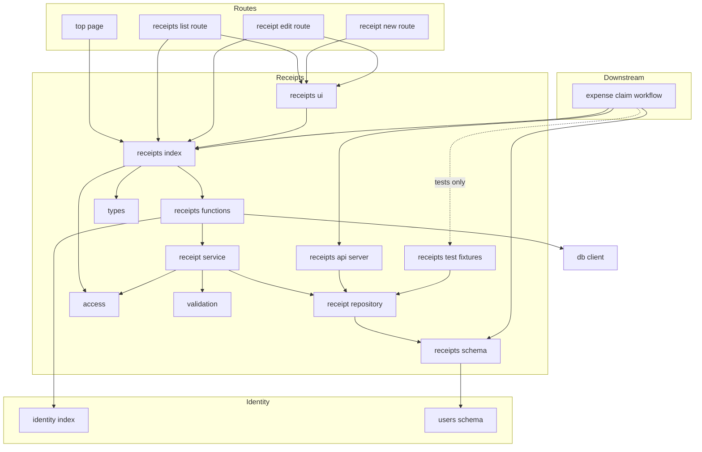
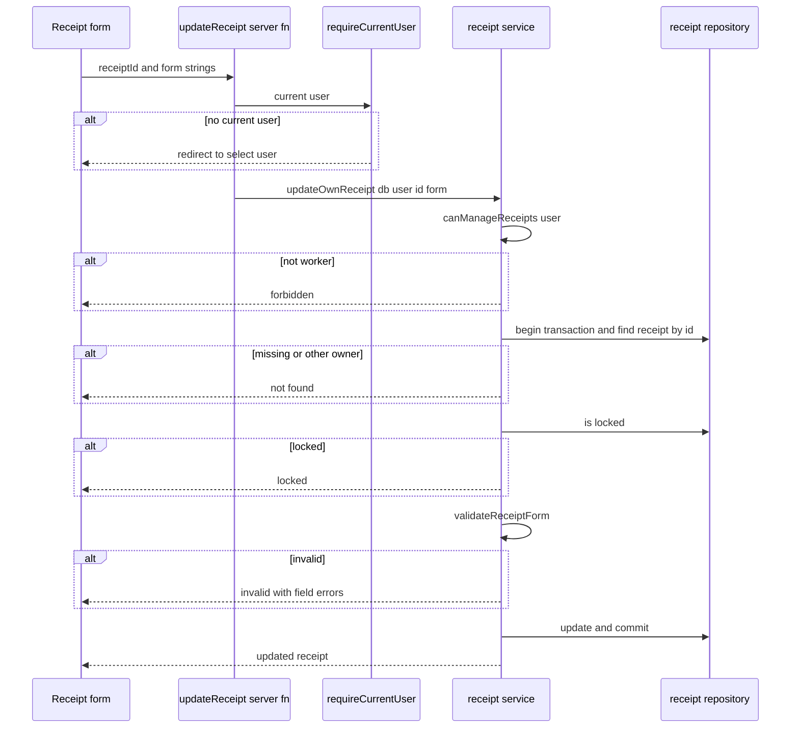
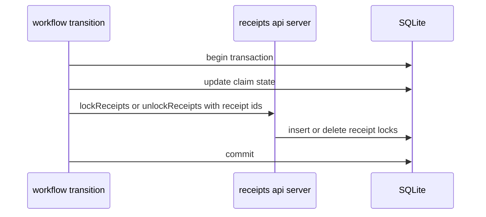
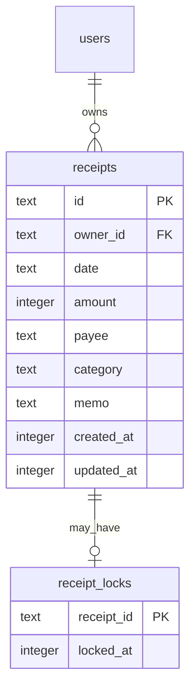

# Design Document: receipt-management

## Overview
**Purpose**: 作業者が、経費精算の材料となる自分の領収書（日付・金額・支払先・費目・メモ）を登録・一覧・編集・削除できるようにする。

**Users**: 作業者ロールを持つアプリ利用者が、`/receipts` 配下の画面で自分の領収書を管理する。後続の expense-claim-workflow の開発者は、サーバー側の公開面から領収書を参照し、申請に含めた領収書のロックを付け外しする。

**Impact**: 次のものを新設・変更する。

- 機能モジュール `src/receipts/`（型、入力検証、テーブル、サービス、Server Function、画面部品、下流向けの公開面、下流のテスト向けのフィクスチャ）
- 画面 `/receipts`、`/receipts/new`、`/receipts/$receiptId/edit`
- マイグレーション（`receipts`、`receipt_locks`）
- `eslint.config.js` の `MODULE_BOUNDARIES` への追加、トップ画面への導線

### Goals
- 作業者が自分の領収書だけを扱え、他人の領収書は存在すら分からない
- 入力の誤りを項目ごとに示し、誤った内容を保存しない
- ロックの判断を expense-claim-workflow に委ねたまま、ロック中の領収書の更新・削除を確実に拒否する。依存は workflow → receipts の一方向に保つ
- 下流が使ってよい契約（参照・ロックの付け外し・外部キーの規則）を本書で確定させる

### Non-Goals
- 領収書画像の添付・OCR
- 申請の作成・状態管理、どの申請状態でロックするかの判断
- 承認者による他人の領収書の閲覧（必要なら workflow が `@/receipts/api.server` を使って自分の画面で行う）
- 費目のマスタ管理画面
- 楽観ロック（同じ作業者の複数タブでの同時編集は後勝ち）
- 領収書の検索・絞り込み・ページ分割

## Boundary Commitments

### This Spec Owns
- **領収書のデータ**: `receipts` テーブル。領収書の項目・所有者の真実の情報源
- **ロックの記録**: `receipt_locks` テーブル。「この領収書はロック中か」の真実の情報源。ロックの理由（申請の状態）は持たない
- **入力検証**: 項目ごとの規則とエラーメッセージ、費目の定義（7 種類、コードと表示ラベル）
- **アクセス制御**: 作業者ロールの判定（`canManageReceipts`）、所有者の判定、ロック中の更新・削除の拒否
- **画面**: 領収書一覧、登録、編集（削除を含む）、トップ画面から一覧への導線
- **公開契約**:
  - `@/receipts`：Server Function（`listMyReceipts` / `getMyReceipt` / `createReceipt` / `updateReceipt` / `deleteReceipt`）、型、費目の定数、`canManageReceipts`
  - `@/receipts/schema`：外部キー参照のための `receipts`
  - `@/receipts/api.server`：下流のサーバーコード向けの `findReceiptsByIds` / `listReceiptsByOwner` / `lockReceipts` / `unlockReceipts`
  - `@/receipts/ui`：領収書の画面部品（ルートファイル向け）
  - `@/receipts/test-fixtures.server`：下流のテストファイル向けの `createTestReceipt` / `updateTestReceipt` / `deleteTestReceipt`（テストファイル専用。identity の `seed.server` と同じ扱い）

### Out of Boundary
- 申請・申請状態・申請と領収書の紐付け（expense-claim-workflow）
- いつロックし、いつロックを解くかの判断（expense-claim-workflow）
- 承認者向けに他人の領収書を見せるかどうかの判断（expense-claim-workflow）。`@/receipts/api.server` は所有者で絞らずに返すため、権限の確認は呼び出し側が行う
- ユーザー・ロール・現在ユーザーの管理（app-foundation）
- グローバルナビゲーション。本 spec はトップ画面に一覧への導線を置くだけにする

### Allowed Dependencies
- **外部**: app-foundation が導入済みのものだけを使う（TanStack Start / Router、React 19、Drizzle ORM 0.45、better-sqlite3、Tailwind CSS 4、Vitest、Playwright）。新しい依存は追加しない
- **上流の公開面**:
  - `@/identity`：`requireCurrentUser`、`User`、`UserId`、`Role`
  - `@/identity/schema`：`users`（外部キー参照のためだけ）
  - `@/db/client.server`：`getDb`、`AppDatabase`（サーバー専用ファイルからのみ）
  - テストファイルだけ：`@/db/test-utils.server`（`createTestDatabase`）、`@/identity/seed.server`（`SEED_USERS`、`seedUsers`）
- **依存方向（`src/receipts/` 内）**: 各層は左側の層だけを import する。

  `types` → `validation` → `access` → `schema` → `receipt-repository.server` → `receipt-service.server` → `receipts.functions` / `api.server` / `test-fixtures.server` → `index` → `ui/*` → `routes/_app/receipts/*` と `routes/_app/index.tsx`

  - `ui/*` はサーバー専用ファイル（`*.server.ts`）を import しない。Server Function は `@/receipts`（`index`）経由で使う
  - `api.server` は `receipt-repository.server` だけを使い、`receipt-service.server`（現在ユーザー前提の操作）を公開しない
  - `test-fixtures.server` は `types` と `receipt-repository.server` だけを使う。`index` / `api.server` / `ui` からは import しない
- **禁止**:
  - `src/receipts/` から expense-claim-workflow のモジュールを import しない。申請の状態名（下書き・申請中など）をコード・型・文言に持たない
  - `identity` と `db` は `receipts` を import しない

### Revalidation Triggers
次の変更は expense-claim-workflow の再検証を要する。

- `@/receipts/api.server` の関数の入力・出力・事前条件（特にロックの付け外しの意味、冪等性、存在しない ID の扱い）
- 型 `Receipt` / `ReceiptId` / `ReceiptCategory` と `RECEIPT_CATEGORIES` の変更
- `receipts.id` の型・採番方式、`receipts` の列の削除・改名
- 「ロック中の領収書は更新・削除できない」の意味、ロックの記録の持ち方
- 下流の外部キーに求める規則（`ON DELETE CASCADE`）
- `canManageReceipts` の判定規則（作業者ロール）
- `@/receipts/test-fixtures.server` の関数名・引数・戻り値・既定値の意味の変更（下流のテストが直接依存するため）

次の変更は、本 spec の中で吸収し、expense-claim-workflow の再検証を要しない。

- `receipts` への NOT NULL 列の追加・既定値の変更。`createTestReceipt` が既定値を補い、下流のテストは列を知らずに済む（下流が `receipts` に直接書き込まないことが前提。Downstream Contract 4）
- `receipt_locks` の列の追加・持ち方の変更（下流は `api.server` 経由でしか触れない）

app-foundation 側の次の変更は、本 spec の再検証を要する。

- `src/start.ts` の request middleware の構成（CSRF ミドルウェアの有無、順序）

## Architecture

### Existing Architecture Analysis
- app-foundation の機能モジュール方式に従う。現在ユーザーは `requireCurrentUser()` で得て、`*.functions.ts` のハンドラから `*.server.ts` の普通の関数に `db` と `user` を渡す
- `_app` 配下のルートはゲート済みで、コンテキストに `user: User` を持つ。画面のゲートはデータの保護ではないため、Server Function ごとに現在ユーザー・ロール・所有者を確かめる
- `src/start.ts` は独自の `startInstance` を定義しているため TanStack Start の既定の CSRF ミドルウェアが外れる。app-foundation が `createCsrfMiddleware` を明示的に登録しており、本 spec の変更系の Server Function もこれで保護される。本 spec は `src/start.ts` を変更しない（経緯は `research.md`）
- テスト専用の入口は identity の `seed.server` と同じ方式（`eslint.config.js` の `testOnly`）で、モジュールの外ではテストファイルからだけ import できるようにする

### Architecture Pattern & Boundary Map



**Architecture Integration**:
- **Selected pattern**: 機能モジュール（深いモジュール）。所有者・ロール・ロック・検証の判断を `receipt-service.server` に集め、画面と Server Function は結果を受け渡すだけにする
- **ロックの依存方向**: receipts がロックの記録を持ち、workflow が `lockReceipts` / `unlockReceipts` で付け外しを指示する。receipts は自分のテーブルだけを見て判定するため、workflow を import しない。ポートの実行時登録は採らない（Server Function の遅延読み込みで登録の時機が保証できず、登録漏れが無言で「ロックなし」になるため。比較は `research.md`）
- **Existing patterns preserved**: Server Function は薄く、判断は `*.server.ts`。結果は判別共用体。入力の形の検証は `validation.ts` の `parseXxxInput`。外部キーは `users.id` を参照
- **Steering compliance**: feature-first、公開面だけを見せる、`../` を使わない、マイグレーションはコミットする

### Technology Stack

| Layer | Choice / Version | Role in Feature | Notes |
|-------|------------------|-----------------|-------|
| Frontend | React 19、TanStack Router 1.170 | 一覧・フォーム・確認領域、ルートのローダー | `useServerFn`、`useHydrated`、`router.invalidate()` |
| Backend | TanStack Start 1.169（`createServerFn`） | Server Function（CSRF 保護は app-foundation の `src/start.ts`） | 新しい依存なし |
| Data / Storage | SQLite（better-sqlite3）+ Drizzle ORM 0.45 / drizzle-kit 0.31 | `receipts` / `receipt_locks`、マイグレーション | `npm run db:generate -- --name receipts` |
| Runtime | Node.js 24 | `crypto.randomUUID()`、`Intl.NumberFormat` | 標準 API |

## File Structure Plan

### Directory Structure
```
src/receipts/
├── index.ts                      # クライアントからも使える公開面：Server Function、型、費目の定数、canManageReceipts
├── types.ts                      # ReceiptId、ReceiptCategory、RECEIPT_CATEGORIES、RECEIPT_CATEGORY_LABELS、Receipt、ReceiptFormInput、ReceiptDraft、ReceiptField、ReceiptFieldErrors、各操作の結果型
├── validation.ts                 # parseReceiptFormInput / parseReceiptIdInput / parseUpdateReceiptInput（形の検証）、validateReceiptForm（項目の検証）、RECEIPT_LIMITS
├── access.ts                     # canManageReceipts(user)：作業者ロールの判定
├── schema.ts                     # receipts / receipt_locks テーブル定義（外部キー参照のため公開）
├── receipt-repository.server.ts  # SQL の唯一の所在：行 ↔ Receipt の変換、所有者・ID での取得、挿入・更新・削除、ロックの付け外しと判定（内部）
├── receipt-service.server.ts     # 現在ユーザーの操作：ロール・所有者・ロック・検証の判断とトランザクション（内部）
├── receipts.functions.ts         # Server Function：listMyReceipts / getMyReceipt / createReceipt / updateReceipt / deleteReceipt
├── api.server.ts                 # 下流のサーバーコード向けの公開面：findReceiptsByIds / listReceiptsByOwner / lockReceipts / unlockReceipts
├── test-fixtures.server.ts       # 下流のテストファイル専用：createTestReceipt / updateTestReceipt / deleteTestReceipt（リポジトリの上に作る）
└── ui/
    ├── index.ts                  # ルート向けの公開面：ReceiptList、ReceiptForm、ReceiptDetails、DeleteReceiptSection、WorkerRoleRequired、ReceiptNotFound、LockedNotice、formatYen、formatReceiptDate
    ├── format.ts                 # formatYen / formatReceiptDate（表示の書式。下流の画面も使えるよう ui/index から公開）
    ├── receipt-list.tsx          # 一覧の表、ロック中の表示、空の状態
    ├── receipt-form.tsx          # 登録・編集で共通のフォーム（送信、項目エラー、送信失敗の表示）
    ├── receipt-details.tsx       # ロック中の読み取り専用表示
    ├── delete-receipt-section.tsx  # 削除の確認領域
    └── notices.tsx               # WorkerRoleRequired / ReceiptNotFound / LockedNotice の文言部品

src/routes/_app/receipts/
├── index.tsx                     # /receipts：一覧（ローダーで listMyReceipts）
├── new.tsx                       # /receipts/new：登録
└── $receiptId.edit.tsx           # /receipts/$receiptId/edit：編集・削除（ローダーで getMyReceipt）

drizzle/
└── 0001_receipts.sql             # drizzle-kit generate の出力（メタ情報 drizzle/meta/ の更新を含む）

e2e/
└── receipts.spec.ts              # 登録・検証・一覧・編集・削除・所有者の分離・ロール不足・キーボード操作
```

テストファイルは対象と同じディレクトリに置く。

- `src/receipts/validation.test.ts`
- `src/receipts/access.test.ts`
- `src/receipts/receipt-repository.test.ts`
- `src/receipts/receipt-service.test.ts`
- `src/receipts/api.test.ts`（`api.server.ts` の契約）
- `src/receipts/test-fixtures.test.ts`（`test-fixtures.server.ts` の契約）
- `src/receipts/index.test.ts`（公開面）
- `src/receipts/ui/index.test.tsx`

### Modified Files
- `eslint.config.js` — `RESTRICT_RECEIPTS_INTERNAL`（`@/receipts/**` から `schema`、`ui`、`api.server`、`test-fixtures.server` を除く）と `RESTRICT_RECEIPTS_TEST_FIXTURES`（`@/receipts/test-fixtures.server` をテストファイル専用にする）を定義し、`MODULE_BOUNDARIES` に `{ dir: 'src/receipts', internal: [RESTRICT_RECEIPTS_INTERNAL], testOnly: [RESTRICT_RECEIPTS_TEST_FIXTURES], appShellOnly: [] }` を足す（定義は ReceiptsPublicApi の Implementation Notes）
- `src/routes/_app/index.tsx` — `canManageReceipts(user)` が真なら「領収書を管理する」リンク（`/receipts`）を表示する（8.4）
- `src/routeTree.gen.ts` — ルートの追加に伴う自動生成
- `.kiro/steering/structure.md` — import 境界の節に `@/receipts` の公開面（`index`、`schema`、`ui`、`api.server`、テストファイル専用の `test-fixtures.server`）を 1 行追記する

## System Flows

### 更新・削除の判定（Server Function → サービス）



**Key Decisions**:
- 判定の順序は「現在ユーザー → ロール → 存在と所有者 → ロック → 項目の検証」。ロック中なら入力の誤りより先にロック中を返し、存在しない・他人の領収書なら何も漏らさない
- 存在・所有者・ロックの確認と更新（削除）は 1 つのトランザクションで行う。画面を開いた後にロックされても、送信時の判定で拒否する（7.3）
- 削除も同じ順序で、項目の検証がないだけ
- 登録は「現在ユーザー → ロール → 項目の検証 → 挿入」
- 画面は結果を受けて次のように振る舞う
  - `created` / `updated` / `deleted`：`router.invalidate()` の後 `/receipts` へ遷移する
  - `invalid`：入力を保持したまま項目ごとにエラーを表示する
  - `locked`：ロック中である旨を `role="alert"` で表示し、`router.invalidate()` で編集画面を読み取り専用の表示に切り替える
  - `not-found`：見つからない旨を `role="alert"` で表示する
  - `forbidden`：作業者ロールが必要である旨を表示する
  - 例外（DB の障害など）：「保存できませんでした」を `role="alert"` で表示し、遷移しない（8.5）

### ロックの付け外し（下流との契約）



- workflow は状態遷移と同じトランザクションの中で付け外しを呼ぶ。better-sqlite3 は単一接続の同期 API のため、`db.transaction(() => { ... })` の中で同じ `db` を渡せば、`api.server` の処理も同じトランザクションに入る
- receipts 側の手順は Downstream Contract に定める

## Requirements Traceability

| Requirement | Summary | Components | Interfaces | Flows |
|-------------|---------|------------|------------|-------|
| 1.1 | 登録画面に 5 項目の入力欄 | NewRoute、ReceiptForm | — | — |
| 1.2 | 現在ユーザーを所有者として保存し一覧に表示 | ReceiptService、ReceiptRepository、ReceiptsFunctions、ReceiptForm | `createReceipt` | 更新・削除の判定 |
| 1.3 | 不正なら保存せず、入力を保持して項目ごとにエラー | ReceiptValidation、ReceiptService、ReceiptForm | `CreateReceiptResult` の `invalid` | 更新・削除の判定 |
| 1.4 | 再起動後も保持 | ReceiptsSchema（SQLite ファイル） | — | — |
| 2.1 | 日付の必須・実在 | ReceiptValidation | `validateReceiptForm` | — |
| 2.2 | 金額の必須・整数・範囲 | ReceiptValidation | `validateReceiptForm`、`RECEIPT_LIMITS` | — |
| 2.3 | 支払先の必須・100 文字 | ReceiptValidation | `validateReceiptForm` | — |
| 2.4 | 費目の必須・定義済み | ReceiptValidation、ReceiptTypes、ReceiptsSchema（CHECK） | `RECEIPT_CATEGORIES` | — |
| 2.5 | メモの 500 文字 | ReceiptValidation | `validateReceiptForm` | — |
| 2.6 | メモは任意 | ReceiptValidation、ReceiptsSchema（既定値 `''`） | — | — |
| 2.7 | 7 種類の費目をこの順で提示 | ReceiptTypes、ReceiptForm | `RECEIPT_CATEGORIES`、`RECEIPT_CATEGORY_LABELS` | — |
| 2.8 | 金額を桁区切りと「円」で表示 | ReceiptsUiFormat、ReceiptList、ReceiptDetails | `formatYen` | — |
| 2.9 | 支払先・メモの前後空白を除いて保存 | ReceiptValidation | `ReceiptDraft` | — |
| 2.10 | 登録と更新で同じ検証 | ReceiptService | `validateReceiptForm` | 更新・削除の判定 |
| 3.1 | 自分の領収書だけを 4 項目付きで一覧 | ListRoute、ReceiptList、ReceiptService、ReceiptRepository | `listMyReceipts` | — |
| 3.2 | 日付降順 → 登録降順 | ReceiptRepository | `findReceiptsByOwner` | — |
| 3.3 | 0 件なら空の表示と登録への導線 | ReceiptList | — | — |
| 3.4 | 一覧から編集・登録へ遷移 | ReceiptList、ListRoute | — | — |
| 3.5 | ロック中の表示 | ReceiptList、ReceiptRepository（`locked` の算出） | `Receipt.locked` | — |
| 3.6 | 切替後は新しいユーザーの領収書だけ | ReceiptsFunctions（毎回 `requireCurrentUser`）、ListRoute（ローダー） | `listMyReceipts` | — |
| 4.1 | 編集画面に現在の内容 | EditRoute、ReceiptForm | `getMyReceipt` | — |
| 4.2 | 更新して一覧に反映 | ReceiptService、ReceiptRepository、ReceiptForm | `updateReceipt` | 更新・削除の判定 |
| 4.3 | 不正なら更新せず項目ごとにエラー | ReceiptService、ReceiptForm | `UpdateReceiptResult` の `invalid` | 更新・削除の判定 |
| 4.4 | 所有者を変えない | ReceiptRepository（更新対象の列に `owner_id` を含めない）、ReceiptService | `updateReceipt` | — |
| 5.1 | 削除前に確認を求める | DeleteReceiptSection | — | — |
| 5.2 | 確認後に削除し一覧から消す | ReceiptService、ReceiptRepository、DeleteReceiptSection | `deleteReceipt` | 更新・削除の判定 |
| 5.3 | 確認を取り消せば保持 | DeleteReceiptSection | — | — |
| 6.1 | 作業者ロールだけに許可 | ReceiptAccess、ReceiptService | `canManageReceipts` | 更新・削除の判定 |
| 6.2 | ロール不足なら内容を出さず理由を表示 | WorkerRoleRequired、ListRoute、NewRoute、EditRoute | `forbidden` | — |
| 6.3 | 他人の領収書は存在しないのと同じ応答 | ReceiptService、ReceiptRepository | `not-found` | 更新・削除の判定 |
| 6.4 | 存在しない領収書は見つからない表示 | EditRoute（`notFound()`）、ReceiptNotFound、ReceiptForm | `not-found` | — |
| 6.5 | 未選択ならユーザー選択画面へ | ReceiptsFunctions | `requireCurrentUser` | 更新・削除の判定 |
| 6.6 | 要求ごとに所有者とロールを確認 | ReceiptsFunctions、ReceiptService | すべての Server Function | 更新・削除の判定 |
| 7.1 | ロック中は更新・削除を拒否し理由を表示 | ReceiptService、ReceiptRepository、ReceiptsSchema（RESTRICT）、LockedNotice | `locked` | 更新・削除の判定 |
| 7.2 | ロック中の編集画面は読み取り専用 | EditRoute、ReceiptDetails、LockedNotice | `Receipt.locked` | — |
| 7.3 | 画面表示後のロックも送信時に拒否 | ReceiptService（トランザクション内の判定）、ReceiptForm、DeleteReceiptSection | `locked` | 更新・削除の判定 |
| 7.4 | ロック解除後は再び受け付ける | ReceiptRepository、ReceiptsDownstreamApi | `unlockReceipts` | ロックの付け外し |
| 7.5 | ロックの判断は申請機能に従う | ReceiptsDownstreamApi、ReceiptsTestFixtures、Downstream Contract | `lockReceipts` / `unlockReceipts`、`createTestReceipt` | ロックの付け外し |
| 7.6 | 申請機能がなければ全件ロックなし | ReceiptsSchema（`receipt_locks` は空で始まる） | — | — |
| 8.1 | キーボードだけで操作可能 | ReceiptList、ReceiptForm、DeleteReceiptSection | — | — |
| 8.2 | ラベルとエラーの関連付け | ReceiptForm | — | — |
| 8.3 | 処理中の二重送信防止 | ReceiptForm、DeleteReceiptSection | — | — |
| 8.4 | トップ画面に一覧への導線（作業者のみ） | TopPage | `canManageReceipts` | — |
| 8.5 | 保存先の障害時は失敗を表示 | ReceiptForm、DeleteReceiptSection | — | 更新・削除の判定 |

## Components and Interfaces

| Component | Domain/Layer | Intent | Req Coverage | Key Dependencies (P0/P1) | Contracts |
|-----------|--------------|--------|--------------|--------------------------|-----------|
| ReceiptTypes | receipts | 領収書・費目・結果の型と定数 | 2.4, 2.7, 3.5 | `@/identity` の `UserId` (P0) | — |
| ReceiptValidation | receipts | 入力の形と項目の検証 | 1.3, 2.1–2.6, 2.9, 2.10, 4.3 | ReceiptTypes (P0) | Service |
| ReceiptAccess | receipts | 作業者ロールの判定 | 6.1, 8.4 | `@/identity` の `User` (P0) | Service |
| ReceiptsSchema | receipts | `receipts` / `receipt_locks` | 1.4, 2.4, 2.6, 7.1, 7.6 | `@/identity/schema` (P0) | State |
| ReceiptRepository | receipts（内部） | SQL の唯一の所在 | 1.2, 3.1, 3.2, 3.5, 4.4, 5.2, 7.1, 7.4 | DbClient (P0), ReceiptsSchema (P0) | Service |
| ReceiptService | receipts（内部） | 現在ユーザーの操作の判断 | 1.2, 1.3, 2.10, 3.1, 4.2–4.4, 5.2, 6.1, 6.3, 6.6, 7.1, 7.3 | ReceiptRepository (P0), ReceiptValidation (P0), ReceiptAccess (P0) | Service |
| ReceiptsFunctions | receipts | 画面向けの Server Function | 1.2, 3.1, 3.6, 4.1, 4.2, 5.2, 6.5, 6.6 | `@/identity` (P0), ReceiptService (P0), DbClient (P0) | API |
| ReceiptsDownstreamApi | receipts | 下流のサーバーコード向けの参照とロック | 7.4, 7.5 | ReceiptRepository (P0) | Service |
| ReceiptsTestFixtures | receipts（テスト専用） | 下流のテストが `receipts` に直接書き込まずに領収書を用意・変更・削除する入口 | 7.5 | ReceiptRepository (P0) | Service |
| ReceiptsPublicApi | receipts | クライアントからも使える公開面 | 6.1, 8.4 | ReceiptsFunctions (P0) | Service |
| ReceiptsUi | receipts/ui | 一覧・フォーム・詳細・削除確認・通知 | 1.1, 1.3, 2.7, 2.8, 3.1, 3.3–3.5, 4.1, 5.1–5.3, 6.2, 6.4, 7.1–7.3, 8.1–8.3, 8.5 | ReceiptsPublicApi (P0), TanStack Router (P0) | — |
| ListRoute / NewRoute / EditRoute | routes | 画面の組み立てとデータ取得 | 1.1, 3.1, 3.4, 3.6, 4.1, 6.2, 6.4, 7.2 | ReceiptsUi (P0), ReceiptsPublicApi (P0) | — |
| TopPage（変更） | routes | 一覧への導線 | 8.4 | ReceiptsPublicApi (P0) | — |

### receipts

#### ReceiptTypes（`types.ts`）

```typescript
import type { UserId } from '@/identity';

export type ReceiptId = string & { readonly __brand: 'ReceiptId' };

export const RECEIPT_CATEGORIES = [
  'transportation',
  'lodging',
  'meeting',
  'entertainment',
  'supplies',
  'communication',
  'other',
] as const;
export type ReceiptCategory = (typeof RECEIPT_CATEGORIES)[number];

export const RECEIPT_CATEGORY_LABELS: Readonly<Record<ReceiptCategory, string>> = {
  transportation: '交通費',
  lodging: '宿泊費',
  meeting: '会議費',
  entertainment: '交際費',
  supplies: '消耗品費',
  communication: '通信費',
  other: 'その他',
};

export interface Receipt {
  readonly id: ReceiptId;
  readonly ownerId: UserId;
  /** YYYY-MM-DD（実在する日付） */
  readonly date: string;
  /** 日本円。1 以上 9,999,999 以下の整数 */
  readonly amount: number;
  readonly payee: string;
  readonly category: ReceiptCategory;
  /** 未入力は空文字 */
  readonly memo: string;
  /** ロック中なら true。理由（申請の状態）は持たない */
  readonly locked: boolean;
}

/** フォームから届く生の値。すべて文字列 */
export interface ReceiptFormInput {
  readonly date: string;
  readonly amount: string;
  readonly payee: string;
  readonly category: string;
  readonly memo: string;
}

/** 検証済みの項目（保存する値） */
export interface ReceiptDraft {
  readonly date: string;
  readonly amount: number;
  readonly payee: string;
  readonly category: ReceiptCategory;
  readonly memo: string;
}

export type ReceiptField = keyof ReceiptFormInput;
export type ReceiptFieldErrors = Readonly<Partial<Record<ReceiptField, string>>>;

export type ListMyReceiptsResult =
  | { readonly status: 'ok'; readonly receipts: readonly Receipt[] }
  | { readonly status: 'forbidden' };

export type GetMyReceiptResult =
  | { readonly status: 'ok'; readonly receipt: Receipt }
  | { readonly status: 'not-found' }
  | { readonly status: 'forbidden' };

export type CreateReceiptResult =
  | { readonly status: 'created'; readonly receipt: Receipt }
  | { readonly status: 'invalid'; readonly errors: ReceiptFieldErrors }
  | { readonly status: 'forbidden' };

export type UpdateReceiptResult =
  | { readonly status: 'updated'; readonly receipt: Receipt }
  | { readonly status: 'invalid'; readonly errors: ReceiptFieldErrors }
  | { readonly status: 'locked' }
  | { readonly status: 'not-found' }
  | { readonly status: 'forbidden' };

export type DeleteReceiptResult =
  | { readonly status: 'deleted' }
  | { readonly status: 'locked' }
  | { readonly status: 'not-found' }
  | { readonly status: 'forbidden' };
```
- すべてプレーンなオブジェクト・文字列・数値・真偽値で、Server Function の戻り値としてシリアライズできる
- 申請の状態を表す型・値を持たない

#### ReceiptValidation（`validation.ts`）

| Field | Detail |
|-------|--------|
| Intent | ブラウザから届く入力の形を確かめ、項目ごとの規則で `ReceiptDraft` に変換する |
| Requirements | 1.3, 2.1, 2.2, 2.3, 2.4, 2.5, 2.6, 2.9, 2.10, 4.3 |

**Contracts**: Service [x]

```typescript
export const RECEIPT_LIMITS = {
  amountMin: 1,
  amountMax: 9_999_999,
  payeeMaxLength: 100,
  memoMaxLength: 500,
} as const;

/** 5 項目がすべて文字列であれば返し、そうでなければ Error を投げる（Server Function の validator）。 */
export function parseReceiptFormInput(input: unknown): ReceiptFormInput;

/** { receiptId } が空でない文字列であれば返し、そうでなければ Error を投げる。存在確認はしない。 */
export function parseReceiptIdInput(input: unknown): { readonly receiptId: string };

/** { receiptId, form } の形を確かめる（updateReceipt の validator）。 */
export function parseUpdateReceiptInput(
  input: unknown,
): { readonly receiptId: string; readonly form: ReceiptFormInput };

export type ReceiptValidationResult =
  | { readonly ok: true; readonly draft: ReceiptDraft }
  | { readonly ok: false; readonly errors: ReceiptFieldErrors };

/** 項目ごとの規則で検証する。すべての項目を検証し、誤りのある項目すべてのメッセージを返す。 */
export function validateReceiptForm(form: ReceiptFormInput): ReceiptValidationResult;
```

**項目の規則とメッセージ**（文字数はコードポイント単位で数える）

| 項目 | 前処理 | 規則 | メッセージ |
|------|--------|------|------------|
| date | 前後の空白を除く | 空 → 誤り（2.1） | 日付を入力してください |
| | | `YYYY-MM-DD` の形で、実在する日付（例：`2026-02-30` は誤り）（2.1） | 実在する日付を入力してください |
| amount | 前後の空白を除く | 空 → 誤り（2.2） | 金額を入力してください |
| | | 半角数字だけでない（小数点・符号・桁区切り・全角数字を含む）→ 誤り（2.2） | 金額は半角数字の整数で入力してください |
| | | 1 未満または 9,999,999 超 → 誤り（2.2） | 金額は 1 円以上 9,999,999 円以下で入力してください |
| payee | 前後の空白を除く（2.9） | 空 → 誤り（2.3） | 支払先を入力してください |
| | | 100 文字超 → 誤り（2.3） | 支払先は 100 文字以内で入力してください |
| category | なし | `RECEIPT_CATEGORIES` のいずれでもない（空を含む）→ 誤り（2.4） | 費目を選択してください |
| memo | 前後の空白を除く（2.9） | 500 文字超 → 誤り（2.5）。空は可（2.6） | メモは 500 文字以内で入力してください |

- 純粋関数。DB を使わない
- 登録と更新はどちらも `validateReceiptForm` を通す（2.10）
- 金額の桁数が大きい入力（例：20 桁）でも、数値に変換する前に桁数で範囲外と判定し、精度落ちで範囲内に見えないようにする

#### ReceiptAccess（`access.ts`）

```typescript
import type { User } from '@/identity';

/** 作業者ロールを持つユーザーだけが領収書を管理できる。 */
export function canManageReceipts(user: Pick<User, 'roles'>): boolean;
```
- 判定規則はこの関数だけに置く。サービス・画面・トップ画面の導線が共通で使う（6.1, 6.2, 8.4）

#### ReceiptsSchema（`schema.ts`）

| Field | Detail |
|-------|--------|
| Intent | 領収書とロックの記録の永続化構造 |
| Requirements | 1.4, 2.4, 2.6, 7.1, 7.6 |

**Contracts**: State [x]
- **State model**: 「Data Models」節を参照
- **Persistence & consistency**:
  - 費目は CHECK 制約で 7 値に限定し、金額は CHECK 制約で 1〜9,999,999 に限定する（検証の最後の防衛線）
  - `receipt_locks.receipt_id` は `receipts.id` を `ON DELETE RESTRICT` で参照する。ロック中の領収書は DB 上も削除できない
- `@/receipts/schema` は `receipts` と `receiptLocks`（`receipt_locks` テーブル）を export する
  - `receipts` は下流の外部キー参照（`receipts.id`）のために公開する。下流は `receipts` を外部キー参照以外に使わない（読み書きは Downstream Contract 4）
  - `receiptLocks` は drizzle-kit がテーブルを検出してマイグレーションを生成するためだけに export する。下流は `receiptLocks` を import せず、直接読み書きしてはならない。ロックの判定・付け外しは必ず `@/receipts/api.server` を使う
- drizzle-kit がこのファイルを直接読み込むため、`*.server.ts` にしない

#### ReceiptRepository（内部、`receipt-repository.server.ts`）

| Field | Detail |
|-------|--------|
| Intent | `receipts` / `receipt_locks` への SQL を一か所に集め、行を `Receipt` に変換する |
| Requirements | 1.2, 3.1, 3.2, 3.5, 4.4, 5.2, 7.1, 7.4 |

**Contracts**: Service [x]

```typescript
import type { AppDatabase } from '@/db/client.server';
import type { UserId } from '@/identity';

/** 所有者の領収書を、日付の降順 → 作成日時の降順 → ID の降順で返す。 */
export function findReceiptsByOwner(db: AppDatabase, ownerId: UserId): readonly Receipt[];

/** ID で 1 件返す。所有者で絞らない。未検証の文字列を受け取る。 */
export function findReceiptById(db: AppDatabase, id: string): Receipt | undefined;

/** 指定した ID のうち存在するものを、引数の順序で返す。重複した ID は 1 件にまとめる。 */
export function findReceiptsByIds(db: AppDatabase, ids: readonly string[]): readonly Receipt[];

/** 新しい ID（crypto.randomUUID()）と作成・更新日時を付けて挿入する。ロックなしで返す。 */
export function insertReceipt(db: AppDatabase, ownerId: UserId, draft: ReceiptDraft): Receipt;

/** 項目と更新日時だけを更新する。owner_id は更新しない。 */
export function updateReceiptRow(db: AppDatabase, id: ReceiptId, draft: ReceiptDraft): Receipt;

export function deleteReceiptRow(db: AppDatabase, id: ReceiptId): void;

/** ロックを付ける。既にロック中の ID は変えない。存在しない ID があれば Error を投げる（外部キー違反）。 */
export function insertLocks(db: AppDatabase, ids: readonly ReceiptId[]): void;

/** ロックを外す。ロックされていない ID は無視する。 */
export function deleteLocks(db: AppDatabase, ids: readonly ReceiptId[]): void;
```
- `locked` は `receipt_locks` との左外部結合で算出する
- 作成・更新日時はミリ秒の整数（`Date.now()`）。`Receipt` 型には出さない
- 書き込みの関数は呼び出し側のトランザクションの中で呼ばれる前提で、自分ではトランザクションを開始しない

#### ReceiptService（内部、`receipt-service.server.ts`）

| Field | Detail |
|-------|--------|
| Intent | 現在ユーザーによる操作について、ロール・存在と所有者・ロック・入力をこの順で判定し、トランザクションの中で反映する |
| Requirements | 1.2, 1.3, 2.10, 3.1, 4.2, 4.3, 4.4, 5.2, 6.1, 6.3, 6.6, 7.1, 7.3 |

**Contracts**: Service [x]

```typescript
import type { AppDatabase } from '@/db/client.server';
import type { User } from '@/identity';

export function listOwnReceipts(db: AppDatabase, user: User): ListMyReceiptsResult;
export function getOwnReceipt(db: AppDatabase, user: User, receiptId: string): GetMyReceiptResult;
export function createOwnReceipt(db: AppDatabase, user: User, form: ReceiptFormInput): CreateReceiptResult;
export function updateOwnReceipt(
  db: AppDatabase,
  user: User,
  receiptId: string,
  form: ReceiptFormInput,
): UpdateReceiptResult;
export function deleteOwnReceipt(db: AppDatabase, user: User, receiptId: string): DeleteReceiptResult;
```
- Preconditions: `user` は `requireCurrentUser()` で得た実在のユーザー
- Postconditions:
  - `canManageReceipts(user)` が偽なら、DB を読み書きせずに `forbidden`（6.1）
  - 対象が存在しない、または `ownerId !== user.id` なら `not-found`。両者を区別しない（6.3, 6.4）
  - 対象がロック中なら `locked`。入力の検証より先に判定する（7.1, 7.3）
  - `invalid` / `locked` / `not-found` / `forbidden` の場合、DB を変更しない（1.3, 4.3）
  - 更新後の所有者は更新前と同じ（4.4）
- Invariants: 存在・所有者・ロックの確認と書き込みは 1 回の `db.transaction` の中で行う

#### ReceiptsFunctions（`receipts.functions.ts`）

| Field | Detail |
|-------|--------|
| Intent | 画面から呼ぶ Server Function。現在ユーザーを取り、サービスに渡すだけ |
| Requirements | 1.2, 3.1, 3.6, 4.1, 4.2, 5.2, 6.5, 6.6 |

**Contracts**: API [x]

##### API Contract
| Method | Endpoint | Request | Response | Errors |
|--------|----------|---------|----------|--------|
| Server Function（GET） | `listMyReceipts` | なし | `ListMyReceiptsResult` | 未選択 → `/select-user` へのリダイレクト、DB 障害 → 例外 |
| Server Function（GET） | `getMyReceipt` | `{ receiptId: string }` | `GetMyReceiptResult` | 同上、形が不正 → 検証エラー |
| Server Function（POST） | `createReceipt` | `ReceiptFormInput` | `CreateReceiptResult` | 同上 |
| Server Function（POST） | `updateReceipt` | `{ receiptId: string; form: ReceiptFormInput }` | `UpdateReceiptResult` | 同上 |
| Server Function（POST） | `deleteReceipt` | `{ receiptId: string }` | `DeleteReceiptResult` | 同上 |

```typescript
export const updateReceipt = createServerFn({ method: 'POST' })
  .validator(parseUpdateReceiptInput)
  .handler(async ({ data }): Promise<UpdateReceiptResult> => {
    const user = await requireCurrentUser();
    return updateOwnReceipt(getDb(), user, data.receiptId, data.form);
  });
```
- すべてのハンドラは先頭で `await requireCurrentUser()` を呼ぶ（6.5, 6.6）。他の 4 つも同じ形
- `getDb()` と `requireCurrentUser()` を呼ぶのはこのファイルだけ（steering の規約）
- 変更系は POST。CSRF ミドルウェア（`src/start.ts`）で同一オリジン以外からの呼び出しを拒否する

#### ReceiptsDownstreamApi（`api.server.ts`）

| Field | Detail |
|-------|--------|
| Intent | 下流（expense-claim-workflow）のサーバーコードが使ってよい唯一の入口 |
| Requirements | 7.4, 7.5 |

**Contracts**: Service [x]

```typescript
import type { AppDatabase } from '@/db/client.server';
import type { UserId } from '@/identity';

/**
 * 指定 ID の領収書を引数の順で返す。所有者で絞らない。
 * 未検証の文字列を受け取る（下流は申請の入力から届いた ID をそのまま渡してよい）。
 * 存在しない ID・形式が不正な ID は結果に含めず、Error も投げない。重複した ID は 1 件にまとめる。
 */
export function findReceiptsByIds(db: AppDatabase, ids: readonly string[]): readonly Receipt[];

/** 所有者の領収書を、一覧画面と同じ順序で返す。 */
export function listReceiptsByOwner(db: AppDatabase, ownerId: UserId): readonly Receipt[];

/** 指定した領収書をロック中にする。冪等。存在しない ID が含まれれば Error を投げ、何もロックしない。 */
export function lockReceipts(db: AppDatabase, ids: readonly ReceiptId[]): void;

/** 指定した領収書のロックを外す。冪等。ロックされていない・存在しない ID は無視する。 */
export function unlockReceipts(db: AppDatabase, ids: readonly ReceiptId[]): void;
```
- 参照は未検証の `string` を受け、付け外しはブランド型 `ReceiptId` を受ける。下流は `findReceiptsByIds` で存在を確かめて得た `Receipt.id` を `lockReceipts` / `unlockReceipts` に渡す（未検証の文字列を `ReceiptId` にキャストしない）
- `lockReceipts` / `unlockReceipts` は内部で `db.transaction` を開始する。呼び出し側のトランザクションの中で呼ばれた場合は、better-sqlite3 の入れ子のトランザクション（SAVEPOINT）として外側に含まれる
- 権限の確認をしない。呼び出し側（workflow の Server Function・サービス）が、現在ユーザーがその領収書を参照・ロックしてよいかを判断する
- サーバー専用（`*.server.ts`）。クライアントから import するとビルドエラーになる

##### Downstream Contract（expense-claim-workflow が守ること）
1. **ロックの判断**: どの申請状態で領収書をロックするかは workflow が決める。receipts は状態を解釈しない。想定する使い方は次のとおり（確定は workflow の design が行う）
   - 申請を提出・再提出するとき、その申請の全領収書に `lockReceipts`
   - 差し戻すとき、その申請の全領収書に `unlockReceipts`（作業者が修正できるようにする）
   - 承認済みはロックを解かない
   - 下書きの申請に含まれる領収書はロックしない
2. **トランザクション**: 付け外しは、申請の状態を変える書き込みと同じ `db.transaction` の中で呼ぶ。状態とロックの記録が食い違う時間を作らない
3. **外部キー**: 下流のテーブルが `receipts.id` を参照するときは `ON DELETE CASCADE` にする。ロックされていない領収書の削除（要件 5.2）を妨げないため。ロック中の領収書は receipts が削除させない
4. **書き込み経路**: `receipts` と `receipt_locks` に直接読み書きしない（`receiptLocks` は import もしない）。参照は `findReceiptsByIds` / `listReceiptsByOwner`、外部キーは `@/receipts/schema` の `receipts.id` だけを使う。下流のテストでも同じで、領収書の用意・変更・削除は `@/receipts/test-fixtures.server` の `createTestReceipt` / `updateTestReceipt` / `deleteTestReceipt`、ロックの付け外しは `lockReceipts` / `unlockReceipts` を使い、`receipts` テーブルに INSERT・UPDATE・DELETE しない（`receipts` の列の追加を receipts の中で吸収するため。Revalidation Triggers 参照）
5. **表示**: 申請の画面で領収書の項目を表示するときは、`@/receipts` の `RECEIPT_CATEGORY_LABELS` と `@/receipts/ui` の表示部品・書式を使ってよい
6. **既定**: workflow が一度も `lockReceipts` を呼ばない限り、すべての領収書はロックされていない（要件 7.6）

#### ReceiptsTestFixtures（`test-fixtures.server.ts`、テストファイル専用）

| Field | Detail |
|-------|--------|
| Intent | 下流（expense-claim-workflow）のテストが、`receipts` テーブルに直接書き込まずに領収書を用意・変更・削除する唯一の入口 |
| Requirements | 7.5 |

**Contracts**: Service [x]

```typescript
import type { AppDatabase } from '@/db/client.server';
import type { UserId } from '@/identity';

/**
 * 所有者 ownerId の領収書を 1 件挿入し、ロックなしの Receipt を返す。
 * overrides で指定しなかった項目は、検証規則を満たす既定値（固定の日付・金額・支払先・費目、メモは空）で補う。
 */
export function createTestReceipt(
  db: AppDatabase,
  ownerId: UserId,
  overrides?: Partial<ReceiptDraft>,
): Receipt;

/** 既存の領収書の項目を patch で上書きし、更新後の Receipt を返す。所有者は変えない。存在しない ID なら Error を投げる。 */
export function updateTestReceipt(
  db: AppDatabase,
  id: ReceiptId,
  patch: Partial<ReceiptDraft>,
): Receipt;

/** 領収書を削除する。存在しない ID なら Error を投げる。ロック中なら外部キー（RESTRICT）違反の Error になる。 */
export function deleteTestReceipt(db: AppDatabase, id: ReceiptId): void;
```
- `receipt-repository.server` の `insertReceipt` / `findReceiptById` / `updateReceiptRow` / `deleteReceiptRow` の上に作り、SQL を持たない。各関数は自分で `db.transaction` を開始する（呼び出し側のトランザクションの中では入れ子）
- 現在ユーザー・ロール・ロックの判定はしない（テストの前提を作るための入口であり、`receipt-service.server` の判断を通さない）。`ownerId` は `seedUsers(db)` 済みのユーザーであることが前提（外部キー）
- 項目の検証（`validateReceiptForm`）は通さない。範囲外の金額・未定義の費目は DB の CHECK 制約で Error になる
- `receipts` に列が増えたときは、本ファイルの既定値で補う。下流のテストは変えずに済む（Revalidation Triggers）
- import できるのは `src/receipts/` 自身と、モジュールの外のテストファイル（`*.test.ts` / `*.test.tsx`）だけ（`eslint.config.js` の `testOnly`）。サーバー専用（`*.server.ts`）

#### ReceiptsPublicApi（`index.ts`）

```typescript
export {
  listMyReceipts,
  getMyReceipt,
  createReceipt,
  updateReceipt,
  deleteReceipt,
} from './receipts.functions';
export { canManageReceipts } from './access';
export { RECEIPT_CATEGORIES, RECEIPT_CATEGORY_LABELS } from './types';
export type {
  ReceiptId,
  ReceiptCategory,
  Receipt,
  ReceiptFormInput,
  ReceiptField,
  ReceiptFieldErrors,
  ListMyReceiptsResult,
  GetMyReceiptResult,
  CreateReceiptResult,
  UpdateReceiptResult,
  DeleteReceiptResult,
} from './types';
```
- サーバー専用のコード（リポジトリ、サービス、`api.server`、`getDb`）を再エクスポートしない。クライアントから import しても安全
- `RECEIPT_LIMITS` と `validateReceiptForm` は公開しない（検証はサーバーで行う）

**Implementation Notes**
- `eslint.config.js` に次を足す
  ```js
  const RESTRICT_RECEIPTS_INTERNAL = {
    group: [
      '@/receipts/**',
      '!@/receipts/schema',
      '!@/receipts/ui',
      '!@/receipts/api.server',
      '!@/receipts/test-fixtures.server',
    ],
    message: '`@/receipts` の内部モジュールは import できません。`@/receipts`、`@/receipts/ui`、サーバーコードなら `@/receipts/api.server`、外部キー参照なら `@/receipts/schema` を使ってください。',
  }

  const RESTRICT_RECEIPTS_TEST_FIXTURES = {
    group: ['@/receipts/test-fixtures.server'],
    message: '`@/receipts/test-fixtures.server` はテストファイル（`*.test.ts` / `*.test.tsx`）専用です。',
  }
  ```
  `MODULE_BOUNDARIES` に `{ dir: 'src/receipts', internal: [RESTRICT_RECEIPTS_INTERNAL], testOnly: [RESTRICT_RECEIPTS_TEST_FIXTURES], appShellOnly: [] }` を追加する。`test-fixtures.server` を internal から除外し testOnly で制限する形は、identity の `seed.server`（`RESTRICT_IDENTITY_INTERNAL` の除外と `RESTRICT_IDENTITY_SEED`）と同じ
- `src/receipts/` 自身のファイルは、上の階層のファイルも `@/receipts/...` のエイリアスで参照する（`ui/` から `@/receipts` など）

### receipts/ui

`@/receipts/ui` から公開する。データは props で受け取り、Server Function は `useServerFn` で `@/receipts` から使う。新しい境界は持たないため、振る舞いの要点だけを記す。

```typescript
interface ReceiptFormProps {
  readonly mode: 'create' | 'edit';
  /** edit のときだけ。初期値と送信先の ID */
  readonly receipt?: Receipt;
}
interface ReceiptListProps {
  readonly receipts: readonly Receipt[];
}
interface ReceiptDetailsProps {
  readonly receipt: Receipt;
}
interface DeleteReceiptSectionProps {
  readonly receiptId: ReceiptId;
}
```

- **ReceiptList**（2.8, 3.1, 3.3, 3.4, 3.5, 8.1）
  - 0 件なら「登録された領収書はありません」と「領収書を登録する」リンク（`/receipts/new`）を表示する
  - 1 件以上なら `<table>`（`<caption>` は「自分の領収書」）で、列は日付・金額・支払先・費目・状態・操作
  - 金額は `formatYen`（例：`1,234円`）、日付は `formatReceiptDate`（例：`2026/10/16`）、費目は `RECEIPT_CATEGORY_LABELS`
  - ロック中の行は状態列に「ロック中」と表示する。ロックされていない行は空欄
  - 操作列に `<Link to="/receipts/$receiptId/edit">`。アクセシブルネームは「{日付} {支払先} の領収書を開く」。ロック中でも開ける（読み取り専用の表示になる）
  - 並び順は受け取った配列の順（サーバーが決める）
- **ReceiptForm**（1.1, 1.3, 2.7, 4.1, 4.3, 8.1, 8.2, 8.3, 8.5）
  - 入力欄：日付（`type="date"`）、金額（`type="text"`、`inputMode="numeric"`、後ろに「円」）、支払先（`type="text"`）、費目（`<select>`、先頭に値が空の「選択してください」、続けて `RECEIPT_CATEGORIES` の順に 7 件）、メモ（`<textarea>`、任意と明記）
  - 各入力欄は `<label htmlFor>` で名前を付ける。必須項目は `aria-required="true"`
  - 入力値はコンポーネントの状態に文字列で持ち、送信結果が `invalid` でも消さない
  - `invalid` のとき、誤りのある入力欄に `aria-invalid="true"` と、エラー文の要素を指す `aria-describedby` を付ける。フォームの先頭に `role="alert"` で「入力内容を確認してください」を出し、最初の誤りのある入力欄にフォーカスを移す
  - 送信ボタンは「登録する」（create）／「更新する」（edit）。`useHydrated()` が偽の間と送信中は `disabled`
  - 結果の扱いは System Flows の Key Decisions のとおり。例外は catch して「保存できませんでした。時間をおいてもう一度お試しください」を `role="alert"` で表示し、遷移しない
  - 「キャンセル」リンクで `/receipts` に戻る
- **ReceiptDetails**（2.8, 7.2）
  - 読み取り専用の `<dl>` で 5 項目を表示する。メモが空なら「なし」
- **DeleteReceiptSection**（5.1, 5.2, 5.3, 7.3, 8.1, 8.3, 8.5）
  - 初期表示は「この領収書を削除」ボタンだけ
  - 押すと確認領域（`role="group"`、`aria-labelledby` で「この領収書を削除しますか？」を指す）を表示し、その見出しにフォーカスを移す。確認領域には「削除する」「キャンセル」ボタン
  - 「キャンセル」で確認領域を閉じ、「この領収書を削除」ボタンにフォーカスを戻す。何も送信しない
  - 「削除する」で `deleteReceipt` を送る。送信中と `useHydrated()` が偽の間は両ボタンを `disabled`
  - 結果の扱いは ReceiptForm と同じ（`deleted` は一覧へ、`locked` は表示を切り替える、例外は「削除できませんでした。時間をおいてもう一度お試しください」）
- **Notices**（`notices.tsx`。6.2, 6.4, 7.1, 7.2）
  - `WorkerRoleRequired`：「領収書を管理するには作業者ロールが必要です」と、ユーザー切替画面（`/select-user`）へのリンク
  - `ReceiptNotFound`：「領収書が見つかりません」と一覧へのリンク
  - `LockedNotice`：「この領収書はロック中のため、編集・削除できません」（`role="status"`）
- **format.ts**（`@/receipts/ui` から公開。下流の申請画面も同じ書式で表示できるようにする）
  - `formatYen(amount: number): string`：`Intl.NumberFormat('ja-JP')` で桁区切りし、末尾に「円」
  - `formatReceiptDate(date: string): string`：`YYYY-MM-DD` を `YYYY/MM/DD` にする

### routes

- **ListRoute**（`src/routes/_app/receipts/index.tsx`、パス `/receipts`。3.1, 3.4, 3.6, 6.2）
  - `loader`: `listMyReceipts()`
  - 見出し「領収書」と「領収書を登録する」リンク（1 件以上のとき。0 件のときは ReceiptList の空の表示が導線を持つ）
  - 結果が `forbidden` なら `WorkerRoleRequired` だけを表示する
  - ルーターの `defaultGcTime: 0` により、ユーザー切替後の遷移でローダーが再実行される（3.6）
- **NewRoute**（`src/routes/_app/receipts/new.tsx`、パス `/receipts/new`。1.1, 6.2）
  - ローダーなし。コンテキストの `user` で `canManageReceipts` が偽なら `WorkerRoleRequired`、真なら見出し「領収書を登録」と `ReceiptForm mode="create"`
  - 送信時もサーバーが `forbidden` を返しうる（別のタブでの切替）。ReceiptForm がその結果を表示する
- **EditRoute**（`src/routes/_app/receipts/$receiptId.edit.tsx`、パス `/receipts/$receiptId/edit`。4.1, 6.2, 6.4, 7.2）
  - `loader`: `getMyReceipt({ data: { receiptId: params.receiptId } })`。`not-found` なら `throw notFound()`
  - `notFoundComponent`: `ReceiptNotFound`
  - `forbidden` なら `WorkerRoleRequired`
  - `ok` かつ `receipt.locked` なら、見出し「領収書」、`LockedNotice`、`ReceiptDetails`、一覧へ戻るリンク。更新・削除の操作は置かない（7.2）
  - `ok` かつロックされていなければ、見出し「領収書を編集」、`ReceiptForm mode="edit"`、`DeleteReceiptSection`
- **TopPage**（`src/routes/_app/index.tsx` の変更。8.4）
  - `canManageReceipts(user)` が真なら、既存の表示の下に `<Link to="/receipts">`「領収書を管理する」を置く。偽なら置かない

## Data Models

### Domain Model
- **Receipt**（集約ルート）：`id`、`ownerId`、`date`、`amount`、`payee`、`category`、`memo`
  - 所有者は作成時に決まり、変わらない
  - 不変条件：`amount` は 1〜9,999,999 の整数、`category` は 7 値のいずれか、`payee` は空でなく 100 文字以内、`memo` は 500 文字以内、`date` は実在する日付
- **ReceiptLock**（Receipt に従属する印）：あるかないかだけ。理由・申請への参照を持たない
  - ロック中の Receipt は更新・削除できない
  - 付け外しは下流（expense-claim-workflow）の指示でだけ起こる
- **Category**（値）：7 値の固定リスト。表示ラベルは ui の関心だが、下流と共有するため `types.ts` に置く

### Logical Data Model



- `users` 1 : N `receipts`、`receipts` 1 : 0..1 `receipt_locks`
- 下流のテーブルは `receipts.id` を `ON DELETE CASCADE` で参照する（Downstream Contract）

### Physical Data Model

| Table | Column | Type | Constraints |
|-------|--------|------|-------------|
| `receipts` | `id` | TEXT | PRIMARY KEY（`crypto.randomUUID()`） |
| `receipts` | `owner_id` | TEXT | NOT NULL、REFERENCES `users(id)` |
| `receipts` | `date` | TEXT | NOT NULL（`YYYY-MM-DD`） |
| `receipts` | `amount` | INTEGER | NOT NULL、CHECK (`amount` BETWEEN 1 AND 9999999) |
| `receipts` | `payee` | TEXT | NOT NULL |
| `receipts` | `category` | TEXT | NOT NULL、CHECK (`category` IN (7 値)) |
| `receipts` | `memo` | TEXT | NOT NULL、DEFAULT `''` |
| `receipts` | `created_at` | INTEGER | NOT NULL（ミリ秒） |
| `receipts` | `updated_at` | INTEGER | NOT NULL（ミリ秒） |
| `receipt_locks` | `receipt_id` | TEXT | PRIMARY KEY、REFERENCES `receipts(id)` ON DELETE RESTRICT |
| `receipt_locks` | `locked_at` | INTEGER | NOT NULL（ミリ秒） |

- インデックス：`receipts(owner_id, date, created_at)`（所有者ごとの一覧の並べ替え用）
- Drizzle では `id` を `text('id').primaryKey().$type<ReceiptId>()`、`owner_id` を `text('owner_id').notNull().references(() => users.id).$type<UserId>()`、`category` を `text('category', { enum: RECEIPT_CATEGORIES })` と定義する。CHECK 制約は identity と同じく `check(...)` で `RECEIPT_CATEGORIES` から組み立てる
- マイグレーションは `npm run db:generate -- --name receipts` で `drizzle/0001_receipts.sql` として生成し、コミットする。既存の DB は `npm run db:setup` で追随する（開発サーバーは再起動する）

## Error Handling

### Error Strategy
- 利用者の操作で起こりうる拒否（入力の誤り、ロール不足、存在しない・他人の領収書、ロック中）は例外ではなく結果の判別共用体で返し、画面が網羅的に表示する
- 未選択は `requireCurrentUser()` が送出するリダイレクトに任せる
- DB の障害（`DatabaseUnavailableError`、SQLite のエラー）は握りつぶさず伝播させる
  - ローダーで起きた場合は共通のエラー表示（`RouteError`）
  - フォーム・削除の送信で起きた場合は、画面が catch して「完了しなかった」ことを表示する（8.5）
- Server Function の入力の形が不正な場合は validator が Error を投げる。正規の UI からは発生しない

### Error Categories and Responses
| 状況 | 分類 | 応答 |
|------|------|------|
| 項目の誤り | User input | `invalid` と項目ごとのメッセージ。入力を保持 |
| 作業者ロールなし | Authorization | `forbidden`。「作業者ロールが必要です」 |
| 存在しない／他人の領収書 | Not found | `not-found`。編集画面は `notFound()` で「領収書が見つかりません」、送信時は `role="alert"` |
| ロック中 | Business rule | `locked`。「ロック中のため、編集・削除できません」、読み取り専用の表示へ切替 |
| 未選択 | User state | `/select-user` へリダイレクト |
| DB の障害 | System | 例外を伝播。ローダーは共通のエラー表示、送信は「保存（削除）できませんでした」 |
| 同一オリジン以外からの Server Function 呼び出し | Security | CSRF ミドルウェアが 403 |

### Monitoring
ローカル開発のみのため、サーバーログ（`DatabaseUnavailableError` は `db` が `console.error` 済み）に限る。

## Testing Strategy

### Unit Tests（Vitest）
- `src/receipts/validation.test.ts`
  - 日付：空、`2026-02-30`、`2026/10/16`、`2024-02-29`（うるう年で可）、`2025-02-29`（不可）（2.1）
  - 金額：空、`0`、`1`、`9999999`、`10000000`、`1.5`、`-1`、`1,000`、全角数字、20 桁の数字（2.2）
  - 支払先：空白のみ、100 文字（可）、101 文字（不可）、前後の空白が除かれること（2.3, 2.9）
  - 費目：空、未定義のコード、7 種類それぞれ（2.4）
  - メモ：空（可）、500 文字（可）、501 文字（不可）、前後の空白が除かれること（2.5, 2.6, 2.9）
  - 複数の項目が誤っているとき、すべての項目のメッセージが返ること（1.3）
  - `parseReceiptFormInput` / `parseUpdateReceiptInput` / `parseReceiptIdInput` が文字列でない値・欠けた項目を拒否すること
- `src/receipts/access.test.ts`：`worker`、`approver`、両方のロールでの `canManageReceipts`（6.1）
- `src/receipts/ui/index.test.tsx`（`renderToString`）
  - ReceiptForm：5 つの入力欄とラベル、費目の選択肢が 7 種類この順で並ぶこと、`invalid` の状態で `aria-invalid` と `aria-describedby` が付くこと、ハイドレーション前は送信ボタンが `disabled`（1.1, 2.7, 8.2, 8.3）
  - ReceiptList：0 件で空の表示と登録へのリンク、ロック中の行に「ロック中」、金額が `1,234円` の形、編集へのリンクの名前（2.8, 3.3, 3.4, 3.5）
  - ReceiptDetails と LockedNotice：ロック中の表示に更新・削除のボタンがないこと（7.2）
  - DeleteReceiptSection：初期表示に確認領域がないこと（5.1）
  - WorkerRoleRequired / ReceiptNotFound の文言（6.2, 6.4）

### Integration Tests（Vitest、`createTestDatabase()` + `seedUsers(db)`）
- `src/receipts/receipt-repository.test.ts`
  - 所有者ごとの一覧が日付降順、同じ日付なら作成の新しい順になること（3.2）
  - `locked` が `receipt_locks` の有無で決まること（3.5）
  - `updateReceiptRow` が `owner_id` を変えないこと（4.4）
  - ロック中の領収書の行を直接削除しようとすると外部キー違反になること（7.1）
  - CHECK 制約が範囲外の金額・未定義の費目を拒否すること（2.2, 2.4）
  - 接続を閉じて開き直すファイル DB で、登録した領収書が同じ内容で読めること（1.4）
- `src/receipts/receipt-service.test.ts`
  - `user-01` が登録した領収書が `user-01` の一覧に出て、`user-02` の一覧には出ないこと（1.2, 3.1, 3.6）
  - `user-03`（承認者のみ）が 5 操作すべてで `forbidden` を受け、DB が変わらないこと（6.1）
  - `user-05`（両方）が操作できること（6.1）
  - `user-02` が `user-01` の領収書を取得・更新・削除すると `not-found` で、DB が変わらないこと。存在しない ID と同じ結果であること（6.3, 6.4）
  - 不正な入力での登録・更新が `invalid` を返し、DB が変わらないこと（1.3, 4.3）
  - 更新が内容を変え、所有者を変えないこと（4.2, 4.4）
  - 削除後に一覧から消えること（5.2）
  - ロック中の領収書の更新・削除が、入力が不正でも `locked` を返し、DB が変わらないこと（7.1）
  - 取得後に `lockReceipts` し、その後の更新・削除が `locked` になること（7.3）
  - `unlockReceipts` 後に更新・削除が成功すること（7.4）
  - 何もロックしていない初期状態ですべての領収書が `locked: false` であること（7.6）
  - 閉じた DB で操作すると例外が伝播すること（8.5 の前提）
- `src/receipts/api.test.ts`（Downstream Contract）
  - `lockReceipts` を 2 回呼んでもエラーにならず、ロック中のままであること。`unlockReceipts` も冪等で、ロックされていない ID を無視すること（7.4, 7.5）
  - 存在しない ID を含む `lockReceipts` が Error を投げ、他の ID もロックされないこと
  - 外側の `db.transaction` の中で `lockReceipts` を呼び、外側をロールバックするとロックも残らないこと（Downstream Contract 2）
  - `findReceiptsByIds` が引数の順で返し、存在しない ID・形式が不正な文字列（空文字、UUID でない文字列）を Error なしに除き、重複を 1 件にまとめること。`listReceiptsByOwner` が一覧画面と同じ順であること
- `src/receipts/test-fixtures.test.ts`（ReceiptsTestFixtures の契約）
  - `createTestReceipt` が overrides なしで検証規則を満たす領収書をロックなしで作り、overrides の項目だけを差し替えること。作った領収書が `findReceiptsByIds` と所有者の一覧に出ること
  - `updateTestReceipt` が patch の項目だけを変え、所有者を変えないこと。存在しない ID で Error を投げること
  - `deleteTestReceipt` が領収書を消すこと。存在しない ID で Error を投げ、ロック中の領収書では Error を投げて削除しないこと
  - 範囲外の金額・未定義の費目を overrides に渡すと Error になること（CHECK 制約）
- `src/receipts/index.test.ts`：`@/receipts` が Server Function・`canManageReceipts`・費目の定数だけを実行時に公開し、リポジトリ・サービス・`api.server` と `test-fixtures.server` の関数・`getDb` を公開しないこと

Server Function のラッパーとルートは薄い接続部分のため、Vitest では扱わず E2E で検証する。

### E2E Tests（Playwright、`e2e/receipts.spec.ts`）
前回の実行のデータが残るため、各テストは実行ごとに一意な支払先名（例：`E2E 文具店 <タイムスタンプ>`）を使い、自分が作った行だけを検証する。

- 佐藤 花子（作業者）としてトップ画面の「領収書を管理する」から一覧へ進み、登録画面で 5 項目を入力して登録すると、一覧に日付・`1,234円`・支払先・費目が表示されること（1.1, 1.2, 2.8, 3.1, 8.4）
- 金額 `abc`・支払先未入力で登録すると、両方の項目のエラーが表示され、入力した日付と費目が残り、一覧に増えないこと（1.3, 2.2, 2.3）
- 登録した領収書を一覧から開いて金額を変えて更新すると、一覧の金額が変わること（3.4, 4.1, 4.2）
- 編集画面の「この領収書を削除」→「キャンセル」で残り、「削除する」で一覧から消えること（5.1, 5.2, 5.3）
- 佐藤 花子が登録した後に鈴木 一郎へ切り替えると、一覧に佐藤 花子の領収書が表示されないこと。佐藤 花子の領収書の編集 URL を直接開くと「領収書が見つかりません」になること（3.6, 6.3, 6.4）
- 田中 美咲（承認者のみ）ではトップ画面に導線がなく、`/receipts` を直接開くと「作業者ロールが必要です」が表示され、領収書の内容が表示されないこと（6.2, 8.4）
- キーボード（Tab / Enter / 文字入力 / 矢印キー）だけで登録画面から登録を完了し、一覧へ戻れること（8.1）
- Server Function の応答に `Cache-Control: private, no-store` が付いていること（app-foundation が `src/start.ts` で登録しているミドルウェアが本 spec の Server Function にも効いている）

ロック中の画面（7.1, 7.2）は、UI からロックを付ける手段が本 spec にないため、サービスとコンポーネントのテストで検証する。

### Setup Verification
タスク完了時に手動で確認する。

- `npm run db:generate -- --name receipts` の出力がコミットされ、`npm run db:setup` を既存の `data/app.db` に実行すると `receipts` と `receipt_locks` ができること
- `npm run lint` が、`src/routes/` などから `@/receipts/receipt-service.server` や `@/receipts/ui/receipt-form` を import すると検出し、`@/receipts`、`@/receipts/ui`、`@/receipts/schema`、`@/receipts/api.server` は検出しないこと（一時ファイルで確かめて削除する）
- `npm run lint` が、モジュールの外のテストファイル以外（例：`src/routes/` の一時ファイル）からの `@/receipts/test-fixtures.server` の import を検出し、モジュールの外のテストファイル（例：`src/routes/tmp.test.ts`）からの import は検出しないこと（一時ファイルで確かめて削除する）
- `npm run build` が成功すること（`api.server` やサービスがクライアントに混ざっていない）
- 別オリジン（例：`curl` で `Origin: http://evil.example` と `Sec-Fetch-Site: cross-site` を付ける）から `createReceipt` を POST すると 403 になること（app-foundation の CSRF ミドルウェアが本 spec の Server Function にも効いていることの確認）
- `npm run typecheck`、`npm run format:check`、`npm test` が成功すること

## Security Considerations
- データの保護は Server Function ごとに行う。画面の表示制御（ゲート、ロール不足の表示）だけに頼らない（6.6）
- 他人の領収書は `not-found` とし、存在を知らせない（6.3）
- 変更系の Server Function は、app-foundation が `src/start.ts` で明示的に登録している CSRF ミドルウェアで同一オリジンからの呼び出しに限る。本 spec は `src/start.ts` を変更しない
- `@/receipts/test-fixtures.server` は権限・ロックの判定を通さないため、`eslint.config.js` の `testOnly` でテストファイル以外からの import を禁じ、本番のコード経路に入らないようにする
- 本格認証ではない（Cookie を書き換えれば他人になれる）ことは app-foundation の前提どおり受け入れる
- `@/receipts/api.server` は所有者で絞らない。下流は呼ぶ前に自分で権限を確かめる（Downstream Contract）

## Performance & Scalability
- ローカルの小規模なアプリのため、一覧のページ分割はしない。所有者ごとの一覧は `receipts(owner_id, date, created_at)` のインデックスで並べ替える
