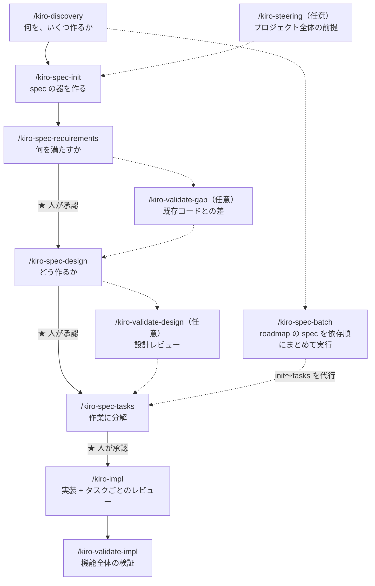

# expt-sdd-expense-tracker

Kiro スタイルの Spec-Driven Development (SDD) を、AI エージェント主導の開発フローで試すための実験リポジトリです。題材として、小さな経費精算 Web アプリを作ります。

## 作るもの

作業者が自分の領収書を登録し、複数の領収書をまとめて経費精算を申請します。申請時に指定した承認者が承認すると、精算完了になります。

- 簡易的なユーザー切替（ログインなし）と、作業者／承認者のロール
- 領収書の登録・編集・削除・一覧（日付・金額・支払先・費目・メモ）
- 複数の領収書を束ねた申請の作成と、承認者を指定しての提出
- 承認者による承認／差し戻し（コメント付き）と、差し戻し後の再申請
- 承認をもって精算完了とし、以後は変更不可

## セットアップ

### 1. Node.js 24 を用意する

Node.js 24 を使います。[mise](https://mise.jdx.dev/) を使っている場合は、リポジトリ直下の `.node-version` を自動で読みます。

```sh
node -v # v24.x
```

### 2. 依存関係のインストール・データ初期化・起動

```sh
npm install
npm run db:setup
npm run dev
```

- `npm run db:setup` はデータ初期化手順です。DB ファイルを作成し、未適用のマイグレーションを順に適用してから、シードユーザーを投入します。何度実行しても同じ状態になります
- DB ファイルの場所は既定で `data/app.db` です。環境変数 `DATABASE_PATH` で変更できます
- `npm run dev` の後、ブラウザで http://localhost:3000/ を開きます

### マイグレーションを追加する

1. 機能ごとのテーブル定義（`src/<feature>/schema.ts`）を変更する
2. `npm run db:generate` で `drizzle/` にマイグレーションを生成する
3. 生成したファイル（手で編集した場合も含む）をコミットする
4. `npm run db:setup` を実行して手元の DB に適用する

`drizzle-kit push` は履歴が残らないため使いません。

## 開発の流れ


